# Lab 10 - Depth Effects and Flipbooks

```yaml
week: 5
session: B
duration: 30 min
prerequisites:
  - "Notes 06, sections 5.8 to 5.11"
  - "Worked Example Part B (6.2)"
assets_needed:
  - "/Game/GD/Shared/Levels/Lvl_Lab"
  - "/Game/GD/Shared/Textures/Fire/T_Fire_Flipbook"
```

---

## 1. Overview

You build two effects that only look right because the material knows about the scene or about time. The first is a force field that glows wherever it cuts through the floor or another object, using the depth of the geometry behind it. The second is a fire that plays a 64-frame flipbook, which you then turn into a soft particle so it fades where it meets the ground instead of cutting a hard line.

---

## 2. What You Will Learn

| Outcome | Step |
|:---|:---|
| Highlight intersections with `DepthFade` in a translucent, unlit material | 2 |
| Combine an intersection glow, a Fresnel rim and a faint body into one effect | 2 |
| Play a flipbook by turning time into a frame, a column and a row | 3 |
| Soften a sprite where it meets geometry, making it a soft particle | 4 |

---

## 3. Before You Start

- [ ] You have read sections 5.8 to 5.11 of Notes 06, because the steps use depth, Depth Fade and flipbook maths without explaining them again.
- [ ] You can find `T_Fire_Flipbook` in `/Game/GD/Shared/Textures/Fire`. It holds 64 frames of a looping flame in 8 columns and 8 rows.

---

## 4. Plan

```mermaid
%%{init: {"theme": "base", "themeVariables": {"fontFamily": "Arial, Helvetica, sans-serif", "fontSize": "15px", "lineColor": "#64748b", "edgeLabelBackground": "#ffffff"}}}%%
flowchart LR
    accTitle: Lab 10 plan
    accDescr: Build a translucent unlit force field whose glow comes from one minus Depth Fade at intersections, a Fresnel rim and a faint body, and place it half sunk into the floor with a cube through it. Then build an additive fire material that plays the 64-frame flipbook from time, and finally make a translucent copy that multiplies the flame's alpha by Depth Fade so it fades into the floor.

    field["<b>MM_FX_ForceField_Trans</b><br/>Intersection + rim"]
    fire["<b>MM_FX_FireFlipbook_Add</b><br/>64-frame flipbook"]
    soft["<b>MM_FX_SoftFire_Trans</b><br/>Depth Fade on alpha"]
    cmp{{"Hard line<br/>vs soft fade"}}

    field --> fire --> soft --> cmp

    classDef build fill:#e0f2fe,stroke:#0284c7,stroke-width:2px,color:#0f172a
    classDef check fill:#fef3c7,stroke:#d97706,stroke-width:2px,color:#1f2937
    class field,fire,soft build
    class cmp check
```



| Step | Time |
|:---|:---|
| 1 - Set up the level and folders | 3 min |
| 2 - The force field | 10 min |
| 3 - The fire flipbook | 10 min |
| 4 - A soft particle | 7 min |

---

## 5. Steps

### Step 1 - Set Up the Level and Folders

1. Open `/Game/GD/Shared/Levels/Lvl_Lab`. Choose **File > Save Current Level As** and save it as `/Game/Student/Lab10/Maps/Lvl_Lab10`, then work in your copy, so the shared level stays unchanged for everyone, as the [lab folder conventions](../supplementary/unreal-lab-folder-conventions.md) explain.
2. Create `/Game/Student/Lab10/Materials`.
3. Place a **Sphere** scaled to 2.4 and sink it halfway into the floor. Place a **Cube** scaled to 0.6 x 0.6 x 1.2 so it passes through the sphere's side.
4. Place two upright **Plane** shapes for the fire, each with **Rotation** X set to -90, standing with their bottom edge pushed about 20 units into the floor.

**Checkpoint:** The level shows a half-sunk grey sphere with a cube through it, and two upright grey planes sunk slightly into the floor.

### Step 2 - The Force Field

1. In `Lab10/Materials`, create `MM_FX_ForceField_Trans`. With nothing selected, set **Blend Mode** to `Translucent` and **Shading Model** to `Unlit`.
2. Add a `DepthFade` node and wire a `ScalarParameter` `IntersectionWidth`, default 20, in group `Field`, into its **FadeDistance**. `OneMinus` of its output is the intersection glow: 1 where the sphere meets geometry, 0 a short distance away.
3. Add a `Fresnel` node with **ExponentIn** 4, and `Multiply` it by 0.6. This is the rim.
4. `total = intersection + rim + 0.04`. The constant is a faint body so the middle of the field is just visible.
5. `total * FieldColour * Glow -> Emissive Color`, with a `VectorParameter` `FieldColour` (0.1, 0.7, 1) and a `ScalarParameter` `Glow` default 3.
6. `Saturate(total) -> Opacity`.
7. Apply and save, and apply it to the sphere.

**Checkpoint:** The sphere is a faint blue bubble with a brighter rim, and a bright line traces exactly where it meets the floor and where the cube passes through it. Move the cube and the line follows.

### Step 3 - The Fire Flipbook

1. Create `MM_FX_FireFlipbook_Add`. Set **Blend Mode** to `Additive` and **Shading Model** to `Unlit`.
2. Choose the frame: `frame = Fmod(Floor(Time * FPS), 64)`, with a `ScalarParameter` `FPS` default 24 and a `Constant` 64 on the `Fmod` **B**.
3. Choose the cell: `column = Fmod(frame, 8)` and `row = Floor(frame / 8)`.
4. Offset the UVs: `UV' = (TextureCoordinate + AppendVector(column, row)) / 8`.
5. Sample `T_Fire_Flipbook` with `UV'`. Multiply its RGB by a `ScalarParameter` `FireStrength` default 4, into `Emissive Color`.
6. Apply and save, and apply it to the first fire plane. Click **Simulate**.

**Checkpoint:** One flame plays on the plane, flickering and looping smoothly. Where the plane is sunk into the floor, the flame is cut off by a hard horizontal line.

### Step 4 - A Soft Particle

1. Duplicate `MM_FX_FireFlipbook_Add` and name the copy `MM_FX_SoftFire_Trans`. Set **Blend Mode** to `Translucent`.
2. Add a `DepthFade` node with **FadeDistance** 30.
3. `Multiply` the flipbook sample's A, the flame's density, by the `DepthFade` output, and wire the result into `Opacity`.
4. Apply and save, and apply it to the second fire plane.
5. Look at both flames from a low angle where they meet the floor.

**Checkpoint:** The additive flame still cuts a hard line into the floor, while the soft flame fades out smoothly as it approaches the floor, with no visible edge.

---

## 6. Debugging and Pitfalls

| Symptom | Likely cause | Fix |
|:---|:---|:---|
| Compile error on `DepthFade` or `SceneDepth` | The material is Opaque | Set **Blend Mode** to `Translucent` |
| The whole sphere glows evenly | `DepthFade` output used directly, not inverted | Use `OneMinus` of the `DepthFade` output |
| The intersection line is very thick or invisible | `IntersectionWidth` far too high or too low | Start at 20 and adjust |
| The field is lit by the sun and looks grey | Shading Model left at `Default Lit` | Set **Shading Model** to `Unlit` |
| The plane shows a grid of 64 flames | The UVs were not divided by 8 | Divide the offset UVs by the number of columns and rows |
| The flame jumps instead of looping | The frame does not wrap | Use `Fmod` by 64 |
| The flame plays upside down | The rows are counted from the wrong end | Check the row maths against the texture, where frame 0 is top-left |
| The soft fire is invisible | `Opacity` gets the colour instead of the alpha | Wire the sample's A into the multiply |

---

## 7. Production Checklist

| Check | Why |
|:---|:---|
| All three materials are in `Lab10/Materials` | The lab folder holds everything for the lab, and each name says what the material makes and how it blends |
| The force field and soft fire use `Translucent`, and the fire uses `Additive` | Depth can only be read by translucent materials, and fire adds light |
| Both effects are `Unlit` | They emit light rather than reflecting it |
| `IntersectionWidth`, `Glow`, `FPS` and `FireStrength` are parameters | An instance can retune each effect without a recompile |
| The flipbook wraps with `Fmod` | The animation loops forever without a jump |
| The soft fire fades where it meets the floor | A hard line where a sprite meets geometry is the most common giveaway of a cheap effect |

---

## 8. Extension

1. **Flipbook function.** Replace the frame maths in a copy of the fire with the engine's `FlipBook` function, feeding `Frac(Time * FPS / 64)` into `Animation Phase (0-1)` and 8 into both the column and row counts. Confirm it plays the same animation.
2. **Proximity glow.** Make a translucent water plane whose foam uses `1 - SmoothStep(0, 40, DistanceToNearestSurface)`. Push a few cubes through it and see foam appear on every side of each cube. Check that **Generate Mesh Distance Fields** is on in Project Settings.
3. **Hit pulse.** Add a `ScalarParameter` `HitPulse` to the force field that adds a bright ring travelling out from the centre, like the radar ring in Notes 04, and drive it from Blueprint with a dynamic instance when something hits the sphere.
4. **Frame blending.** Sample the flipbook twice, at the current frame and the next, and `Lerp` between them by `Frac(Time * FPS)`, so the fire plays smoothly at a low frame rate.

---

## 9. Reflective Questions

1. Depth Fade only looks at the geometry directly behind each pixel. Where does that make the force field's intersection glow fail, and what would fix it?
2. The flipbook plays 64 hand-made frames. How would you decide between a flipbook and a procedural flame built from noise as in Notes 04?
3. Soft particles fade where they meet geometry. What happens to a soft particle that is entirely inside a wall, and why?
4. Every pixel of the force field reads the scene depth. How does its cost compare with an opaque sphere of the same size?

---

## 10. How This Builds

- **Week 6** (`07_composite_effects`) builds water from depth colour, intersection foam, panning normals and refraction, and a hologram whose scanlines are a flipbook-style pattern.
- **Lab 11** (`lab_11_water_and_hologram`) builds the hologram, using the additive, unlit setup from this lab.
- **Week 9** rewrites the flipbook maths in HLSL, where frame blending takes a few lines.
