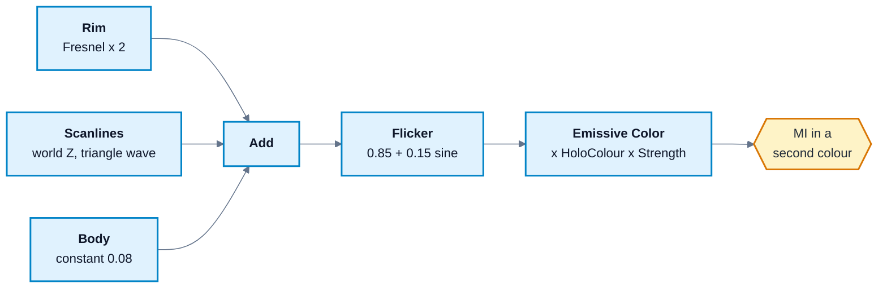

# Lab 11 - Water and Hologram

```yaml
week: 6
session: A
duration: 30 min
prerequisites:
  - "Notes 07, sections 5.1 to 5.6"
  - "Worked Example Part A (6.1)"
assets_needed:
  - "/Game/GD/Shared/Levels/Lvl_Lab"
  - "/Game/Characters/Mannequins/Meshes/SKM_Quinn_Simple"
  - "/Game/GD/Shared/Textures/Water/T_Water_Normal (Extension)"
  - "/Game/GD/Shared/Textures/Noise/T_Noise_Macro (Extension)"
```

---

## 1. Overview

You build a hologram projected onto a character: a glowing rim, scanlines that scroll up the body, a faint fill and a flicker, all added together in one additive material. You build it one layer at a time and check each layer on its own before combining them, which is how you would build any composite effect. Then you make an instance of it in a second colour, to show that every layer is driven by a parameter. The full water material from the notes is in the Extension.

---

## 2. What You Will Learn

| Outcome | Step |
|:---|:---|
| Set up an additive, unlit material for a skeletal mesh | 2 |
| Build and check each layer of a composite effect on its own | 2, 3, 4 |
| Draw level, scrolling scanlines from world height and a triangle wave | 3 |
| Combine layers with weights and a flicker into one emissive output | 4 |
| Restyle a composite effect through a material instance | 5 |

---

## 3. Before You Start

- [ ] You have read sections 5.1 and 5.6 of Notes 07, because the steps use the layer plan and the hologram maths without explaining them again.
- [ ] You can find `SKM_Quinn_Simple` in `/Game/Characters/Mannequins/Meshes`. It is the engine's mannequin, and the hologram goes on it.
- [ ] You can build a triangle wave, `Abs(Frac(x) - 0.5) * 2`, from Notes 04, because the scanlines use it.

---

## 4. Plan



| Step | Time |
|:---|:---|
| 1 - Set up the level and folders | 4 min |
| 2 - The material and the rim | 7 min |
| 3 - Scanlines | 8 min |
| 4 - Body, flicker and colour | 6 min |
| 5 - A second hologram | 5 min |

---

## 5. Steps

### Step 1 - Set Up the Level and Folders

1. Open `/Game/GD/Shared/Levels/Lvl_Lab`. Choose **File > Save Current Level As** and save it as `/Game/Student/Lab11/Maps/Lvl_Lab11`, then work in your copy, so the shared level stays unchanged for everyone, as the [lab folder conventions](../supplementary/unreal-lab-folder-conventions.md) explain.
2. Create `/Game/Student/Lab11/Materials`.
3. Place a **Cylinder** scaled to 1.4 x 1.4 x 0.5 as a projector pedestal.
4. Drag `SKM_Quinn_Simple` from the Content Browser so it stands on top of the pedestal. Place a second copy next to it for Step 5.

**Checkpoint:** Two grey mannequins stand in the level, one of them on a short cylinder.

### Step 2 - The Material and the Rim

1. In `Lab11/Materials`, create `MM_FX_Hologram_Add`. With nothing selected, set **Blend Mode** to `Additive` and **Shading Model** to `Unlit`. Additive light only brightens what is behind it, so it needs no opacity and never sorts badly.
2. Add a `Fresnel` node and set its **ExponentIn** to 2, so the glow spreads a little way in from the silhouette.
3. `Multiply` it by 2 and wire the result straight into `Emissive Color`. This checks the rim layer on its own before anything else is added.
4. Apply and save, and apply the material to the mannequin on the pedestal. Unreal ticks **Used with Skeletal Mesh** on the material automatically when you do, and recompiles it.

**Checkpoint:** The mannequin turns into a bright white outline, with a see-through dark middle. The floor and the pedestal show through the body.

### Step 3 - Scanlines

1. Add an `AbsoluteWorldPosition` node and a `ComponentMask` with only **B** ticked. This is the world height of each pixel. Using world height rather than UVs keeps the lines level across the whole figure, whichever way it faces.
2. `Multiply` it by a `ScalarParameter` `LineDensity`, default 0.25, in group `Scanlines`. That gives one line every 4 cm.
3. `Subtract` `Time * ScrollSpeed`, with a `ScalarParameter` `ScrollSpeed`, default 0.5, in group `Scanlines`. Subtracting time moves the lines upwards.
4. Build a triangle wave from the result: `Frac`, `Subtract` 0.5, `Abs`, `Multiply` by 2.
5. `Power` it with an **Exp** of 8. The triangle wave is a broad ramp, and raising it to a high power keeps only the tips, which turns it into thin lines.
6. Temporarily wire the `Power` output into `Emissive Color` in place of the rim, apply, and look at the mannequin.

**Checkpoint:** Thin, level horizontal lines cover the mannequin and drift slowly upwards, with no rim visible.

### Step 4 - Body, Flicker and Colour

1. Combine the layers: `total = rim * 2 + lines * 0.6 + 0.08`. The constant 0.08 is a faint body, so the inside of the figure is never fully empty.
2. Build the flicker: `0.85 + 0.15 * Sine(Time * FlickerSpeed)`, with a `ScalarParameter` `FlickerSpeed`, default 23, in group `Flicker`. A fast, small sine reads as an unstable projection rather than a pulse.
3. `Multiply` `total` by the flicker, then by a `VectorParameter` `HoloColour`, default (0.1, 0.6, 1), and a `ScalarParameter` `Strength`, default 2, both in group `Hologram`.
4. Wire the result into `Emissive Color`. Apply and save.
5. Fill in each parameter's **Desc** so an artist can tell what it does from the instance.

**Checkpoint:** The mannequin is a blue hologram with a bright rim, rising scanlines and a faint fill, and its brightness flickers quickly. Compare it with the reference in `/Game/GD/Notes07/Demo/Levels/Lvl_Notes07`.

### Step 5 - A Second Hologram

1. Right-click `MM_FX_Hologram_Add` and choose **Create Material Instance**. Name it `MI_FX_HologramWarning_Add`, because it makes a warning-coloured hologram.
2. In the instance, set `HoloColour` to (1, 0.25, 0.05), `LineDensity` to 0.6, `ScrollSpeed` to 2 and `FlickerSpeed` to 40.
3. Apply the instance to the second mannequin.

**Checkpoint:** The second mannequin is an orange-red hologram with denser, faster lines and a nervous flicker, while the first stays blue. You changed no nodes to make it.

---

## 6. Debugging and Pitfalls

| Symptom | Likely cause | Fix |
|:---|:---|:---|
| The mannequin is grey and solid | The material is still Opaque and Default Lit | Set **Blend Mode** to `Additive` and **Shading Model** to `Unlit` |
| The mannequin shows the default checker material | The material is not allowed on skeletal meshes | Tick **Used with Skeletal Mesh** and apply |
| The lines run at angles over the body | Lines built from `TextureCoordinate` | Use the B channel of `AbsoluteWorldPosition` |
| The lines are broad bands, not thin lines | `Power` missing or its exponent too low | Raise the triangle wave to the power 8 |
| The lines move downwards | Time added instead of subtracted | `Subtract` the time term |
| The whole figure is equally bright | The rim was not weighted, or the body constant is too large | Check `rim * 2` and keep the body near 0.08 |
| The flicker is a slow pulse | `FlickerSpeed` too low | Use 20 or more |

---

## 7. Production Checklist

| Check | Why |
|:---|:---|
| `MM_FX_Hologram_Add` and `MI_FX_HologramWarning_Add` are in `Lab11/Materials` | The lab folder holds everything for the lab, and each name says what it makes and how it blends |
| The material is `Additive` and `Unlit` | A projection only adds light, so it never needs opacity, sorting or lighting |
| Scanlines use world height | Lines stay level across any mesh and any rotation |
| Every layer's strength and every speed is a parameter | An instance can restyle the effect without a recompile, as Step 5 shows |
| Each parameter has a **Desc** | Artists working from the instance see what each value does |

---

## 8. Extension

1. **Water.** Build `MM_Env_Water_Trans` from Notes 07 6.1 Steps 1 to 4: depth colour, two world-space panning normals from `T_Water_Normal`, refraction 1.33, Fresnel opacity and noise-broken foam from `T_Noise_Macro`. Place `SM_Terrain_Hills` from `/Game/GD/Shared/Meshes`, lower it 150 units, and lay a plane scaled 19.6 at height 0 over it. Check each layer in `Emissive Color` before you combine them.
2. **Glitch offset.** Add a World Position Offset that shifts a thin horizontal band of the hologram sideways for a few frames at a time. Use `Step` on `Frac(Time * 0.7)` to choose when, and the world height to choose where.
3. **Build-up.** Add a `ScalarParameter` `Reveal`, 0 to 1, and hide every pixel above `Reveal` times the figure's height, with a bright line at the edge, so the hologram draws itself from the feet up. Drive it with a Timeline as in Notes 05.
4. **Depth-aware feet.** Make a translucent copy and add the intersection glow from Lab 10, so the hologram's feet glow where they meet the pedestal.

---

## 9. Reflective Questions

1. You checked the rim and the scanlines on their own before combining them. Which mistake would have been hardest to find if you had wired all four layers at once?
2. The hologram uses world height for its lines. What would happen to the lines if the character were lying down, and is that what you would want?
3. An additive material can never darken anything. What does that rule out, and when would you need a translucent material instead?
4. The water in the Extension has five layers and the hologram has four. Which layers of each would you drop first on a low-end device, and why?

---

## 10. How This Builds

- **Lab 12** (`lab_12_toon_shading_and_landscape`) turns to full-screen effects and terrain, building a toon post-process and a slope auto-material.
- **Week 7** (`08_screen_space_post_processing`) builds full-screen effects, including a scanner pulse that uses the same world-space banding as these scanlines.
- **Week 8** (`09_hlsl_fundamentals`) shows the HLSL that a graph like this one compiles to.
- **Week 9** rewrites the Week 4 dissolve as a Custom node and compares it with the node version, the same trade-off you could weigh for this hologram.
