# Lab 12 - Toon Shading and Landscape

```yaml
week: 6
session: B
duration: 30 min
prerequisites:
  - "Notes 07, sections 5.7 to 5.10"
  - "Worked Example Part B (6.2)"
assets_needed:
  - "/Game/GD/Shared/Levels/Lvl_Lab"
  - "/Game/GD/Shared/Meshes/SM_Terrain_Hills"
  - "/Game/GD/Shared/Textures/Rock/T_Rock_Albedo, T_Rock_Normal, T_Rock_ORM"
  - "/Game/GD/Shared/Textures/Grass/T_Grass_Albedo, T_Grass_Normal, T_Grass_ORM"
```

---

## 1. Overview

You build two things that change a whole world rather than one object. The first is a terrain material that paints itself: grass on flat ground, rock on steep slopes, with no painting at all. The second is a post-process material that turns the entire scene into a toon style, with flat bands of light and ink outlines. You build the terrain first, so the toon pass has hills, props and a horizon to work on.

---

## 2. What You Will Learn

| Outcome | Step |
|:---|:---|
| Sample terrain textures with world-aligned UVs | 2 |
| Blend two layers by slope using `VertexNormalWS` and `SmoothStep` | 2 |
| Separate lighting from surface colour in a post-process material | 3 |
| Quantise lighting into flat bands | 3 |
| Draw outlines from depth jumps between neighbouring pixels | 4 |

---

## 3. Before You Start

- [ ] You have read sections 5.7 to 5.10 of Notes 07, because the steps use the toon and slope maths without explaining them again.
- [ ] You can find `SM_Terrain_Hills` in `/Game/GD/Shared/Meshes`, and the `T_Rock_*` and `T_Grass_*` textures in `/Game/GD/Shared/Textures/Rock` and `Grass`.
- [ ] You remember how Lab 8 added a post-process material to a **Post Process Volume** and read neighbouring pixels with `ScreenPosition` and `InvSize`, because Step 4 uses the same pattern on depth.

---

## 4. Plan

```mermaid
%%{init: {"theme": "base", "themeVariables": {"fontFamily": "Arial, Helvetica, sans-serif", "fontSize": "15px", "lineColor": "#64748b", "edgeLabelBackground": "#ffffff"}}}%%
flowchart LR
    accTitle: Lab 12 plan
    accDescr: First build a terrain material that samples rock and grass with world-aligned UVs and blends them by the up-facing part of the vertex normal, and apply it to the hills mesh. Then build a post-process material that divides the rendered image by the base colour to get the lighting, quantises it into bands and multiplies the colour back, keeping the sky unchanged. Finally add depth-jump outlines and compare the toon and normal looks.

    slope["<b>MM_Terrain_SlopeBlend_Opaque</b><br/>rock to grass by slope"]
    bands["<b>PPM_Toon</b><br/>light bands"]
    lines["<b>PPM_Toon</b><br/>+ depth outlines"]
    cmp{{"Blend Weight<br/>0 vs 1"}}

    slope --> bands --> lines --> cmp

    classDef build fill:#e0f2fe,stroke:#0284c7,stroke-width:2px,color:#0f172a
    classDef check fill:#fef3c7,stroke:#d97706,stroke-width:2px,color:#1f2937
    class slope,bands,lines build
    class cmp check
```



| Step | Time |
|:---|:---|
| 1 - Set up the level and folders | 3 min |
| 2 - The slope auto-material | 10 min |
| 3 - Toon bands | 10 min |
| 4 - Ink outlines | 7 min |

---

## 5. Steps

### Step 1 - Set Up the Level and Folders

1. Open `/Game/GD/Shared/Levels/Lvl_Lab`. Choose **File > Save Current Level As** and save it as `/Game/Student/Lab12/Maps/Lvl_Lab12`, then work in your copy, so the shared level stays unchanged for everyone, as the [lab folder conventions](../supplementary/unreal-lab-folder-conventions.md) explain.
2. Create `/Game/Student/Lab12/Materials`.
3. Drag `SM_Terrain_Hills` into the level and set its **Location** to (0, 3000, -150), well away from the lab's floor, so the terrain has room around it.
4. Place two **Sphere** shapes and a **Cube** on the flat ground of the terrain, and give them any of your materials from earlier labs.

**Checkpoint:** A grey, hilly terrain with flat valleys sits beside the lab area, with three props standing in a valley.

### Step 2 - The Slope Auto-Material

1. In `Lab12/Materials`, create `MM_Terrain_SlopeBlend_Opaque`.
2. Build world-aligned UVs: `AbsoluteWorldPosition`, a `ComponentMask` with **R** and **G** ticked, `Divide` by a `ScalarParameter` `TileSize`, default 400, in group `Tiling`. The terrain is stretched over its hills, so world-aligned UVs keep the textures the same size everywhere.
3. Add six `TextureSample` nodes, for `T_Rock_Albedo`, `T_Rock_Normal`, `T_Rock_ORM`, `T_Grass_Albedo`, `T_Grass_Normal` and `T_Grass_ORM`, and wire the UVs into all six.
4. Build the slope: `VertexNormalWS`, a `ComponentMask` with only **B** ticked. This is 1 on flat ground and 0 on a vertical cliff.
5. `grass = SmoothStep(SlopeStart, SlopeEnd, slope)`, with `ScalarParameter` `SlopeStart` default 0.7 and `SlopeEnd` default 0.85, both in group `Slope`.
6. Add three `Lerp` nodes, each with rock on **A**, grass on **B** and `grass` on **Alpha**: one for the two albedos into `Base Color`, one for the two normals into `Normal`, and one for the two ORMs.
7. From the ORM `Lerp`, wire R into `Ambient Occlusion`, G into `Roughness` and B into `Metallic`, using a `ComponentMask` for each.
8. Apply and save, and apply it to the terrain.

**Checkpoint:** Grass covers the valleys and the gentle slopes, and rock shows on every steep hillside, with a soft change between them. Drag `SlopeStart` and `SlopeEnd` closer together and the boundary sharpens.

### Step 3 - Toon Bands

1. Create `PPM_Toon`. With nothing selected, set **Material Domain** to `Post Process` and **Blendable Location** to `Scene Color After Tonemapping`.
2. Add a `SceneTexture` with **Scene Texture Id** `PostProcessInput0`, the rendered image, and a second with `BaseColor`, the surface colour. Take the RGB of each with a `ComponentMask`.
3. Find each one's luminance with a `Dot` against a `Constant3Vector` (0.3, 0.59, 0.11).
4. `light = lumLit / Max(lumAlbedo, 0.02)`. Dividing out the surface colour leaves only how brightly each pixel is lit. The `Max` stops a division by zero on black surfaces.
5. `band = Floor(light * Bands + 0.5) / Bands`, with a `ScalarParameter` `Bands`, default 3, in group `Toon`.
6. `toon = albedo * band * Brightness`, with a `ScalarParameter` `Brightness`, default 0.6, in group `Toon`. The tonemapped image is brighter than the raw base colour, so the bands need scaling down.
7. Keep the sky: add a `SceneTexture` with `SceneDepth`, take its R, and `SmoothStep` it from 40000 to 50000. Use the result as the **Alpha** of a `Lerp` with `toon` on **A** and the rendered image on **B**.
8. Wire the `Lerp` into `Emissive Color`. Apply and save.
9. Place a **Post Process Volume**, tick **Infinite Extent (Unbound)**, and add `PPM_Toon` under **Rendering Features > Post Process Materials**.

**Checkpoint:** The whole scene shows flat steps of light. Each sphere has a hard edge between its lit and shadowed sides instead of a smooth gradient, and the grass and rock textures are still visible inside each band. The sky is unchanged.

### Step 4 - Ink Outlines

1. Add a `ScreenPosition` node. For each of the four neighbours, `(1, 0)`, `(-1, 0)`, `(0, 1)` and `(0, -1)`, `Multiply` the offset by the `InvSize` output of the `PostProcessInput0` node, `Add` the `ViewportUV` output of `ScreenPosition`, and wire it into the **UVs** of a new `SceneDepth` scene texture. Take its R.
2. For each neighbour, `Abs(neighbour - centre)`, where `centre` is the depth from Step 3. `Add` the four results together.
3. `Divide` the sum by `centre`. A far object's depth values are larger, so dividing by the centre depth makes the same threshold work at every distance.
4. `outline = SmoothStep(Threshold, Threshold * 2, jump)`, with a `ScalarParameter` `Threshold`, default 0.05, in group `Outline`.
5. `Lerp` from the Step 3 result to a `VectorParameter` `OutlineColour`, default (0.02, 0.02, 0.03), by `outline`, into `Emissive Color`. Apply and save.
6. Set the volume's **Blend Weight** to 0, then back to 1, to compare the two looks.

**Checkpoint:** A dark ink line runs along every silhouette: each prop, each hilltop against the sky and each hill in front of another. Flat ground has no lines across it. Compare with the reference in `/Game/GD/Notes07/Demo/Levels/Lvl_Notes07`, where the toon volume surrounds the second terrain.

---

## 6. Debugging and Pitfalls

| Symptom | Likely cause | Fix |
|:---|:---|:---|
| Textures are stretched on the hillsides | Sampled with the mesh's `TextureCoordinate` | Use world-aligned UVs from `AbsoluteWorldPosition` |
| Rock and grass swap places | Rock and grass wired to the wrong `Lerp` inputs | Rock on **A**, grass on **B** |
| Rock speckles across flat ground | Slope taken from `PixelNormalWS` | Use `VertexNormalWS`, which ignores the normal maps |
| The whole screen turns black | `BaseColor` divided without the `Max` | Divide by `Max(lumAlbedo, 0.02)` |
| The toon image is washed out | `Brightness` left at 1 | Use about 0.6 |
| The sky turns dark or grey | Sky not excluded | Lerp back to the rendered image where depth is very large |
| Outlines cover the ground near the camera | Depth jump not divided by the centre depth | `Divide` the sum by `centre` |
| No outlines anywhere | Neighbour UVs not offset, or `Threshold` far too high | Check the `InvSize` multiply and start at 0.05 |
| The effect only shows inside a box | **Infinite Extent (Unbound)** not ticked | Tick it |

---

## 7. Production Checklist

| Check | Why |
|:---|:---|
| `MM_Terrain_SlopeBlend_Opaque` and `PPM_Toon` are in `Lab12/Materials` | The lab folder holds everything for the lab, and each name says what it makes |
| The terrain uses world-aligned UVs | Texture size stays the same across stretched terrain |
| The slope comes from `VertexNormalWS` | Normal-map detail does not leak into the layer choice |
| `SlopeStart`, `SlopeEnd`, `TileSize`, `Bands`, `Brightness`, `Threshold` and `OutlineColour` are parameters | Art direction can retune the world without a recompile |
| Toon bands come from lighting divided by base colour | Textures stay readable inside each band |
| The depth jump is divided by the centre depth | Outlines are equally reliable near and far |

---

## 8. Extension

1. **A real Landscape.** Open **Landscape** mode, and on the **Manage** tab create a new landscape with the default settings. Sculpt two or three hills with the **Sculpt** tool, then set the landscape's **Landscape Material** to `MM_Terrain_SlopeBlend_Opaque`. The material needs no changes, because it reads only the world position and the normal, and the layers follow every stroke you sculpt.
2. **Snow by height.** Add a third layer, white with roughness 0.6, where `AbsoluteWorldPosition.z` is above a `SnowHeight` parameter, and keep it only on flat-enough ground, so snow sits on peaks but not on cliffs.
3. **Painted paths.** On the real Landscape, replace the slope blend's alpha with a `LandscapeLayerBlend` node, add a third painted layer for a path, and paint a path between two hills.
4. **Footprints in snow.** Create a **Canvas Render Target**, draw a soft dot into it from Blueprint at the player's position each frame with **Draw Material to Render Target**, and sample it in the terrain material by world position to dent the snow and darken it. This is how many games draw trails in snow or sand.
5. **Coloured shadows.** Tint the darkest toon band blue, as many stylised games do, by lerping the band colour from a `ShadowTint` parameter when `band` is below 0.5.
6. **Exclude a prop.** Give one prop **Render CustomDepth Pass** with a stencil value of 1, as in Lab 8, and skip the toon effect wherever the custom stencil is 1.

---

## 9. Reflective Questions

1. The auto-material never needs painting. Name a place in a real level where you would still want to paint a layer by hand, and say why the slope rule gets it wrong.
2. The toon pass divides by the base colour. What happens on a surface whose base colour is black, and how does the `Max` hide the problem?
3. Outlines come from depth jumps. Why does a crease inside one object, such as the edge of a cube's face, get no outline, and what extra buffer could you test to find it?
4. Toon shading as post-process applies to every object at once. When would a per-material toon shader be the better choice?

---

## 10. How This Builds

- **Week 7** (`08_screen_space_post_processing`) extends `PPM_Toon`'s outline to normals, so creases inside an object get lines too, and uses Custom Stencil to keep one object in colour.
- **Week 8** (`09_hlsl_fundamentals`) starts HLSL by viewing the code that graphs like `PPM_Toon` compile to, and Lab 15 translates graphs into Custom nodes.
- **Week 9** introduces loops in HLSL for multi-tap sampling, which turns the four hand-wired neighbour reads in Step 4 into a few lines that can take eight or more.
