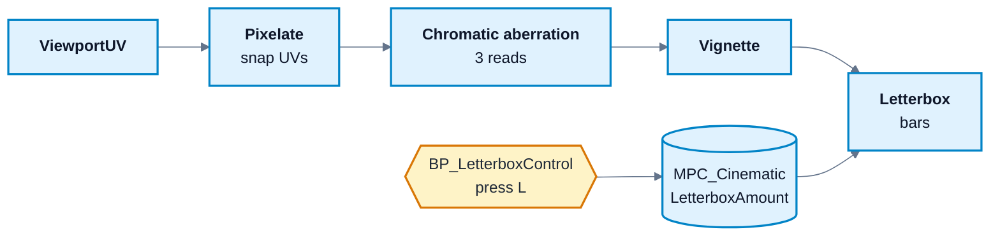

# Lab 13 - Screen Filters

```yaml
week: 7
session: A
duration: 30 min
prerequisites:
  - "Notes 08, sections 5.1 to 5.5"
  - "Worked Example Part A (6.1)"
assets_needed:
  - "/Game/GD/Shared/Levels/Lvl_Lab"
```

---

## 1. Overview

You build one post-process material that holds four screen filters: pixelation, chromatic aberration, a vignette and letterbox bars. Each filter has its own strength parameter, so a value of 0 or 1 switches it off, and one material means one full-screen pass however many filters are on. Then you slide the letterbox bars in and out from Blueprint, the way a game starts a cutscene.

---

## 2. What You Will Learn

| Outcome | Step |
|:---|:---|
| Set up a post-process material and read the rendered image | 1 |
| Pixelate the image by snapping the sample UVs to a grid | 2 |
| Split the colour channels for chromatic aberration | 3 |
| Darken the corners with an aspect-correct vignette | 4 |
| Draw letterbox bars for a target aspect ratio and animate them from Blueprint | 5 |

---

## 3. Before You Start

- [ ] You have read sections 5.1 to 5.5 of Notes 08, because the steps use the screen UV maths without explaining it again.
- [ ] You can add a material to a **Post Process Volume** under **Rendering Features > Post Process Materials**, as in Lab 8.
- [ ] You can build a Timeline that outputs a float from 0 to 1, as in Lab 7.

---

## 4. Plan



| Step | Time |
|:---|:---|
| 1 - Set up the level and a pass-through material | 4 min |
| 2 - Pixelation | 7 min |
| 3 - Chromatic aberration | 6 min |
| 4 - Vignette | 4 min |
| 5 - Letterbox bars from Blueprint | 9 min |

---

## 5. Steps

### Step 1 - Set Up the Level and a Pass-Through Material

1. Open `/Game/GD/Shared/Levels/Lvl_Lab`. Choose **File > Save Current Level As** and save it as `/Game/Student/Lab13/Maps/Lvl_Lab13`, then work in your copy, so the shared level stays unchanged for everyone, as the [lab folder conventions](../supplementary/unreal-lab-folder-conventions.md) explain.
2. Create `/Game/Student/Lab13/Materials` and `/Game/Student/Lab13/Blueprints`.
3. In `Lab13/Materials`, create `PPM_ScreenFilters`. With nothing selected, set **Material Domain** to `Post Process` and **Blendable Location** to `Scene Color After Tonemapping`. These filters imitate a screen and a lens, so they work on the final colours.
4. Add a `SceneTexture` node with **Scene Texture Id** `PostProcessInput0`, take its RGB with a `ComponentMask`, and wire it into `Emissive Color`. Apply and save.
5. Place a **Post Process Volume**, tick **Infinite Extent (Unbound)**, and add `PPM_ScreenFilters` under **Rendering Features > Post Process Materials**.

**Checkpoint:** The level looks exactly as before. That proves the material reads the image and writes it back unchanged, so any change from now on comes from your filters.

### Step 2 - Pixelation

1. Add a `ScreenPosition` node and a `ViewSize` node.
2. `cells = ViewSize / PixelSize`, with a `ScalarParameter` `PixelSize`, default 6, in group `Pixelate`. This is how many blocks fit across and down the screen.
3. `uv' = (Floor(ViewportUV * cells) + 0.5) / cells`. `Floor` snaps every pixel in a block to the same corner, and adding 0.5 moves the read to the block's centre.
4. Wire `uv'` into the **UVs** input of the `PostProcessInput0` node. Apply and save.

**Checkpoint:** The whole view breaks into 6 by 6 pixel blocks. Set `PixelSize` to 1 and the image is sharp again.

### Step 3 - Chromatic Aberration

1. `dir = (uv' - 0.5) * AberrationAmount`, with a `ScalarParameter` `AberrationAmount`, default 0.01, in group `Lens`. `dir` points out from the centre and grows towards the edges.
2. Make three `PostProcessInput0` reads in place of the one you had: the first at `uv' + dir`, the second at `uv'`, the third at `uv' - dir`.
3. Take R from the first, G from the second and B from the third with `ComponentMask` nodes, and combine them with two `AppendVector` nodes.
4. Wire the result into `Emissive Color`. Apply and save.

**Checkpoint:** Red and blue fringes appear along high-contrast edges, strongest in the corners and absent at the centre. Set `AberrationAmount` to 0 and they disappear.

### Step 4 - Vignette

1. `aspect = ViewSize.x / ViewSize.y`, using two `ComponentMask` nodes and a `Divide`.
2. `centred = (ViewportUV - 0.5) * AppendVector(aspect, 1)`. Multiplying the horizontal part by the aspect ratio keeps the darkening round instead of stretched.
3. `d = Length(centred) * 2`.
4. `colour * (1 - VignetteIntensity * SmoothStep(0.5, 1.4, d))`, with a `ScalarParameter` `VignetteIntensity`, default 0.6, in group `Lens`. Apply and save.

**Checkpoint:** The corners darken smoothly, in a round falloff that does not stretch with the screen. Set `VignetteIntensity` to 0 and the corners return.

### Step 5 - Letterbox Bars from Blueprint

1. In `Lab13/Materials`, create a **Material Parameter Collection** `MPC_Cinematic` with one scalar, `LetterboxAmount`, default 0.
2. In `PPM_ScreenFilters`, add a `CollectionParameter` for `LetterboxAmount` and a `ScalarParameter` `TargetAspect`, default 2.39, in group `Letterbox`.
3. `bar = Saturate((1 - aspect / TargetAspect) / 2) * LetterboxAmount`.
4. `edge = Min(ViewportUV.y, 1 - ViewportUV.y)`, the distance to the nearer of the top and bottom.
5. `mask = 1 - SmoothStep(bar - px, bar + px, edge)`, where `px` is the G of the `InvSize` output of a `PostProcessInput0` node, one pixel's height.
6. `Lerp` from the vignette result to black by `mask`, into `Emissive Color`. Apply and save.
7. In `Lab13/Blueprints`, create an **Actor** Blueprint `BP_LetterboxControl`. In **Class Defaults**, set **Auto Receive Input** to `Player 0`.
8. In its Event Graph, add an **L** key event. From **Pressed**, add a **Flip Flop**: **A** plays a Timeline `LetterboxSlide` (a float track from 0 to 1 over 0.5 seconds), and **B** reverses it. On **Update**, call **Set Scalar Parameter Value** with **Collection** `MPC_Cinematic`, **Parameter Name** `LetterboxAmount` and the track's value.
9. Compile, save, place `BP_LetterboxControl` in the level, and click **Play**. Press L twice.

**Checkpoint:** Black bars slide in from the top and bottom over half a second, then slide out again. On a 16:9 window each bar is about an eighth of the height. Resize the window wider and the bars get thinner, because the screen is already closer to 2.39:1.

---

## 6. Debugging and Pitfalls

| Symptom | Likely cause | Fix |
|:---|:---|:---|
| The material cannot be added to the volume | **Material Domain** is still `Surface` | Set it to `Post Process` |
| The screen is black | Wrong **Scene Texture Id**, or the RGB not masked | Use `PostProcessInput0` and take RGB |
| The blocks change size when the window is resized | Cell count built from a constant, not `ViewSize` | `cells = ViewSize / PixelSize` |
| Fringes appear at the centre as well as the edges | `dir` not centred | Subtract 0.5 before multiplying |
| The vignette is an oval | Aspect ratio left out | Multiply the horizontal offset by `aspect` |
| No bars appear | `LetterboxAmount` is 0, or the window is wider than 2.39:1 | Press L in **Play**, and check the window shape |
| Bars appear but do not animate | Blueprint not receiving input | Set **Auto Receive Input** to `Player 0` |
| Bar edges flicker or step | No `SmoothStep` across one pixel | Use `InvSize` for the width of the edge |

---

## 7. Production Checklist

| Check | Why |
|:---|:---|
| `PPM_ScreenFilters` and `MPC_Cinematic` are in `Lab13/Materials`, and `BP_LetterboxControl` is in `Lab13/Blueprints` | The lab folder holds everything for the lab, sorted by type |
| All four filters are in one material | One full-screen pass is cheaper than four |
| Each filter has a parameter whose neutral value switches it off | Art direction can mix filters without editing the graph |
| Pixel size and vignette use `ViewSize` | The look is the same at every resolution and aspect ratio |
| The letterbox reads an MPC | Any Blueprint can start a cutscene look without a reference to the material |

---

## 8. Extension

1. **Film grain.** Add `grain = Frac(Sine(Dot(PixelPosition + Frac(Time) * 100, (12.9898, 78.233))) * 43758.5453) - 0.5` and add `grain * GrainAmount`, with `GrainAmount` 0.04. `PixelPosition` is an output of `ScreenPosition`.
2. **CRT screen.** Add barrel distortion before the pixelation, `uv' = 0.5 + c * (1 + Curve * Dot(c, c))` with `c = uv - 0.5`, and scanlines, `0.75 + 0.25 * Sine(uv'.y * Rows * 2 * Pi)`. Compare with `PPM_CRT` in `/Game/GD/Notes08/Demo/Materials`.
3. **Heat haze.** Offset the UVs sideways by `Sine(uv.y * 40 + Time * 3) * 0.002`, only in the bottom third of the screen.
4. **Posterise.** Add `Floor(colour * Levels) / Levels` with a `Levels` parameter, and find the lowest value that still reads well.
5. **Cost.** Compare `stat GPU` with the volume's **Blend Weight** at 1 and at 0, and work out how much each extra scene read costs.

---

## 9. Reflective Questions

1. You put four filters in one material. When would you want them in separate materials instead, even though that costs more passes?
2. Pixelation and chromatic aberration both change where the image is read. Why must pixelation happen first?
3. The letterbox shows nothing on an ultra-wide monitor. Is that a bug or the right behaviour for a cutscene, and why?
4. The HUD is drawn after post-processing. What does that mean for a pixelation filter in a retro-style game, and how would you pixelate the HUD too?

---

## 10. How This Builds

- **Lab 14** (`lab_14_scanner_pulse_and_selective_colour`) reads the scene's depth and stencil to place effects in the world rather than on the screen.
- **Week 8** (`09_hlsl_fundamentals`) moves into HLSL. These filters are a few lines each and make good first Custom nodes.
- **Week 9** writes multi-tap blurs as HLSL loops, the same pattern as the three aberration reads with any number of samples.
