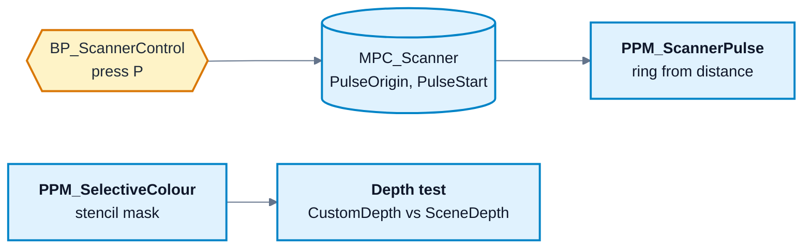

# Lab 14 - Scanner Pulse and Selective Colour

```yaml
week: 7
session: B
duration: 30 min
prerequisites:
  - "Notes 08, sections 5.6 to 5.9"
  - "Worked Example Part B (6.2)"
assets_needed:
  - "/Game/GD/Shared/Levels/Lvl_Lab"
```

---

## 1. Overview

You build two post-process effects that know where things are in the world. The first is a scanner pulse: press a key and a ring of light sweeps outwards from the player across the floor, walls and props. The second keeps one object in colour while the rest of the world turns grey, and fixes the classic bug where the colour shows straight through walls.

---

## 2. What You Will Learn

| Outcome | Step |
|:---|:---|
| Use the world position rebuilt from depth in a post-process material | 2 |
| Draw an expanding ring from a distance and a radius | 2 |
| Fire a time-based effect from Blueprint through an MPC, with no Tick | 3 |
| Mask one object with Custom Stencil | 4 |
| Stop a stencil mask showing through walls with a depth test | 5 |

---

## 3. Before You Start

- [ ] You have read sections 5.6, 5.8 and 5.9 of Notes 08, because the steps use the pulse and stencil maths without explaining them again.
- [ ] You have finished Lab 13, or can set up a post-process material and an unbound volume without instructions.
- [ ] You remember Custom Stencil from Lab 8. The project already has **Custom Depth-Stencil Pass** set to `Enabled with Stencil`.

---

## 4. Plan



| Step | Time |
|:---|:---|
| 1 - Set up the level and folders | 4 min |
| 2 - A ring in the world | 8 min |
| 3 - Fire the pulse from Blueprint | 6 min |
| 4 - One object in colour | 7 min |
| 5 - Stop it showing through walls | 5 min |

---

## 5. Steps

### Step 1 - Set Up the Level and Folders

1. Open `/Game/GD/Shared/Levels/Lvl_Lab`. Choose **File > Save Current Level As** and save it as `/Game/Student/Lab14/Maps/Lvl_Lab14`, then work in your copy, so the shared level stays unchanged for everyone, as the [lab folder conventions](../supplementary/unreal-lab-folder-conventions.md) explain.
2. Create `/Game/Student/Lab14/Materials` and `/Game/Student/Lab14/Blueprints`.
3. Place a **Sphere** and give it a strongly coloured material from an earlier lab. Place a **Cube** scaled to 1.6 x 0.2 x 1.8 as a wall, so that from the camera it hides about half of the sphere.
4. Place a **Post Process Volume** and tick **Infinite Extent (Unbound)**.

**Checkpoint:** A coloured sphere stands half hidden behind a thin wall, with the rest of the lab level around it.

### Step 2 - A Ring in the World

1. In `Lab14/Materials`, create a **Material Parameter Collection** `MPC_Scanner` with a vector `PulseOrigin`, default (0, 0, 0), and a scalar `PulseStart`, default -1000. The negative start puts the first pulse far in the past, so nothing shows until you fire one.
2. Create `PPM_ScannerPulse` with **Material Domain** `Post Process` and **Blendable Location** `Scene Color Before Bloom`, so the ring blooms like a light. Set **Blendable Priority** to 1, so it runs after the selective colour material you build in Step 4.
3. `d = Distance(AbsoluteWorldPosition, PulseOrigin)`, using a `CollectionParameter` for `PulseOrigin` and taking its RGB. In a post-process material, `AbsoluteWorldPosition` is the position of the surface seen at each pixel.
4. For now, test with a fixed radius: `ring = 1 - SmoothStep(0, PulseWidth, Abs(d - 300))`, with a `ScalarParameter` `PulseWidth`, default 60, in group `Pulse`.
5. Read the image from a `PostProcessInput0` scene texture, and wire `image + ring * PulseColour * Strength` into `Emissive Color`, with a `VectorParameter` `PulseColour` (0.1, 0.8, 1) and a `ScalarParameter` `Strength`, default 5, both in group `Look`.
6. Apply and save, and add `PPM_ScannerPulse` to the volume.

**Checkpoint:** A glowing cyan ring of radius 3 m sits around the world origin, bending over the floor and climbing any object it crosses.

### Step 3 - Fire the Pulse from Blueprint

1. Replace the fixed 300 with a radius that grows: `r = (Time - PulseStart) * PulseSpeed`, using a `CollectionParameter` for `PulseStart` and a `ScalarParameter` `PulseSpeed`, default 1500, in group `Pulse`.
2. Fade the pulse as it grows: multiply the ring by `1 - Saturate(r / MaxRadius)`, with a `ScalarParameter` `MaxRadius`, default 5000.
3. Keep the sky clean: multiply by `1 - SmoothStep(40000, 50000, SceneDepth)`, using a `SceneTexture` with `SceneDepth` and its R. Apply and save.
4. In `Lab14/Blueprints`, create an **Actor** Blueprint `BP_ScannerControl`, and set **Auto Receive Input** to `Player 0` in **Class Defaults**.
5. Add a **P** key event. From **Pressed**, call **Set Vector Parameter Value** on `MPC_Scanner` for `PulseOrigin`, with **Get Player Pawn** > **Get Actor Location** converted to a linear colour. Then call **Set Scalar Parameter Value** for `PulseStart` with **Get Game Time in Seconds**.
6. Compile, save, place the Blueprint in the level, click **Play** and press P a few times as you walk around.

**Checkpoint:** Each press sends a ring out from the player, sweeping over the floor, the wall and the sphere and fading as it grows. The Blueprint only sets two values once. The material's `Time` is the same game time, so the ring animates itself.

### Step 4 - One Object in Colour

1. Select the sphere. Under **Rendering**, tick **Render CustomDepth Pass** and set **CustomDepth Stencil Value** to 1.
2. Create `PPM_SelectiveColour` with **Material Domain** `Post Process`, **Blendable Location** `Scene Color Before Bloom` and **Blendable Priority** 0. It shares a location with the pulse and runs first, so it greys the world but not the cyan ring drawn after it.
3. Read `PostProcessInput0` and make it grey: `grey = Dot(colour, (0.3, 0.59, 0.11))`.
4. `mask = 1 - Saturate(Abs(CustomStencil - StencilValue))`, using a `SceneTexture` with `CustomStencil` and its R, and a `ScalarParameter` `StencilValue`, default 1, in group `Selection`. This is 1 only where the stencil is exactly 1.
5. `Lerp(grey, colour, mask)` into `Emissive Color`. Apply and save, and add it to the volume.
6. Look at the sphere from in front of the wall.

**Checkpoint:** The world is grey and the sphere is in full colour. But the half of the sphere behind the wall is also in colour, painted over the wall as if the wall were not there.

### Step 5 - Stop It Showing Through Walls

1. Add a `SceneTexture` with `CustomDepth` and one with `SceneDepth`, and take R from each. Custom depth is the sphere's own depth, drawn even where something hides it. Scene depth is the nearest surface.
2. `visible = Step(CustomDepth, SceneDepth + 1)`, with `CustomDepth` on **Y** and `SceneDepth + 1` on **X**. The `Step` gives 1 only where the sphere is no further away than the nearest surface, meaning nothing is in front of it. The extra 1 cm absorbs small precision errors.
3. Multiply `mask` by `visible` before the `Lerp`. Apply and save.

**Checkpoint:** The visible half of the sphere is in colour and the wall correctly hides the other half in grey. Fire a pulse with P: the cyan ring sweeps over the grey world and the coloured sphere alike, and stays cyan because it is drawn after the grey.

---

## 6. Debugging and Pitfalls

| Symptom | Likely cause | Fix |
|:---|:---|:---|
| The ring is drawn on the screen, not the world | Distance taken from screen UVs | Use `AbsoluteWorldPosition` |
| Nothing happens when you press P | Blueprint not receiving input, or not placed | Set **Auto Receive Input** and place it in the level |
| The ring starts huge and is already faded | `PulseStart` set to a constant instead of game time | Use **Get Game Time in Seconds** |
| The ring is painted on the sky | Sky not excluded | Multiply by the sky mask from `SceneDepth` |
| The ring looks flat and dull | Blendable location after tonemapping | Use `Scene Color Before Bloom` |
| The whole world stays in colour | Stencil not set on the object, or the mask inverted | Tick **Render CustomDepth Pass**, set the value to 1, and check the `Lerp` order |
| Everything is grey including the sphere | `StencilValue` does not match the object's value | Use the same number on both |
| The colour shows through the wall | No depth test | Multiply the mask by the `Step` |
| The visible sphere turns grey too | `Step` inputs swapped | `CustomDepth` on **Y**, `SceneDepth + 1` on **X** |
| The scanner ring turns grey | Selective colour runs after the pulse | Give the pulse the higher **Blendable Priority** in the same location |

---

## 7. Production Checklist

| Check | Why |
|:---|:---|
| `MPC_Scanner`, `PPM_ScannerPulse` and `PPM_SelectiveColour` are in `Lab14/Materials`, and `BP_ScannerControl` is in `Lab14/Blueprints` | The lab folder holds everything for the lab, sorted by type |
| The pulse radius comes from `Time` and an MPC start time | The effect animates on the GPU with no per-frame Blueprint work |
| The pulse runs before bloom | Bright rings glow like the rest of the scene's lights |
| The stencil value is a parameter | Different objects can be picked out with different values |
| The stencil mask has a depth test | Selected objects do not show through walls |

---

## 8. Extension

1. **Crease outlines.** Build `PPM_EdgeDetect` from Notes 08 5.7, reading `WorldNormal` and `SceneDepth` at four neighbours, and compare its lines with the depth-only outline in Lab 12.
2. **Thermal vision.** Show the world as a dark blue gradient by depth, and objects with stencil 2 as hot white-orange. Give two props stencil 2 and toggle the view with a key and an MPC value.
3. **Scan grid.** Inside the pulse ring, draw a faint grid on the world using the triangle wave from Notes 04 on `AbsoluteWorldPosition.xy / 100`.
4. **Tinted groups.** Give one object stencil 1 and another stencil 2. Keep the first in colour and tint the second red.
5. **Depth fog tint.** Add `Lerp(colour, FogColour, Saturate((SceneDepth - FogStart) / FogRange))` to make the far half of the level fade into a coloured haze.

---

## 9. Reflective Questions

1. The pulse needed no Tick and no Timeline. What other effects could you drive with just a start time in an MPC and the material's `Time`?
2. A translucent surface does not write depth. What happens to the pulse when it crosses a glass window, and why?
3. The stencil outline in Lab 8 deliberately showed through walls, but selective colour must not. Which would you want for an objective marker in a game, and why?
4. Both effects in this lab read several screen buffers. Estimate how many scene reads each pixel performs, and which effect you would switch off first on a low-end device.

---

## 10. How This Builds

- **Week 8** (`09_hlsl_fundamentals`) moves into HLSL. Lab 15 translates node graphs into Custom nodes, and the pulse and stencil maths here are a few lines of code each.
- **Week 9** writes edge detectors and blurs as HLSL loops, where reading eight or sixteen neighbours costs one line instead of dozens of nodes.
