# Lab 15 - Custom Node Translation

```yaml
week: 8
session: A
duration: 30 min
prerequisites:
  - "Notes 09, sections 5.1 to 5.6"
  - "Worked Example Part A (6.1)"
assets_needed:
  - "/Game/GD/Shared/Levels/Lvl_Lab"
  - "/Game/GD/Notes09/Lab15/Supplied/MM_Prop_ContrastRamp_Opaque"
  - "/Game/GD/Notes09/Lab15/Supplied/MM_Prop_AAStripes_Opaque"
  - "/Game/GD/Notes09/Lab15/Supplied/MM_FX_PolarSweep_Opaque"
```

---

## 1. Overview

You are given three working node graphs, from easy to hard: a colour ramp, anti-aliased stripes and an animated radar display. You translate each one into a single Custom node. Before you delete any nodes, you prove that your code gives the same result as the graph, using a difference check that shows black wherever the two match. Then you compare node counts and instruction counts.

---

## 2. What You Will Learn

| Outcome | Step |
|:---|:---|
| Read a node graph and write the same maths as HLSL | 2, 3, 4 |
| Set a Custom node's inputs and output type | 2 |
| Prove a translation is correct with a difference check | 2 |
| Translate `Sine`, `Cosine` and `Arctangent2` correctly | 3, 4 |
| Pass time into a Custom node as an input | 4 |
| Compare the cost and size of the two versions | 5 |

---

## 3. Before You Start

- [ ] You have read sections 5.2 to 5.6 of Notes 09, because the steps use the type, swizzle and intrinsic tables without explaining them again.
- [ ] You know that a `Sine` or `Cosine` node with **Period** 1 computes `sin(x * 6.283185)`.
- [ ] You can find the three supplied materials in `/Game/GD/Notes09/Lab15/Supplied`.

---

## 4. Plan

```mermaid
%%{init: {"theme": "base", "themeVariables": {"fontFamily": "Arial, Helvetica, sans-serif", "fontSize": "15px", "lineColor": "#64748b", "edgeLabelBackground": "#ffffff"}}}%%
flowchart LR
    accTitle: Lab 15 plan
    accDescr: For each of three supplied graphs, duplicate it, add a Custom node fed by the same inputs, and wire the absolute difference between the node result and the Custom result, times 100, into Emissive Color. A black surface proves they match. Then wire the Custom node into the output, delete the original nodes and compare node and instruction counts.

    dup["<b>Duplicate</b><br/>supplied graph"]
    code["<b>Custom node</b><br/>same inputs"]
    diff{{"Difference check<br/>Abs(a - b) x 100"}}
    swap["<b>Rewire</b><br/>delete old nodes"]
    stats{{"Stats<br/>nodes vs instructions"}}

    dup --> code --> diff --> swap --> stats

    classDef build fill:#e0f2fe,stroke:#0284c7,stroke-width:2px,color:#0f172a
    classDef check fill:#fef3c7,stroke:#d97706,stroke-width:2px,color:#1f2937
    class dup,code,swap build
    class diff,stats check
```



| Step | Time |
|:---|:---|
| 1 - Set up the level and copies | 4 min |
| 2 - The colour ramp | 7 min |
| 3 - Anti-aliased stripes | 8 min |
| 4 - The radar display | 8 min |
| 5 - Compare | 3 min |

---

## 5. Steps

### Step 1 - Set Up the Level and Copies

1. Open `/Game/GD/Shared/Levels/Lvl_Lab`. Choose **File > Save Current Level As** and save it as `/Game/Student/Lab15/Maps/Lvl_Lab15`, then work in your copy, so the shared level stays unchanged for everyone, as the [lab folder conventions](../supplementary/unreal-lab-folder-conventions.md) explain.
2. Create `/Game/Student/Lab15/Materials`.
3. Drag each supplied material onto `Lab15/Materials` in the Content Browser, choose **Copy Here**, and rename the copy by adding `HLSL` to the name: `MM_Prop_ContrastRampHLSL_Opaque`, `MM_Prop_AAStripesHLSL_Opaque` and `MM_FX_PolarSweepHLSL_Opaque`. You keep the originals untouched for the comparison in Step 5.
4. Place three upright **Plane** shapes, each with **Rotation** X set to -90, and apply one copy to each.

**Checkpoint:** Three planes show a blue-to-orange ramp, black and yellow diagonal stripes, and a green radar display with a turning sweep.

### Step 2 - The Colour Ramp

1. Open `MM_Prop_ContrastRampHLSL_Opaque` and read the graph. It computes `t = Saturate((U - 0.5) * Contrast + 0.5)` and `Lerp(ColourA, ColourB, t)`.
2. Add a **Custom** node. Set **Description** to `ContrastRamp` and **Output Type** to `CMOT Float 3`, and add four inputs: `UV`, `Contrast`, `ColourA` and `ColourB`.
3. Wire the existing `TextureCoordinate`, `Contrast`, `ColourA` and `ColourB` nodes into the matching inputs, so both versions read the same values.
4. Paste this code. **Output Type:** `CMOT Float 3`. **Inputs:** `UV` (float2), `Contrast` (float), `ColourA` (float3), `ColourB` (float3).

   ```hlsl
   float t = saturate((UV.x - 0.5) * Contrast + 0.5);
   return lerp(ColourA, ColourB, t);
   ```

5. Build the difference check: `Subtract` the Custom output from the graph's final `Lerp`, then `Abs`, then `Multiply` by 100. Wire it into `Emissive Color` and disconnect `Base Color`. Apply.
6. When the plane is black, wire the Custom node into `Base Color`, disconnect `Emissive Color`, and delete the graph's maths nodes. Keep the parameter nodes and the `TextureCoordinate`, because they feed the Custom node. Apply and save.

**Checkpoint:** During the check, the plane is completely black, which means the two versions differ by less than 1% anywhere. After the swap, the ramp looks exactly as it did in Step 1.

### Step 3 - Anti-Aliased Stripes

1. Open `MM_Prop_AAStripesHLSL_Opaque`. The graph rotates the UVs by `Angle`, scales by `Count`, builds a triangle wave and smooths its edge by the screen-space width. Note that its `Sine` and `Cosine` nodes have **Period** 1, so `Angle` is in turns.
2. Add a Custom node, `AAStripes`, wired to the existing `TextureCoordinate`, `Angle`, `Count`, `ColourA` and `ColourB`. **Output Type:** `CMOT Float 3`. **Inputs:** `UV` (float2), `Angle` (float), `Count` (float), `ColourA` (float3), `ColourB` (float3).

   ```hlsl
   float a = Angle * 6.283185;
   float x = UV.x * cos(a) - UV.y * sin(a);
   float s = x * Count;
   float tri = abs(frac(s) - 0.5) * 2.0;
   float w = fwidth(s) * 2.0;
   float stripe = smoothstep(0.5 - w, 0.5 + w, tri);
   return lerp(ColourA, ColourB, stripe);
   ```

3. Run the difference check from Step 2, then swap and delete as before. Apply and save.

**Checkpoint:** The difference check is black, apart from at most a faint line along stripe edges seen at a grazing angle. After the swap, the stripes are still clean at every distance. Remove the `* 6.283185` and check again: the stripes turn to almost no angle at all, which shows why the **Period** matters.

### Step 4 - The Radar Display

1. Open `MM_FX_PolarSweepHLSL_Opaque`. It is **Unlit**. The graph finds the angle around the centre with `Arctangent2`, turns it into a sweep that rotates with `Time`, adds rings from the radius, and cuts everything outside a disc.
2. Add a Custom node, `PolarSweep`, and wire the existing `TextureCoordinate`, `Time`, `Speed` and `Colour` nodes into it. Time is passed in as an input called `Seconds`, so the code does not depend on engine variables. **Output Type:** `CMOT Float 3`. **Inputs:** `UV` (float2), `Seconds` (float), `Speed` (float), `Colour` (float3).

   ```hlsl
   float2 p = UV - 0.5;
   float r = length(p) * 2.0;
   float angle = atan2(p.y, p.x) / 6.283185 + 0.5;
   float sweep = pow(frac(angle - Seconds * Speed), 6.0);
   float rings = saturate(1.0 - abs(frac(r * 4.0 + 0.5) - 0.5) * 20.0);
   float disc = 1.0 - step(1.0, r);
   return Colour * (sweep + rings * 0.3) * disc;
   ```

3. The graph drives `Emissive Color`, so build the difference check into `Emissive Color` and wire the graph's output nowhere else during the check. Click **Simulate** or turn on **Realtime** so time moves.
4. Swap and delete as before. Apply and save.

**Checkpoint:** The difference check stays black while the sweep turns. After the swap, the radar sweeps, its rings and its round edge look as they did in Step 1.

### Step 5 - Compare

1. For each pair, open the supplied original and your copy, and note the node count and the **Stats** panel's pixel shader instruction count.
2. Fill in a table: material, nodes before, nodes after, instructions before, instructions after.

**Checkpoint:** Each Custom version has far fewer nodes, for example around 40 against 5 for the radar, while the instruction counts are within a few of each other. The reference solutions are in `/Game/GD/Notes09/Lab15/Materials`.

---

## 6. Debugging and Pitfalls

| Symptom | Likely cause | Fix |
|:---|:---|:---|
| "undeclared identifier" error | An input name in the code does not match the **Inputs** list | Match the names exactly, including case |
| Error mentioning an input with no type | An input pin is not connected | Wire every input |
| Error about the return type | **Output Type** does not match what the code returns | Set `CMOT Float 3` for a colour |
| The difference check shows the whole pattern | The Custom output is wired to the wrong `Subtract` pin, or one version is broken | Check both pins, then preview each version on its own |
| Stripes at the wrong angle | `Angle` not converted from turns to radians | Multiply by 6.283185 |
| The radar does not turn | `Time` not wired into `Seconds`, or the viewport not in **Realtime** | Wire it, and enable **Realtime** |
| The radar sweep is mirrored | `atan2` arguments swapped | `atan2(p.y, p.x)`, Y first, like the node |

---

## 7. Production Checklist

| Check | Why |
|:---|:---|
| Three `HLSL` copies are in `Lab15/Materials`, and the supplied originals are unchanged | You can compare old and new at any time |
| Each Custom node has a **Description** | The node's title says what it does |
| Each translation passed the difference check before nodes were deleted | You proved it correct instead of trusting your eyes |
| Parameters stay as parameter nodes wired into the Custom node | Material instances keep working |
| Time comes in as an input | The code is reusable and testable |

---

## 8. Extension

1. **Your own graph.** Translate the brick wall from Lab 5 into one Custom node returning a `float4` of colour and roughness.
2. **Read the generated code.** In the supplied radar, choose **Window > Shader Code > HLSL Code**, find the `atan2` line, and compare the generated version with your code.
3. **Half precision.** Change the `float` variables in the ramp to `half`, then check **Window > Platform Stats** for a mobile platform and see whether anything changes.
4. **Additional Outputs.** Find the Custom node's **Additional Outputs** setting and use it to output the radar's `sweep` value as a second pin, without packing it into a vector.

---

## 9. Reflective Questions

1. The difference check multiplies by 100. Why, and what would you miss without it?
2. The node and code versions cost almost the same. What else, besides cost, would make you choose one over the other for each of these three materials?
3. The radar takes time as an input rather than reading it inside the code. What does that make possible?
4. Which of the three graphs was hardest to translate, and what made it hard: the maths, the node settings or the layout?

---

## 10. How This Builds

- **Lab 16** (`lab_16_procedural_patterns`) writes a pattern from scratch in HLSL, with no graph to translate.
- **Week 9** (`10_applied_hlsl`) adds loops, texture sampling and shared helper files, and rewrites the Week 4 dissolve in HLSL.
