# Lab 16 - Procedural Patterns

```yaml
week: 8
session: B
duration: 30 min
prerequisites:
  - "Notes 09, sections 5.7 to 5.11"
  - "Worked Example Part B (6.2)"
assets_needed:
  - "/Game/GD/Shared/Levels/Lvl_Lab"
```

---

## 1. Overview

You write a riveted metal panel entirely in HLSL, with no textures. A tiled rounded box makes the panels and their seams, one circle mirrored into four corners makes the rivets, and value noise adds patches of grime. One Custom node returns both colour and roughness. Each step gives the complete code so far, ending in a return value you can check, so you can see every layer before adding the next.

---

## 2. What You Will Learn

| Outcome | Step |
|:---|:---|
| Tile a surface with `frac` and find each cell's ID with `floor` | 1 |
| Draw a rounded box with a signed distance field and anti-alias it with `fwidth` | 2 |
| Mirror one shape into four places with `abs` | 3 |
| Write value noise from a hash | 4 |
| Combine distance fields and noise, and return colour and roughness in a `float4` | 5 |

---

## 3. Before You Start

- [ ] You have read sections 5.8 to 5.11 of Notes 09, because the steps use the tiling, distance field and noise code without explaining it again.
- [ ] You finished Lab 15, so you can set up a Custom node's inputs and output type without instructions.

---

## 4. Plan

```mermaid
%%{init: {"theme": "base", "themeVariables": {"fontFamily": "Arial, Helvetica, sans-serif", "fontSize": "15px", "lineColor": "#64748b", "edgeLabelBackground": "#ffffff"}}}%%
flowchart LR
    accTitle: Lab 16 plan
    accDescr: One Custom node builds the panel in stages. UVs are tiled into cells with frac and floor. A rounded box distance field makes each panel and its seams, and a circle distance field mirrored with abs makes four rivets per panel. Value noise from a hash makes grime. The layers are combined into a colour and a roughness, packed into a float4 and split into Base Color and Roughness.

    tile["<b>Tile</b><br/>frac, floor"]
    panel["<b>Panel</b><br/>rounded box SDF"]
    rivet["<b>Rivets</b><br/>circle SDF, abs"]
    noise["<b>Grime</b><br/>value noise"]
    out{{"float4<br/>colour + roughness"}}

    tile --> panel --> rivet --> noise --> out

    classDef build fill:#e0f2fe,stroke:#0284c7,stroke-width:2px,color:#0f172a
    classDef check fill:#fef3c7,stroke:#d97706,stroke-width:2px,color:#1f2937
    class tile,panel,rivet,noise build
    class out check
```



| Step | Time |
|:---|:---|
| 1 - Set up and tile | 5 min |
| 2 - Panels | 7 min |
| 3 - Rivets | 5 min |
| 4 - Grime | 7 min |
| 5 - Combine | 6 min |

---

## 5. Steps

### Step 1 - Set Up and Tile

1. Open `/Game/GD/Shared/Levels/Lvl_Lab`. Choose **File > Save Current Level As** and save it as `/Game/Student/Lab16/Maps/Lvl_Lab16`, then work in your copy, so the shared level stays unchanged for everyone, as the [lab folder conventions](../supplementary/unreal-lab-folder-conventions.md) explain.
2. Create `/Game/Student/Lab16/Materials`, and in it create `MM_Prop_RivetedPanelHLSL_Opaque`. Place an upright **Plane**, **Rotation** X -90, scaled to 2.4, and apply the material.
3. Add a **Custom** node with **Description** `RivetedPanel` and **Output Type** `CMOT Float 4`. Add the inputs `UV`, `PanelCount`, `NoiseScale`, `PanelColour`, `RivetColour` and `GrimeColour`.
4. Wire a `TextureCoordinate` into `UV`, and create and wire these parameters: `ScalarParameter` `PanelCount` 3 and `NoiseScale` 12, and `VectorParameter` `PanelColour` (0.55, 0.57, 0.6), `RivetColour` (0.8, 0.78, 0.7) and `GrimeColour` (0.18, 0.12, 0.07).
5. From the Custom node, wire a `ComponentMask` RGB into `Base Color` and a `ComponentMask` A into `Roughness`. Wire a `Constant` 1 into `Metallic`.
6. Paste this code and apply. **Output Type:** `CMOT Float 4`. **Inputs:** `UV` (float2), `PanelCount` (float), `NoiseScale` (float), `PanelColour` (float3), `RivetColour` (float3), `GrimeColour` (float3).

   ```hlsl
   float2 p = UV * PanelCount;
   float2 q = frac(p) - 0.5;
   return float4(q + 0.5, 0.0, 0.5);
   ```

**Checkpoint:** The plane shows a 3 by 3 grid of squares, each running from black in one corner to yellow in the opposite one. Each square is one panel, and `q` is the position inside it, centred on 0.

### Step 2 - Panels

1. Replace the code with this version, which adds a rounded box. **Output Type** and **Inputs** are unchanged.

   ```hlsl
   float2 p = UV * PanelCount;
   float2 q = frac(p) - 0.5;
   float2 b = abs(q) - 0.42;
   float dPanel = length(max(b, 0.0)) + min(max(b.x, b.y), 0.0) - 0.03;
   float aaP = fwidth(dPanel);
   float panel = 1.0 - smoothstep(-aaP, aaP, dPanel);
   return float4(panel.xxx, 0.5);
   ```

2. Apply. The box has a half-size of 0.42, so a seam of 0.08 is left between neighbouring panels. Subtracting 0.03 rounds the corners.

**Checkpoint:** White rounded squares sit on a black grid of thin seams. The seam edges stay clean when you move the camera close or far away.

### Step 3 - Rivets

1. Replace the code with this version, which adds one circle mirrored into all four corners of each panel.

   ```hlsl
   float2 p = UV * PanelCount;
   float2 q = frac(p) - 0.5;
   float2 b = abs(q) - 0.42;
   float dPanel = length(max(b, 0.0)) + min(max(b.x, b.y), 0.0) - 0.03;
   float dRivet = length(abs(q) - 0.36) - 0.035;
   float aaP = fwidth(dPanel);
   float aaR = fwidth(dRivet);
   float panel = 1.0 - smoothstep(-aaP, aaP, dPanel);
   float rivet = 1.0 - smoothstep(-aaR, aaR, dRivet);
   return float4(panel * 0.5 + rivet * 0.5, panel * 0.5, panel * 0.5, 0.5);
   ```

2. Apply. `abs(q)` folds every corner of the panel onto the top-right one, so the single circle at (0.36, 0.36) appears in all four.

**Checkpoint:** Each grey panel has four small pink-red rivets, one near each corner, all exactly the same size.

### Step 4 - Grime

1. Replace the code with this version, which adds value noise and shows it on its own.

   ```hlsl
   float2 p = UV * PanelCount;
   float2 q = frac(p) - 0.5;
   float2 n = UV * NoiseScale;
   float2 i = floor(n);
   float2 f = frac(n);
   float h00 = frac(sin(dot(i, float2(12.9898, 78.233))) * 43758.5453);
   float h10 = frac(sin(dot(i + float2(1.0, 0.0), float2(12.9898, 78.233))) * 43758.5453);
   float h01 = frac(sin(dot(i + float2(0.0, 1.0), float2(12.9898, 78.233))) * 43758.5453);
   float h11 = frac(sin(dot(i + float2(1.0, 1.0), float2(12.9898, 78.233))) * 43758.5453);
   float2 u = f * f * (3.0 - 2.0 * f);
   float grime = lerp(lerp(h00, h10, u.x), lerp(h01, h11, u.x), u.y);
   return float4(grime.xxx, 0.5);
   ```

2. Apply, then try `NoiseScale` at 4 and at 30 in the material's preview to see the patch size change. Set it back to 12.

**Checkpoint:** The plane shows soft grey blotches with no visible grid or straight edges. The panels are hidden for now, because this step returns only the noise.

### Step 5 - Combine

1. Replace the code with the final version, which brings the three layers together, gives every panel a slightly different tint from its cell ID, and returns colour and roughness.

   ```hlsl
   float2 p = UV * PanelCount;
   float2 cell = floor(p);
   float2 q = frac(p) - 0.5;

   // Panel: a rounded box
   float2 b = abs(q) - 0.42;
   float dPanel = length(max(b, 0.0)) + min(max(b.x, b.y), 0.0) - 0.03;

   // Rivets: one circle, mirrored into all four corners by abs()
   float dRivet = length(abs(q) - 0.36) - 0.035;

   // Grime: value noise
   float2 n = UV * NoiseScale;
   float2 i = floor(n);
   float2 f = frac(n);
   float h00 = frac(sin(dot(i, float2(12.9898, 78.233))) * 43758.5453);
   float h10 = frac(sin(dot(i + float2(1.0, 0.0), float2(12.9898, 78.233))) * 43758.5453);
   float h01 = frac(sin(dot(i + float2(0.0, 1.0), float2(12.9898, 78.233))) * 43758.5453);
   float h11 = frac(sin(dot(i + float2(1.0, 1.0), float2(12.9898, 78.233))) * 43758.5453);
   float2 u = f * f * (3.0 - 2.0 * f);
   float grime = lerp(lerp(h00, h10, u.x), lerp(h01, h11, u.x), u.y);

   // Anti-aliased masks
   float aaP = fwidth(dPanel);
   float aaR = fwidth(dRivet);
   float panel = 1.0 - smoothstep(-aaP, aaP, dPanel);
   float rivet = 1.0 - smoothstep(-aaR, aaR, dRivet);

   // Combine
   float tint = frac(sin(dot(cell, float2(39.346, 11.135))) * 43758.5453);
   float3 colour = PanelColour * lerp(0.85, 1.1, tint);
   colour = lerp(colour * 0.25, colour, panel);
   colour = lerp(colour, GrimeColour, smoothstep(0.5, 0.9, grime) * 0.6);
   colour = lerp(colour, RivetColour, rivet);
   float roughness = lerp(0.35, 0.8, grime);
   roughness = lerp(roughness, 0.25, rivet);
   return float4(colour, roughness);
   ```

2. Apply and save. Fill in each parameter's **Desc**.
3. Create a material instance, `MI_Prop_RivetedPanelRusty_Opaque`, and set `GrimeColour` to a rust orange and `NoiseScale` to 6. Apply it to a second plane.

**Checkpoint:** The first plane is brushed grey metal in panels of slightly different shades, with dark seams, four bright rivets per panel, and brown grime patches that are rougher than the clean metal. The second plane shows larger orange patches. Compare with the reference in `/Game/GD/Notes09/Lab16/Materials`.

---

## 6. Debugging and Pitfalls

| Symptom | Likely cause | Fix |
|:---|:---|:---|
| "undeclared identifier" for a parameter name | An input is missing from the **Inputs** list | Add it with exactly the same spelling |
| Error about an input with no type | An input pin is not wired | Wire every input, even the ones the current step does not use |
| The grid is offset by half a panel | `- 0.5` missing from `q` | `q = frac(p) - 0.5` |
| The seams are jagged at a distance | `fwidth` not used | Smooth the edge over `fwidth(d)` |
| Only one rivet per panel | `abs` missing | `length(abs(q) - 0.36)` |
| The noise is blocky | `u` not smoothed, or `f` used directly | `u = f * f * (3.0 - 2.0 * f)` |
| All panels the same shade | `tint` hashes `q` instead of `cell` | Hash the cell ID |
| Roughness has no effect | The A channel is not wired to `Roughness` | Add the `ComponentMask` A |

---

## 7. Production Checklist

| Check | Why |
|:---|:---|
| `MM_Prop_RivetedPanelHLSL_Opaque` and its instance are in `Lab16/Materials` | The lab folder holds everything for the lab, and the name says what it makes and how |
| The pattern uses at least two distance fields and noise | The pattern meets the brief: shapes from distance fields, broken up by noise |
| Every distance field edge is anti-aliased with `fwidth` | Edges stay clean at every distance |
| Colours and scales are parameters wired into the Custom node | Instances can restyle it, as the rusty variant shows |
| The code is commented by section | The next person can find each layer quickly |

---

## 8. Extension

1. **Screws, not rivets.** Subtract a thin box from each rivet with `max(dRivet, -dSlot)` to cut a screw slot.
2. **Wear on the edges.** Make the paint wear away near the seams: use `smoothstep` on `dPanel` to find the panel's outer rim, and show bare, shinier metal where it meets high grime.
3. **Normal from the distance field.** Return the panel mask through a second Custom node output and feed it to a `PerturbNormalLQ` node so the seams look recessed.
4. **Fewer copies of the hash.** Write the four hash lines as one line inside a loop over the four corners. Week 9 covers loops properly.
5. **Your own pattern.** Combine at least two different distance fields of your choice, such as a hexagon and a ring, with noise, into a sci-fi floor or a manhole cover.

---

## 9. Reflective Questions

1. You checked the pattern one layer at a time by changing the return value. How does that compare with checking a node graph by previewing nodes?
2. The hash is written five times in the final code. Which line would you have to change in every copy to get a different random pattern, and how could that go wrong?
3. This panel has no textures at all. What would you gain and lose by baking it to a texture instead?
4. Which parts of this material would an artist want to change, and are they all exposed as parameters?

---

## 10. How This Builds

- **Week 9** (`10_applied_hlsl`) removes the repeated hash with helper functions, adds loops and texture sampling inside Custom nodes, and debugs HLSL that does not compile or gives the wrong result.
- **Lab 17** (`lab_17_loops_sampling_and_pom`) samples and animates a texture from inside a Custom node.
