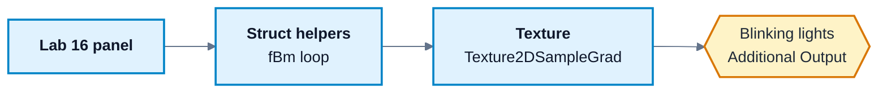

# Lab 17 - Loops, Sampling and POM

```yaml
week: 9
session: A
duration: 30 min
prerequisites:
  - "Notes 10, sections 5.1 to 5.5"
  - "Worked Example Part A (6.1)"
  - "Lab 16 finished, or its reference solution"
assets_needed:
  - "/Game/GD/Shared/Levels/Lvl_Lab"
  - "/Game/GD/Notes09/Lab16/Materials/MM_Prop_RivetedPanelHLSL_Opaque (if your Lab 16 is unfinished)"
  - "/Game/GD/Shared/Textures/PaintedMetal/T_PaintedMetal_Albedo"
```

---

## 1. Overview

You take the riveted panel from Lab 16 and turn it into a painted, weathered, animated panel. The four copies of the hash become two helper functions in a struct, the single layer of grime becomes four octaves of noise in a loop, each panel samples a painted metal texture at its own random offset, and the rivets become warning lights that blink out of step with each other. Each step gives the complete code so far.

---

## 2. What You Will Learn

| Outcome | Step |
|:---|:---|
| Replace repeated code with helper functions in a struct | 2 |
| Write an `[unroll]` loop of noise octaves and measure its cost | 2 |
| Sample a texture inside a Custom node with explicit derivatives | 3 |
| Animate code with time passed in as an input | 4 |
| Return a second result through an Additional Output | 4 |

---

## 3. Before You Start

- [ ] You have read sections 5.1 to 5.4 of Notes 10, because the steps use loops, sampling and the struct trick without explaining them again.
- [ ] You have your `MM_Prop_RivetedPanelHLSL_Opaque` from Lab 16, or you will copy the reference version from `/Game/GD/Notes09/Lab16/Materials`.

---

## 4. Plan



| Step | Time |
|:---|:---|
| 1 - Set up | 4 min |
| 2 - Helpers and an fBm loop | 9 min |
| 3 - A painted texture | 8 min |
| 4 - Blinking lights | 9 min |

---

## 5. Steps

### Step 1 - Set Up

1. Open `/Game/GD/Shared/Levels/Lvl_Lab`. Choose **File > Save Current Level As** and save it as `/Game/Student/Lab17/Maps/Lvl_Lab17`, then work in your copy, so the shared level stays unchanged for everyone, as the [lab folder conventions](../supplementary/unreal-lab-folder-conventions.md) explain.
2. Create `/Game/Student/Lab17/Materials`. Drag your Lab 16 `MM_Prop_RivetedPanelHLSL_Opaque` onto it, choose **Copy Here**, and rename the copy `MM_Prop_PaintedPanelHLSL_Opaque`.
3. Place an upright **Plane**, **Rotation** X -90, scaled to 2.4, and apply the copy. Open the material and note the instruction count in **Stats**.

**Checkpoint:** The plane shows the Lab 16 riveted panel, and you have written down its instruction count, about 250.

### Step 2 - Helpers and an fBm Loop

1. Replace the Custom node's code with this version. The struct holds `Hash` and `Value` once, and the grime is now four octaves of noise in a loop. **Output Type:** `CMOT Float 4`. **Inputs:** `UV` (float2), `PanelCount` (float), `NoiseScale` (float), `PanelColour` (float3), `RivetColour` (float3), `GrimeColour` (float3).

   ```hlsl
   struct GDNoise
   {
       float Hash(float2 p)
       {
           return frac(sin(dot(p, float2(12.9898, 78.233))) * 43758.5453);
       }

       float Value(float2 p)
       {
           float2 i = floor(p);
           float2 f = frac(p);
           float2 u = f * f * (3.0 - 2.0 * f);
           float a = Hash(i);
           float b = Hash(i + float2(1.0, 0.0));
           float c = Hash(i + float2(0.0, 1.0));
           float d = Hash(i + float2(1.0, 1.0));
           return lerp(lerp(a, b, u.x), lerp(c, d, u.x), u.y);
       }
   };
   GDNoise N;

   float2 p = UV * PanelCount;
   float2 cell = floor(p);
   float2 q = frac(p) - 0.5;

   // Shapes: panel and rivets
   float2 b = abs(q) - 0.42;
   float dPanel = length(max(b, 0.0)) + min(max(b.x, b.y), 0.0) - 0.03;
   float dRivet = length(abs(q) - 0.36) - 0.035;
   float aaP = fwidth(dPanel);
   float aaR = fwidth(dRivet);
   float panel = 1.0 - smoothstep(-aaP, aaP, dPanel);
   float rivet = 1.0 - smoothstep(-aaR, aaR, dRivet);

   // Grime: four octaves of value noise
   float2 n = UV * NoiseScale;
   float grime = 0.0;
   float amp = 0.5;
   [unroll] for (int o = 0; o < 4; o++)
   {
       grime += N.Value(n) * amp;
       n *= 2.0;
       amp *= 0.5;
   }
   grime /= 0.9375;

   float tint = N.Hash(cell + 5.0);
   float3 colour = PanelColour * lerp(0.85, 1.1, tint);
   colour = lerp(colour * 0.25, colour, panel);
   colour = lerp(colour, GrimeColour, smoothstep(0.5, 0.8, grime) * 0.6);
   colour = lerp(colour, RivetColour, rivet);
   float roughness = lerp(0.35, 0.8, grime);
   roughness = lerp(roughness, 0.25, rivet);
   return float4(colour, roughness);
   ```

2. Set `NoiseScale` to 6, since each octave now adds finer detail on its own. Apply, and read **Stats** again.
3. Change the `4` in the loop to `8`, apply, and read **Stats**. Change it back to `4`.

**Checkpoint:** The panel looks as before, but the grime has fine detail inside each patch instead of soft blobs. Stats rises by about 17 instructions for every extra octave, so 8 octaves costs about 70 more than 4.

### Step 3 - A Painted Texture

1. Delete the `PanelColour` parameter and remove `PanelColour` from the Custom node's **Inputs**. Add an input `PaintTex`, and wire a **Texture Object** node set to `T_PaintedMetal_Albedo` into it.
2. Replace the code with this version, which samples the paint once per panel at a random offset. **Output Type:** `CMOT Float 4`. **Inputs:** `UV` (float2), `PanelCount` (float), `NoiseScale` (float), `RivetColour` (float3), `GrimeColour` (float3), `PaintTex` (Texture Object).

   ```hlsl
   struct GDNoise
   {
       float Hash(float2 p)
       {
           return frac(sin(dot(p, float2(12.9898, 78.233))) * 43758.5453);
       }

       float Value(float2 p)
       {
           float2 i = floor(p);
           float2 f = frac(p);
           float2 u = f * f * (3.0 - 2.0 * f);
           float a = Hash(i);
           float b = Hash(i + float2(1.0, 0.0));
           float c = Hash(i + float2(0.0, 1.0));
           float d = Hash(i + float2(1.0, 1.0));
           return lerp(lerp(a, b, u.x), lerp(c, d, u.x), u.y);
       }
   };
   GDNoise N;

   float2 p = UV * PanelCount;
   float2 cell = floor(p);
   float2 q = frac(p) - 0.5;

   // Shapes: panel and rivets
   float2 b = abs(q) - 0.42;
   float dPanel = length(max(b, 0.0)) + min(max(b.x, b.y), 0.0) - 0.03;
   float dRivet = length(abs(q) - 0.36) - 0.035;
   float aaP = fwidth(dPanel);
   float aaR = fwidth(dRivet);
   float panel = 1.0 - smoothstep(-aaP, aaP, dPanel);
   float rivet = 1.0 - smoothstep(-aaR, aaR, dRivet);

   // Paint: the texture at a random offset per panel, with derivatives from the unbroken UVs
   float2 offset = float2(N.Hash(cell), N.Hash(cell + 17.0));
   float3 paint = Texture2DSampleGrad(PaintTex, PaintTexSampler, frac(p) + offset, ddx(p), ddy(p)).rgb;

   // Grime: four octaves of value noise
   float2 n = UV * NoiseScale;
   float grime = 0.0;
   float amp = 0.5;
   [unroll] for (int o = 0; o < 4; o++)
   {
       grime += N.Value(n) * amp;
       n *= 2.0;
       amp *= 0.5;
   }
   grime /= 0.9375;

   float3 colour = lerp(paint * 0.25, paint, panel);
   colour = lerp(colour, GrimeColour, smoothstep(0.5, 0.8, grime) * 0.6);
   colour = lerp(colour, RivetColour, rivet);
   float roughness = lerp(0.4, 0.85, grime);
   roughness = lerp(roughness, 0.25, rivet);
   return float4(colour, roughness);
   ```

3. Apply. Then, as a test, change `Texture2DSampleGrad(PaintTex, PaintTexSampler, frac(p) + offset, ddx(p), ddy(p))` to `Texture2DSample(PaintTex, PaintTexSampler, frac(p) + offset)`, apply, and look at the seams from a distance. Change it back.

**Checkpoint:** Each panel shows worn painted metal, and no two neighbouring panels show the same part of the texture. With plain `Texture2DSample`, thin bright lines appear along every seam at a distance, because `frac` jumps there and the GPU picks the smallest mip. With `Texture2DSampleGrad` and the derivatives of the unbroken `p`, they disappear.

### Step 4 - Blinking Lights

1. Delete the `RivetColour` parameter and remove `RivetColour` from **Inputs**. Add three inputs: `LightColour`, from a `VectorParameter` (1, 0.15, 0.05) in group `Lights`; `BlinkRate`, from a `ScalarParameter` 1 in group `Lights`; and `Seconds`, from a `Time` node.
2. Under **Additional Outputs**, add an output named `Glow` with **Output Type** `CMOT Float 3`. A new pin appears on the node. Inside the code, `Glow` is a variable you assign.
3. Replace the code with the final version. **Output Type:** `CMOT Float 4`. **Inputs:** `UV` (float2), `PanelCount` (float), `NoiseScale` (float), `PaintTex` (Texture Object), `GrimeColour` (float3), `LightColour` (float3), `BlinkRate` (float), `Seconds` (float). **Additional Output:** `Glow` (`CMOT Float 3`).

   ```hlsl
   struct GDNoise
   {
       float Hash(float2 p)
       {
           return frac(sin(dot(p, float2(12.9898, 78.233))) * 43758.5453);
       }

       float Value(float2 p)
       {
           float2 i = floor(p);
           float2 f = frac(p);
           float2 u = f * f * (3.0 - 2.0 * f);
           float a = Hash(i);
           float b = Hash(i + float2(1.0, 0.0));
           float c = Hash(i + float2(0.0, 1.0));
           float d = Hash(i + float2(1.0, 1.0));
           return lerp(lerp(a, b, u.x), lerp(c, d, u.x), u.y);
       }
   };
   GDNoise N;

   float2 p = UV * PanelCount;
   float2 cell = floor(p);
   float2 q = frac(p) - 0.5;

   // Shapes: panel and rivets
   float2 b = abs(q) - 0.42;
   float dPanel = length(max(b, 0.0)) + min(max(b.x, b.y), 0.0) - 0.03;
   float dRivet = length(abs(q) - 0.36) - 0.035;
   float aaP = fwidth(dPanel);
   float aaR = fwidth(dRivet);
   float panel = 1.0 - smoothstep(-aaP, aaP, dPanel);
   float rivet = 1.0 - smoothstep(-aaR, aaR, dRivet);

   // Paint: the texture at a random offset per panel, with derivatives from the unbroken UVs
   float2 offset = float2(N.Hash(cell), N.Hash(cell + 17.0));
   float3 paint = Texture2DSampleGrad(PaintTex, PaintTexSampler, frac(p) + offset, ddx(p), ddy(p)).rgb;

   // Grime: four octaves of value noise
   float2 n = UV * NoiseScale;
   float grime = 0.0;
   float amp = 0.5;
   [unroll] for (int o = 0; o < 4; o++)
   {
       grime += N.Value(n) * amp;
       n *= 2.0;
       amp *= 0.5;
   }
   grime /= 0.9375;

   // Rivet lights: every panel blinks at its own phase
   float phase = N.Hash(cell + 31.0);
   float blink = step(0.5, frac(Seconds * BlinkRate + phase));

   float3 colour = lerp(paint * 0.25, paint, panel);
   colour = lerp(colour, GrimeColour, smoothstep(0.5, 0.8, grime) * 0.6);
   colour = lerp(colour, float3(0.05, 0.05, 0.05), rivet);
   Glow = rivet * blink * LightColour * 8.0;
   float roughness = lerp(0.4, 0.85, grime);
   return float4(colour, roughness);
   ```

4. Wire the `Glow` pin into `Emissive Color`. Apply and save. Click **Simulate**, or turn on **Realtime**, to see the animation.

**Checkpoint:** The rivets are dark when off and glow red when on, and the four rivets of each panel blink together, while different panels blink at different moments. Wire a `Constant` 0 into `Seconds` instead of `Time` and the blinking freezes, which shows why time is an input. Compare with the reference in `/Game/GD/Notes10/Lab17/Materials`.

---

## 6. Debugging and Pitfalls

| Symptom | Likely cause | Fix |
|:---|:---|:---|
| Error naming `Hash` or `Value` | Called without the struct instance | Call them as `N.Hash` and `N.Value` |
| Error about a missing `;` after the struct | The struct's closing brace has no semicolon | End the struct with `};` |
| "undeclared identifier" for `PaintTexSampler` | A Texture Sample is wired in instead of a Texture Object | Use a **Texture Object** node |
| Every panel shows the same part of the paint | `offset` built from `q` instead of `cell` | Hash the cell ID |
| Bright lines along the seams at a distance | Plain `Texture2DSample` with broken UVs | Use `Texture2DSampleGrad` with `ddx(p)` and `ddy(p)` |
| All panels blink together | `phase` not added | Add the per-cell `phase` before the `frac` |
| No `Glow` pin | The Additional Output was not added, or the material not applied | Add it under **Additional Outputs** and apply |
| Error about an input with no type | An input was left unwired after deleting its parameter | Remove it from **Inputs** too |

---

## 7. Production Checklist

| Check | Why |
|:---|:---|
| `MM_Prop_PaintedPanelHLSL_Opaque` is in `Lab17/Materials` | The lab folder holds everything for the lab, and the name says what it makes |
| The hash and value noise exist once, in a struct | One copy to read, fix and change |
| The fBm octave count is a literal in an `[unroll]` loop | The compiler can unroll it, and its true cost shows in Stats |
| Textures are sampled with `Texture2DSampleGrad` where the UVs are cut by `frac` | No seams at a distance |
| Time comes in as an input | The animation can be frozen or driven by anything else |
| The glow leaves through an Additional Output | Colour, roughness and glow each reach their own material input |

---

## 8. Extension

1. **Parallax occlusion mapping.** Add the POM loop from Notes 10 5.5 to a new material on a floor plane, using `T_Stone_Height` and the `T_Stone_*` textures with a `TextureCoordinate` tiled 4 times, and compare it with `MM_Env_POMStone_Opaque` from `/Game/GD/Notes06/Demo/Materials`.
2. **Smoother POM.** After the loop, interpolate between the last two UVs by how far the ray overshot the surface, so steps stop showing at grazing angles.
3. **Flipbook blending.** Rewrite the Lab 10 fire flipbook as a Custom node that samples the current and next frame with `Texture2DSample` and blends them by `frac(Seconds * FPS)`.
4. **A dynamic octave count.** Change the fBm loop to `[loop]` with the count from a parameter, and compare the Stats count with the `[unroll]` version. Explain why the dynamic one looks cheaper.

---

## 9. Reflective Questions

1. The struct made the code shorter and removed the copies of the hash. What would have to change to share the struct with another material?
2. Each extra octave cost about 17 instructions. How would you decide how many octaves a floor needs, and would the answer change with distance from the camera?
3. Why does `Texture2DSampleGrad` with `ddx(p)` fix the seams that `Texture2DSample` shows?
4. The lights blink from time alone, with no Blueprint. What would you need to add to make them stop when the player switches the power off?

---

## 10. How This Builds

- **Lab 18** (`lab_18_hlsl_dissolve_rewrite`) rewrites the Week 4 dissolve in HLSL and weighs cost against readability.
- The struct you wrote is the same code as `GDNoise.ush` in `assets/hlsl/`. On a project with the plugin from Notes 10 5.6, it becomes one include line.
