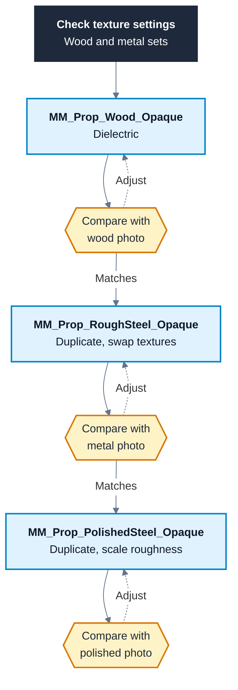

# Lab 1 - PBR Surface Materials

```yaml
week: 1
session: A
duration: 30 min
prerequisites:
  - "Notes 01, sections 5.1 to 5.7"
  - "Worked Example Part A (6.1)"
assets_needed:
  - "/Game/GD/Shared/Levels/Lvl_Lab"
  - "/Game/GD/Shared/Textures/Wood: T_Wood_Albedo, T_Wood_Normal, T_Wood_ORM"
  - "/Game/GD/Shared/Textures/Steel: T_Steel_Albedo, T_Steel_Normal, T_Steel_ORM"
  - "Three reference photos, shown in Steps 3, 4 and 5"
```

---

## 1. Overview

You build three materials from texture sets and match each one to a reference photo: a wood dielectric, a metal, and a polished version of the same metal. The three differ in exactly the properties the PBR model cares about. Wood and metal differ in `Metallic`. The two metals differ only in `Roughness`. Matching each to a photo trains you to read those two properties off a real surface, which is the skill every later material depends on.

---

## 2. What You Will Learn

| Outcome | Step |
|:---|:---|
| Check and correct compression, sRGB and sampler type for a texture set | 2 |
| Wire base colour, normal and ORM textures to the main material node | 3 |
| Make a metal by swapping textures in a duplicated material | 4 |
| Change how a surface reads by scaling roughness alone | 5 |
| Judge a material against a reference photo by its highlights and reflections | 3, 4, 5 |

---

## 3. Before You Start

- [ ] The demo project opens in Unreal Engine 5.7 without errors.
- [ ] You have read sections 5.1 to 5.7 of Notes 01, because the steps assume you know what each PBR input does.
- [ ] You can find the wood set in `/Game/GD/Shared/Textures/Wood` and the steel set in `/Game/GD/Shared/Textures/Steel`. Each has a base colour, a normal and an ORM texture. They come from free Fab listings and ship with the project, so you do not download anything. Step 2 copies them into your own folder.
- [ ] You have the three reference photos in this document open where you can see them beside the editor.

---

## 4. Plan



| Step | Time |
|:---|:---|
| 1 - Open the level and place spheres | 3 min |
| 2 - Check the texture settings | 6 min |
| 3 - Build the wood material | 9 min |
| 4 - Make the metal | 6 min |
| 5 - Make the polished variant | 6 min |

---

## 5. Steps

### Step 1 - Open the Level and Place Spheres

1. In the Content Browser, open `/Game/GD/Shared/Levels/Lvl_Lab` by double-clicking it. The level has a sky and a directional light, which is all you need to judge highlights. Choose **File > Save Current Level As** and save it as `/Game/Student/Lab01/Maps/Lvl_Lab01`, then work in your copy, so the shared level stays unchanged for everyone, as the [lab folder conventions](../supplementary/unreal-lab-folder-conventions.md) explain.
2. Save every material you make in this lab to `/Game/Student/Lab01/Materials`, so your work stays in one place and you can find it again in Week 2. Each material is named for the surface it makes, as the [naming conventions](../supplementary/unreal-naming-conventions.md) describe, so the three materials are `MM_Prop_Wood_Opaque`, `MM_Prop_RoughSteel_Opaque` and `MM_Prop_PolishedSteel_Opaque`.
3. Click the **Quickly add to the project** button (the cube with a plus sign) in the main toolbar, choose **Shapes > Sphere**, and drag three spheres into the level in a row, about 150 units apart. A sphere shows highlights from every angle, which makes roughness easy to judge.

**Checkpoint:** Your level shows three grey spheres in a row under daylight.

### Step 2 - Check the Texture Settings

In the Content Browser, select the three textures in `/Game/GD/Shared/Textures/Wood` and the three in `/Game/GD/Shared/Textures/Steel`, drag them onto `/Game/Student/Lab01/Textures` and choose **Copy Here**. You work on copies because a setting belongs to the texture asset, so changing a shared texture would change every material in the project that samples it.

Open each of the six copies in `/Game/Student/Lab01/Textures` by double-clicking it. In the Details panel, check **Compression Settings** and **sRGB** against this table, correct anything that differs, and save. Both `_ORM` textures use the ORM channel order: AO in R, roughness in G and metallic in B.

| Textures | Compression Settings | sRGB |
|:---|:---|:---|
| `T_Wood_Albedo`, `T_Steel_Albedo` | `Default (DXT1/5, BC1/3 on DX11)` | On |
| `T_Wood_Normal`, `T_Steel_Normal` | `Normalmap (DXT5, BC5 on DX11)` | Off |
| `T_Wood_ORM`, `T_Steel_ORM` | `Masks (no sRGB)` | Off |

Check every texture even though these copies arrive set correctly, because a wrong setting gives no error and you would lose the rest of the lab chasing a material that looks wrong for no visible reason.

**Checkpoint:** All six textures match the table and are saved. The Content Browser shows no asterisk on any of them.

### Step 3 - Build the Wood Material

1. In `/Game/Student/Lab01/Materials`, right-click and choose **Material**. Name it `MM_Prop_Wood_Opaque` and open it.
2. Drag `T_Wood_Albedo`, `T_Wood_Normal` and `T_Wood_ORM` from the Content Browser into the graph. Each becomes a `Texture Sample` node.
3. Wire the graph:
   1. `TextureSample (T_Wood_Albedo).RGB -> Base Color`
   2. `TextureSample (T_Wood_Normal).RGB -> Normal`
   3. `TextureSample (T_Wood_ORM).R -> Ambient Occlusion`
   4. `TextureSample (T_Wood_ORM).G -> Roughness`
   5. `TextureSample (T_Wood_ORM).B -> Metallic`
4. Click **Apply**, save, and drag the material onto the first sphere.
5. Compare the sphere with the reference photo below. Orbit the camera so the sun's highlight sits on the sphere, because roughness only shows in the highlight.

<!-- IMAGE SEARCH: "unfinished oak wood plank surface close up natural daylight" -->


Judge three things, in this order:

| Look at | Wood should show | If it does not |
|:---|:---|:---|
| Highlight | Wide and dim, as in the photo | The ORM is probably sRGB, or `G` is not wired to `Roughness` |
| Reflection colour | White or grey, never brown | `Metallic` is not 0. Check `T_Wood_ORM.B` is wired to `Metallic` and not to `Roughness` |
| Grain detail | Lit from the sun's side as you orbit | The normal map is not set to Normalmap, or `T_Wood_Normal` is not wired to `Normal` |

**Checkpoint:** The first sphere looks like matte wood. Its highlight is wide and soft, its reflections are not tinted brown, and the grain catches the light from the sun's side.

### Step 4 - Make the Metal

You reuse the wood graph, because the wiring for any texture set in ORM layout is identical. Only the textures change.

1. In the Content Browser, right-click `MM_Prop_Wood_Opaque` and choose **Duplicate**. Name the copy `MM_Prop_RoughSteel_Opaque` and open it.
2. Select the base colour `Texture Sample`. In Details, set **Texture** to `T_Steel_Albedo`. Set the other two samples to `T_Steel_Normal` and `T_Steel_ORM`.
3. Click **Apply**, save, and drag the material onto the second sphere.
4. Compare with the reference photo.

<!-- IMAGE SEARCH: "rough unpolished steel plate surface close up daylight" -->


The metal should look different from the wood in one key way. Its reflections pick up the colour of the base colour texture, and it has no diffuse colour of its own. If it looks like grey plastic instead, `Metallic` is not reaching 1.

**Checkpoint:** The second sphere reads as metal. Its reflections are tinted by the base colour, the area away from the highlight shows a reflection of the sky rather than a flat colour, and it is clearly a different material from the wood.

### Step 5 - Make the Polished Variant

A polished metal has the same base colour, metallic and normal as the original. Only roughness changes, so you change only roughness.

1. Duplicate `MM_Prop_RoughSteel_Opaque` and name the copy `MM_Prop_PolishedSteel_Opaque`. Open it.
2. Break the wire from `TextureSample (T_Steel_ORM).G` to `Roughness` by holding **Alt** and clicking the wire.
3. Add a `Multiply` (hold **M** and click) and a `Constant` (hold **1** and click). Set the constant's **Value** to `0.3`.
4. Wire:
   1. `TextureSample (T_Steel_ORM).G -> Multiply.A`
   2. `Constant -> Multiply.B`
   3. `Multiply -> Roughness`
5. Apply, save, drag onto the third sphere, and compare with the reference photo.

<!-- IMAGE SEARCH: "polished chrome steel surface mirror reflection close up" -->


Adjust the constant until the highlight size matches the photo. Lower values give a smaller, brighter highlight and sharper reflections. Multiplying keeps the variation from the original roughness map, so smudges and wear stay visible, which is what makes the result read as the same metal, polished.

**Checkpoint:** The third sphere has a small, bright highlight and sharp sky reflections. Placed beside the second sphere, it reads as the same metal with a polished finish.

---

## 6. Debugging and Pitfalls

| Symptom | Likely cause | Fix |
|:---|:---|:---|
| Red error on a `Texture Sample`, material will not compile | Sampler type does not match the texture's settings, often after you changed them in Step 2 | Select the node and set **Sampler Type** to match: `Color`, `Normal` or `Masks` |
| Surface too glossy, crevices too dark | ORM texture has sRGB on | Set `Masks (no sRGB)` on the ORM texture and save |
| Lighting looks tilted or smeared | Normal map not set to Normalmap | Set `Normalmap (DXT5, BC5 on DX11)`, untick sRGB, save |
| Wood looks metallic, or metal looks like plastic | ORM channels wired to the wrong inputs | Check `R -> Ambient Occlusion`, `G -> Roughness`, `B -> Metallic` |
| Sphere still grey or shows the old look | Material not applied, or not assigned to the sphere | Click Apply, save, and drag the material onto the sphere again |
| No visible highlight to judge | The sun's highlight is on the far side of the sphere | Orbit the camera so the sun is behind you |
| Swapped texture in Step 4 has no effect | You changed the texture on the wrong node | Click each `Texture Sample` and check its **Texture** field in Details |
| Polished variant looks no different | Constant left at 1, or `Multiply` not wired to `Roughness` | Set the constant to 0.3 and check the wire reaches `Roughness` |

---

## 7. Production Checklist

| Check | Why |
|:---|:---|
| All six textures use the compression and sRGB settings in Step 2 | Wrong settings silently change every material that samples the texture |
| The three materials are `MM_Prop_Wood_Opaque`, `MM_Prop_RoughSteel_Opaque` and `MM_Prop_PolishedSteel_Opaque`, in `/Game/Student/Lab01/Materials` | Each name says which surface the material makes, so you and others can find assets without opening them |
| `Specular` is not connected on any material | The default of 0.5 gives the 4% reflectance that suits wood, and metals ignore `Specular` entirely, so changing it gains nothing |
| The wood material reads as `Metallic` 0 and both metals as `Metallic` 1 | Values in between describe no real clean surface |
| The polished variant changes only `Roughness` | Changing anything else would make it a different metal rather than a different finish |
| Every material is saved and the editor shows no compile errors | An unsaved or failed material reverts or shows the default grey the next time you open the project |

---

## 8. Extension

1. **Rough variant.** Duplicate the rough steel as `MM_Prop_WornSteel_Opaque` to make a rougher version of the metal. `Multiply` cannot push roughness past the original towards 1 in a controlled way, so use `Lerp`: wire `TextureSample (T_Steel_ORM).G -> Lerp.A`, a `Constant` of 1 to `Lerp.B`, and a `Constant` of 0.5 to `Lerp.Alpha`. Explain why `Lerp` suits this better than `Multiply`.
2. **Buffer check.** In the level viewport, open the view mode menu (labelled **Lit**) and choose **Buffer Visualization > Metallic**, then **Buffer Visualization > Roughness**. Confirm the wood is black and both metals are white in Metallic, and that the polished metal is darker than the original in Roughness.
3. **Break it on purpose.** Duplicate `T_Wood_ORM`, tick sRGB on the copy, then duplicate `MM_Prop_Wood_Opaque` as `MM_Prop_WoodSRGBTest_Opaque` and point the copy at it. Place the two side by side and describe the difference in highlight and AO.
4. **Third surface.** Find a free plaster or stone set on Fab, import it into `/Game/Student/Lab01/Textures`, and build a fourth material. Check whether the set ships an ORM texture or separate maps, and wire it accordingly.

---

## 9. Reflective Questions

1. When you judged each sphere against its photo, which property did you check first, and why does the order matter?
2. The wood and metal graphs are identical. What does that tell you about where the look of a PBR material actually lives?
3. Why does multiplying roughness preserve the character of the original surface, when connecting a single constant to `Roughness` would not?
4. Which of the faults in the Debugging table would you be least likely to notice without a reference photo, and why?

---

## 10. How This Builds

- **Lab 2** (`lab_2_blend_modes_and_shading_models`) moves from surface properties to how a material combines with the scene, using blend modes and shading models.
- **Week 2** (`03_master_materials_and_layering`) replaces these three separate materials with one master material and three instances, so a change to the graph reaches every surface at once.
- **Week 4** profiles material cost, where the single ORM sample you used here is the cheaper option compared with three separate textures.
