# Lab 2 - Blend Modes and Shading Models

```yaml
week: 1
session: B
duration: 30 min
prerequisites:
  - "Notes 01, sections 5.8 to 5.11"
  - "Worked Example Part B (6.2)"
  - "Lab 1, because this lab assumes you can create, wire and apply a material"
assets_needed:
  - "/Game/GD/Shared/Levels/Lvl_Lab"
  - "/Game/GD/Shared/Textures/ChainLink/T_ChainLink_Mask"
```

---

## 1. Overview

You build four materials, one for each blend mode plus one with a non-default shading model: an opaque painted surface, a masked chain-link fence, a translucent glass bottle and a clear-coated version of the paint. You place the glass in front of the fence, so you see refraction bend a masked surface. You place the two paints side by side, so the only difference you see is the shading model. Each pair isolates one decision from Notes 01, which is how you learn what each setting actually does.

---

## 2. What You Will Learn

| Outcome | Step |
|:---|:---|
| Build an opaque material from constants and judge it by its highlight | 2 |
| Cut a hard-edged shape out of a surface with a Masked material and a single-channel texture | 3 |
| Tile a texture with `TextureCoordinate` | 3 |
| Make a see-through material with the Translucent blend mode, a lighting mode and refraction | 4 |
| Change only the shading model and identify what the new inputs add | 5 |

---

## 3. Before You Start

- [ ] You have finished Lab 1, or at least Steps 1 to 3, because this lab assumes you can create, wire and apply a material.
- [ ] You have read sections 5.8 to 5.11 of Notes 01, because each step relies on one of those decisions.
- [ ] You can find `Lvl_Lab` under `/Game/GD/Shared/Levels` in the Content Browser. Every lab uses this level.
- [ ] You can find the chain-link opacity mask `T_ChainLink_Mask` in `/Game/GD/Shared/Textures/ChainLink`. It is white where the wire is and black in the gaps, and it ships with the project, so you do not download anything.

---

## 4. Plan

```mermaid
%%{init: {"theme": "base", "themeVariables": {"fontFamily": "Arial, Helvetica, sans-serif", "fontSize": "15px", "lineColor": "#64748b", "edgeLabelBackground": "#ffffff"}}}%%
flowchart LR
    accTitle: Lab 2 plan
    accDescr: Set up the level with three spheres and an upright plane. Build an opaque paint material from constants. Build a masked chain-link fence from an opacity texture and apply it to the plane. Build a translucent glass material and apply it to a sphere in front of the fence, so the fence bends through the glass. Duplicate the paint and change only its shading model to Clear Coat, then compare it with the original paint.

    setup["<b>Set up level</b><br/>3 spheres, 1 plane"]
    paint["<b>MM_Prop_Paint_Opaque</b><br/>Opaque, Default Lit"]
    fence["<b>MM_Env_ChainLinkFence_Masked</b><br/>Masked"]
    glass["<b>MM_Prop_BottleGlass_Trans</b><br/>Translucent"]
    coat["<b>MM_Prop_ClearCoatPaint_Opaque</b><br/>Opaque, Clear Coat"]
    cmp1{{"Glass in front<br/>of fence"}}
    cmp2{{"Paint beside<br/>clear coat"}}

    setup --> paint --> fence --> glass --> coat
    fence -.-> cmp1
    glass -.-> cmp1
    paint -.-> cmp2
    coat -.-> cmp2

    classDef setupNode fill:#1e293b,stroke:#1e293b,color:#ffffff
    classDef build fill:#e0f2fe,stroke:#0284c7,stroke-width:2px,color:#0f172a
    classDef compare fill:#fef3c7,stroke:#d97706,stroke-width:2px,color:#1f2937
    class setup setupNode
    class paint,fence,glass,coat build
    class cmp1,cmp2 compare
```



| Step | Time |
|:---|:---|
| 1 - Set up the level | 4 min |
| 2 - Opaque paint | 4 min |
| 3 - Masked chain-link fence | 8 min |
| 4 - Translucent glass | 7 min |
| 5 - Clear Coat paint | 7 min |

---

## 5. Steps

### Step 1 - Set Up the Level

1. Open `/Game/GD/Shared/Levels/Lvl_Lab`. Choose **File > Save Current Level As** and save it as `/Game/Student/Lab02/Maps/Lvl_Lab02`, then work in your copy, so the shared level stays unchanged for everyone, as the [lab folder conventions](../supplementary/unreal-lab-folder-conventions.md) explain.
2. Save every material you make in this lab to `/Game/Student/Lab02/Materials`. Each material is named for the surface it makes, with its blend mode as the last field, as the [naming conventions](../supplementary/unreal-naming-conventions.md) describe. The clear-coated paint ends in `Opaque`, because Clear Coat is a shading model and the last field records the blend mode.
3. Using **Quickly add to the project > Shapes**, place:
   - Two spheres side by side, about 150 units apart. These take the two paints in Steps 2 and 5.
   - One **Plane**. In its Details panel, set **Rotation** X to 90 so the plane stands upright, and **Scale** to 3 on every axis. This takes the fence.
   - One more sphere, about 100 units in front of the plane. This takes the glass in Step 4, so you look at the fence through it.

**Checkpoint:** The level shows two grey spheres side by side, and a third grey sphere in front of an upright grey wall.

### Step 2 - Opaque Paint

`Opaque` and `Default Lit` are the defaults for a new material, so you only build the graph.

1. Create a material named `MM_Prop_Paint_Opaque` and open it. With nothing selected, confirm **Blend Mode** is `Opaque` and **Shading Model** is `Default Lit`.
2. Add these nodes and wire them:
   1. `Constant3Vector` set to (0.5, 0.02, 0.02) `-> Base Color`. This is linear colour, about (188, 39, 39) in sRGB, so it stays inside the dielectric range from Notes 01 section 5.3.
   2. `Constant` (0) `-> Metallic`
   3. `Constant` (0.5) `-> Roughness`
3. Apply, save, and drag the material onto the first of the two side-by-side spheres.

**Checkpoint:** The first sphere is solid red with a soft, medium-sized white highlight. You cannot see anything through it.

### Step 3 - Masked Chain-Link Fence

1. Open `T_ChainLink_Mask`. It stores one channel: white where the wire is and black where the gaps are. Check that **Compression Settings** is `Grayscale (G8/16, RGB8 sRGB)` and **sRGB** is unticked. It is data, so it must arrive unchanged. Do not change the shared texture; copy it into `/Game/Student/Lab02/Textures` first if you want to experiment.
2. In `Lab02/Materials`, create `MM_Env_ChainLinkFence_Masked` and open it. With nothing selected, set:
   - **Blend Mode:** `Masked`
   - **Two Sided:** ticked, so the fence is visible from behind
3. Drag `T_ChainLink_Mask` into the graph. Select the new `Texture Sample` and check that its **Sampler Type** is `Linear Grayscale`.
4. Add a `TextureCoordinate` (hold **U** and click) and set **U Tiling** and **V Tiling** to 4, so the texture repeats across the large plane rather than stretching.
5. Wire:
   1. `TextureCoordinate -> TextureSample.UVs`
   2. `TextureSample.R -> Opacity Mask`
   3. `Constant3Vector` (0.6, 0.6, 0.6) `-> Base Color`
   4. `Constant` (1) `-> Metallic`
   5. `Constant` (0.4) `-> Roughness`
6. Apply, save, and drag the material onto the plane.
7. With nothing selected in the material, raise **Opacity Mask Clip Value** from 0.3333 to 0.6, apply, and watch the wires get thinner. Set it back to 0.3333.

**Checkpoint:** The plane shows a grey metal wire mesh with clear gaps. The sky shows through the gaps, the wire edges are hard rather than soft, and the fence is still visible when you orbit behind it.

### Step 4 - Translucent Glass

1. In `Lab02/Materials`, create `MM_Prop_BottleGlass_Trans` and open it. With nothing selected, set:
   - **Blend Mode:** `Translucent`
   - **Lighting Mode** (under **Translucency**): `Surface ForwardShading`, so the glass gets a sharp highlight
   - **Refraction Method** (under **Refraction**): `Index Of Refraction`
2. Wire:
   1. `Constant3Vector` (0.05, 0.25, 0.08) `-> Base Color`, a bottle green
   2. `Constant` (0.1) `-> Roughness`
   3. `Constant` (0.3) `-> Opacity`
   4. `Constant` (1.5) `-> Refraction`
3. Apply, save, and drag the material onto the sphere in front of the fence.
4. Orbit until the fence is behind the glass sphere. Then set the `Refraction` constant to 1.0, apply, and compare. Set it back to 1.5.

**Checkpoint:** You see the fence through a green-tinted sphere, and the wires bend and flip near the sphere's edges. With `Refraction` at 1.0 the wires pass straight through without bending.

### Step 5 - Clear Coat Paint

Car paint is a coloured base with a clear varnish on top. The varnish adds a second, sharper reflection. You keep everything from Step 2 and change only the shading model, so any difference you see comes from the shading model alone.

1. Duplicate `MM_Prop_Paint_Opaque` and name the copy `MM_Prop_ClearCoatPaint_Opaque`. Open it.
2. With nothing selected, set **Shading Model** to `Clear Coat`. Two new inputs appear on the main material node: `Clear Coat` and `Clear Coat Roughness`.
3. Wire:
   1. `Constant` (1) `-> Clear Coat`. This is the strength of the varnish layer.
   2. `Constant` (0.05) `-> Clear Coat Roughness`. The varnish is much smoother than the paint under it.
4. Apply, save, and drag the material onto the second of the two side-by-side spheres.
5. Set the `Clear Coat` constant to 0, apply and compare. Set it back to 1.

**Checkpoint:** The second sphere shows two highlights: the same soft red-lit highlight as the first sphere, plus a small, sharp white highlight on top. With `Clear Coat` at 0, the two spheres look the same.

---

## 6. Debugging and Pitfalls

| Symptom | Likely cause | Fix |
|:---|:---|:---|
| `Opacity Mask` or `Opacity` pin is greyed out | Blend Mode is still `Opaque` | Set Blend Mode with nothing selected in the graph, then apply |
| Red error on the fence `Texture Sample` | Sampler Type does not match the texture after you changed it to Grayscale | Set **Sampler Type** to `Linear Grayscale` |
| Fence is a solid grey wall | `TextureSample.R` is wired to `Base Color` instead of `Opacity Mask`, or Blend Mode is not `Masked` | Wire `R -> Opacity Mask` and check Blend Mode |
| Fence holes are huge or the wire is a blur | Tiling left at 1, so one copy of the texture stretches across the whole plane | Set **U Tiling** and **V Tiling** on `TextureCoordinate` to 4 |
| Fence vanishes from behind | **Two Sided** not ticked | Tick **Two Sided** in the material's Details |
| Glass has no visible bending | Refraction Method left at `None`, or `Refraction` left at 1.0 | Set **Refraction Method** to `Index Of Refraction` and `Refraction` to 1.5 |
| Glass is almost invisible or fully solid | `Opacity` too low or too high | Use about 0.3 |
| `Clear Coat` pins do not appear | Shading Model was set on a node instead of the material | Click empty graph space and set **Shading Model** in Details |
| Clear Coat sphere looks the same as the paint | `Clear Coat` constant is 0 or not wired | Wire a `Constant` of 1 to `Clear Coat` |

---

## 7. Production Checklist

| Check | Why |
|:---|:---|
| Four materials in `/Game/Student/Lab02/Materials`: `MM_Prop_Paint_Opaque`, `MM_Env_ChainLinkFence_Masked`, `MM_Prop_BottleGlass_Trans` and `MM_Prop_ClearCoatPaint_Opaque` | Each name says which surface the material makes and how it blends, so you and others can find assets without opening them |
| `T_ChainLink_Mask` uses `Grayscale` with sRGB off | A single-channel mask is data, so it must stay linear, and Grayscale keeps the wire edges free of the colour-block artefacts that `Default` compression adds |
| The fence uses `Masked`, not `Translucent` | The fence only needs hard edges, and Masked is cheaper and sorts correctly |
| The glass uses `Translucent` with `Surface ForwardShading` | Glass needs partial see-through, and the default volume lighting would blur its highlight |
| The Clear Coat paint differs from the paint only in shading model and the two new inputs | Any other change would hide what the shading model contributes |
| Every material is saved and the editor shows no compile errors | An unsaved or failed material reverts or shows the default grey the next time you open the project |

---

## 8. Extension

1. **Cost comparison.** In the level viewport, open the view mode menu (labelled **Lit**) and choose **Optimization Viewmodes > Shader Complexity**. Compare the colours of the paint, the fence and the glass. Explain why the glass is the most expensive, using the reasons in Notes 01 section 5.9. Choose **Lit** to return.
2. **Unlit neon.** Make `MM_Prop_UnlitNeon_Opaque` with **Shading Model** set to `Unlit`. It still ends in `Opaque`, because the blend mode does not change. Wire a bright `Constant3Vector` through a `Multiply` with a `Constant` of 20 into `Emissive Color`, and apply it to a thin cylinder. Explain why the other inputs disappear from the main material node.
3. **Candle wax.** Make `MM_Prop_CandleWax_Subsurface` with **Shading Model** set to `Subsurface`. Use a cream `Base Color`, an orange `Subsurface Color` and an `Opacity` of 0.5, then place a point light just behind a cylinder using it. Describe how the light changes compared with `Default Lit`.
4. **Overlapping glass.** Place a second glass sphere partly behind the first and orbit around them. Find a view where they sort wrongly, and explain why Translucent surfaces do this.

---

## 9. Reflective Questions

1. The fence and the glass both let you see the background. What property of the real surface decided which blend mode each one needed?
2. You built the Clear Coat paint by changing one setting. What does that tell you about how to test the effect of any single material setting?
3. The fence texture is a single grey channel, stored on its own. What would you gain and lose by packing it into the alpha channel of a colour texture instead, as the leaf in the Worked Example does?
4. If a client asked for frosted glass that blurs the background, which of this lab's techniques would get you closest, and what would still be missing?

---

## 10. How This Builds

- **Week 2** (`03_master_materials_and_layering`) replaces the constants in these materials with parameters, so one master material can produce the paint, the clear-coated paint and many more surfaces as instances.
- **Lab 3** (`lab_3_master_material_instances`) asks you to produce five or more surfaces from instances only.
- **Week 4** measures the cost of blend modes with the shader complexity view and instruction counts, which the first extension task previews.
- **Week 6** returns to translucency and refraction to build water, where Index Of Refraction mode no longer suits the surface.
