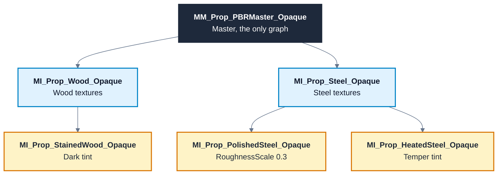

# Lab 3 - Master Material Instances

```yaml
week: 2
session: A
duration: 30 min
prerequisites:
  - "Notes 03, sections 5.1 to 5.5"
  - "Worked Example Part A (6.1)"
  - "Lab 1, because this lab reuses its six textures"
assets_needed:
  - "/Game/GD/Shared/Levels/Lvl_Lab"
  - "Your six Lab 1 texture copies in /Game/Student/Lab01/Textures: T_Wood_Albedo, T_Wood_Normal, T_Wood_ORM, T_Steel_Albedo, T_Steel_Normal, T_Steel_ORM"
```

---

## 1. Overview

You build one **master material** and use it to make five surfaces: raw wood, stained wood, rough metal, polished metal and heat-tinted metal. You do not build a second graph. Every surface is a **Material Instance** that changes only parameter values, and three of them are child instances that inherit from another instance. At the end you change one default in the master and watch every surface update at once. That single change is the answer to the Notes 03 framing question.

---

## 2. What You Will Learn

| Outcome | Step |
|:---|:---|
| Build a master material from texture, vector and scalar parameters | 2 |
| Group and order parameters so an instance is easy to read | 2 |
| Create a Material Instance from its parent and name it for the surface it makes | 3 |
| Build a child instance that overrides one value of its parent | 3, 4 |
| Change a master default and predict which instances update | 5 |

---

## 3. Before You Start

- [ ] You have read sections 5.1 to 5.5 of Notes 03, because the steps use parameters, groups and instances without explaining them again.
- [ ] You have the six texture copies from Lab 1 Step 2 in `/Game/Student/Lab01/Textures`. If you skipped that step, copy the wood and steel sets from `/Game/GD/Shared/Textures/Wood` and `/Game/GD/Shared/Textures/Steel` now. This lab samples them from there, so you do not import anything.
- [ ] You can find `Lvl_Lab` under `/Game/GD/Shared/Levels` in the Content Browser. Every lab uses this level.

---

## 4. Plan



| Step | Time |
|:---|:---|
| 1 - Set up the level and folder | 3 min |
| 2 - Build the master | 10 min |
| 3 - Wood and stained wood | 6 min |
| 4 - Metal, polished and heated | 7 min |
| 5 - Change the master | 4 min |

---

## 5. Steps

### Step 1 - Set Up the Level and Folder

Every asset in this lab is named for the surface it makes, such as `MI_Prop_StainedWood_Opaque`, so the master and all five instances can sit together in one folder.

1. Open `/Game/GD/Shared/Levels/Lvl_Lab`. Choose **File > Save Current Level As** and save it as `/Game/Student/Lab03/Maps/Lvl_Lab03`, then work in your copy, so the shared level stays unchanged for everyone, as the [lab folder conventions](../supplementary/unreal-lab-folder-conventions.md) explain.
2. In the Content Browser, create `/Game/Student/Lab03/Materials`.
3. Place five spheres in a row, about 150 units apart, using **Quickly add to the project > Shapes > Sphere**.

**Checkpoint:** The Content Browser shows an empty `Lab03/Materials` folder, and the level shows five grey spheres in a row.

### Step 2 - Build the Master

1. In `/Game/Student/Lab03/Materials`, create a material named `MM_Prop_PBRMaster_Opaque` and open it.
2. Add these parameter nodes. Set each one's name, default, **Group** and **Sort Priority** in Details:

| Node | Name | Default | Group | Sort Priority |
|:---|:---|:---|:---|:---|
| `TextureSampleParameter2D` | `BaseColorTexture` | `T_Wood_Albedo` | Base Colour | 0 |
| `VectorParameter` | `BaseColorTint` | (1, 1, 1) | Base Colour | 1 |
| `TextureSampleParameter2D` | `NormalTexture` | `T_Wood_Normal` | Surface | 0 |
| `TextureSampleParameter2D` | `ORMTexture` | `T_Wood_ORM` | Surface | 1 |
| `ScalarParameter` | `RoughnessScale` | 1 | Surface | 2 |

   The tint defaults to white and the scale to 1, so the master looks exactly like its textures until an instance changes them.

3. Check the **Sampler Type** on each texture parameter: `Color` for the base colour, `Normal` for the normal and `Masks` for the ORM. The editor sets these from the default texture, so a red error here means the texture's compression settings changed since Lab 1.
4. Wire:
   1. `BaseColorTexture.RGB -> Multiply.A`, `BaseColorTint -> Multiply.B`, `Multiply -> Base Color`
   2. `NormalTexture.RGB -> Normal`
   3. `ORMTexture.R -> Ambient Occlusion`
   4. `ORMTexture.G -> Multiply.A`, `RoughnessScale -> Multiply.B`, `Multiply -> Roughness`
   5. `ORMTexture.B -> Metallic`
5. Apply, save, and drag the master onto the first sphere.

<!-- IMAGE SEARCH: "unreal engine 5 master material texture sample parameter 2d vector parameter multiply base color roughness graph" -->


**Checkpoint:** The first sphere looks the same as your Lab 1 wood. The master's Details panel shows five parameters, and the material compiles with no errors.

### Step 3 - Wood and Stained Wood

You make each instance from its parent with **Create Material Instance**, which sets the parent for you and places the instance beside it.

1. Right-click `MM_Prop_PBRMaster_Opaque` and choose **Create Material Instance**. Rename the new asset `MI_Prop_Wood_Opaque` and open it.
2. In Details, check that **Parent** is `MM_Prop_PBRMaster_Opaque`. The parameter list appears, grouped under **Base Colour** and **Surface**.
3. Tick `BaseColorTexture`, `NormalTexture` and `ORMTexture`, and set them to the three wood textures. This looks the same as the master today, but the instance now keeps its wood textures even if someone changes the master's defaults later.
4. Save, and drag the instance onto the second sphere.
5. Right-click `MI_Prop_Wood_Opaque` and choose **Create Material Instance**. Rename the new asset `MI_Prop_StainedWood_Opaque`. Its parent is the wood instance, not the master.
6. Tick `BaseColorTint` and set it to (0.35, 0.2, 0.1), a dark walnut stain. Leave everything else unticked, so the textures come from the wood instance.
7. Save, and drag it onto the third sphere.

**Checkpoint:** The second sphere matches the first. The third sphere has the same grain and highlights but a darker, browner colour. No shader compiled while you changed the tint, because instances only change values.

### Step 4 - Metal, Polished and Heated

1. Right-click `MM_Prop_PBRMaster_Opaque`, choose **Create Material Instance**, and rename the new asset `MI_Prop_Steel_Opaque`. Tick the three texture parameters and set them to the three metal textures. Save.
2. Right-click `MI_Prop_Steel_Opaque`, choose **Create Material Instance**, and rename the new asset `MI_Prop_PolishedSteel_Opaque`. Tick `RoughnessScale` and set it to 0.3. Save, and drag it onto the fourth sphere.
3. Do the same again from `MI_Prop_Steel_Opaque`, and name the new asset `MI_Prop_HeatedSteel_Opaque`. Tick `BaseColorTint` and set it to (0.45, 0.3, 0.6). Steel heated past about 300 degrees Celsius grows a thin oxide film that reflects purple and blue, and a metal's base colour is the colour of its reflection, so a tint models it. Save, and drag it onto the fifth sphere.

**Checkpoint:** The fourth sphere shows a smaller, sharper highlight than your Lab 1 rough metal. The fifth sphere has the same roughness as the rough metal, but its reflections are tinted purple-blue.

### Step 5 - Change the Master

1. Before you change anything, predict which of the five spheres will change when you raise the master's `RoughnessScale` default from 1 to 1.5. Write your prediction down.
2. Open `MM_Prop_PBRMaster_Opaque`, select `RoughnessScale`, set **Default Value** to 1.5, apply and save.
3. Compare the spheres with your prediction, then set the default back to 1, apply and save.

**Checkpoint:** Four spheres get rougher: the master, wood, stained wood and heated metal. The polished metal does not change, because it overrides `RoughnessScale` with its own value.

---

## 6. Debugging and Pitfalls

| Symptom | Likely cause | Fix |
|:---|:---|:---|
| An instance shows no parameters | **Parent** is not set | Set **Parent** in the instance's Details |
| Changing a value in an instance does nothing | The checkbox beside the parameter is not ticked | Tick it, then change the value |
| Stained wood shows the master's default textures instead of your wood | Its parent is the master, not the wood instance | Set **Parent** to `MI_Prop_Wood_Opaque` |
| An instance has the master's name with `_Inst` added | **Create Material Instance** names it after its parent | Rename it for the surface it makes |
| Red error on a texture parameter | Its **Sampler Type** does not match the texture's compression | Set `Color`, `Normal` or `Masks` to match, as in Step 2 |
| Every instance lost its tint after you renamed a parameter | Instances store overrides by name | Rename it back, or re-enter the overrides (Notes 03 section 5.5) |
| Parameters appear under **None** | **Group** left empty | Set the group on each parameter node in the master |

---

## 7. Production Checklist

| Check | Why |
|:---|:---|
| One master, `MM_Prop_PBRMaster_Opaque`, and five instances: `MI_Prop_Wood_Opaque`, `MI_Prop_StainedWood_Opaque`, `MI_Prop_Steel_Opaque`, `MI_Prop_PolishedSteel_Opaque` and `MI_Prop_HeatedSteel_Opaque` | Each name says which surface the asset makes, so you can find it in a search without opening it |
| The project contains only one material graph for this lab | Every extra graph is another set of shaders to compile and another copy to fix |
| `BaseColorTint` defaults to (1, 1, 1) and `RoughnessScale` to 1 | Neutral defaults leave the textures unchanged until an instance asks otherwise |
| Every parameter has a group | An instance with parameters under **None** is hard to read once a master grows |
| The three child instances use another instance as their parent | A child inherits its parent's textures, so a texture change in one place reaches all its variants |
| Every asset is saved | An unsaved instance reverts to its parent's values the next time you open the project |

---

## 8. Extension

1. **Painted surface with a switch.** Add a `ScalarParameter` named `Roughness` (default 0.5) and a `StaticSwitchParameter` named `UseORMTexture` (default ticked) to the master, and wire the switch between the ORM roughness and the constant, as in Notes 03 Worked Example Step 2. Make a `Paint` instance with the switch unticked and a red tint. Click **Stats** in the master and record the instruction count with the switch ticked and unticked.
2. **Count the permutations.** Add a second switch to the master and use it in one instance. How many shader permutations could the master have now, and how many have your instances actually caused? Explain the difference using Notes 03 section 5.4.
3. **Convert to Parameter.** Duplicate your Lab 1 wood material, then right-click each `Constant` and `Texture Sample` and choose **Convert to Parameter**. Compare the time this takes with building the master from scratch.
4. **Sixth surface.** Find a free plaster or brick texture set on Fab, import it into `/Game/Student/Lab03/Textures`, and make a sixth instance for it without opening the master.

---

## 9. Reflective Questions

1. The polished metal did not change in Step 5. When is that the behaviour you want, and when would it surprise an artist?
2. You gave the stained wood the wood instance as its parent rather than the master. What would change if a teammate later replaced the wood textures?
3. Each instance is named for its surface, not for its parent. What would you lose if you named them `MI_Master_1` to `MI_Master_5` instead?
4. A level designer asks for a sixth surface that glows. Would you add a parameter to this master or build a new master? What would decide it?

---

## 10. How This Builds

- **Lab 4** (`lab_4_material_functions_and_blending`) moves logic out of a single master and into a Material Function, so several masters can share it.
- **Week 4** sets the parameters you created here at runtime. A Dynamic Material Instance changes `BaseColorTint` or `RoughnessScale` on one object while the game runs.
- **Week 8** shows the HLSL this master compiles to, so you can see that the parameters become shader constants rather than separate shaders.
