# Lab 4 - Material Functions and Blending

```yaml
week: 2
session: B
duration: 30 min
prerequisites:
  - "Notes 03, sections 5.6 to 5.9"
  - "Worked Example Part B (6.2)"
  - "Lab 3, because this lab assumes you can create parameters and set groups"
assets_needed:
  - "/Game/GD/Shared/Levels/Lvl_Lab"
  - "/Game/GD/Shared/Textures/Stone: T_Stone_Albedo, T_Stone_Normal, T_Stone_ORM, T_Stone_Height"
  - "/Game/GD/Shared/Textures/Moss: T_Moss_Albedo, T_Moss_Normal, T_Moss_ORM"
  - "/Game/GD/Shared/Textures/Noise/T_Noise_Macro"
  - "/Game/GD/Shared/Textures/Splat/T_Splat_Mask"
```

---

## 1. Overview

You build a large stone floor that does not look tiled, then grow moss into its cracks. First you package **macro variation** as a Material Function, so any material can call it. Then you blend a moss layer over the stone using a **splat map**, first with a plain `Lerp` and then with a **height blend**, and compare the two. The comparison shows why a height map, not the splat map alone, decides where a second surface appears.

---

## 2. What You Will Learn

| Outcome | Step |
|:---|:---|
| Build a Material Function with typed inputs, preview values and a named output | 2 |
| Call a Material Function from a material and check its effect from a distance | 3 |
| Blend two texture sets per attribute with `Lerp` and a splat map | 4 |
| Replace a plain blend with a height blend and tune its contrast | 5 |

---

## 3. Before You Start

- [ ] You have read sections 5.6 to 5.9 of Notes 03, because the steps build those graphs without explaining the maths again.
- [ ] You can find these textures in `/Game/GD/Shared/Textures`. They ship with the project, so you do not download anything, and you sample them where they are because this lab changes no texture settings:
  - `Stone/`: `T_Stone_Albedo`, `T_Stone_Normal`, `T_Stone_ORM` and `T_Stone_Height`. The height is the stone's ambient occlusion saved as its own texture, because the scan ships no height map. AO is dark in the cracks and bright on the stone tops, which is the shape a height blend needs.
  - `Moss/`: `T_Moss_Albedo`, `T_Moss_Normal` and `T_Moss_ORM`.
  - `Noise/T_Noise_Macro`, a soft, cloudy greyscale noise.
  - `Splat/T_Splat_Mask`, large soft white patches on black.
- [ ] You know the compression each texture uses, because a wrong setting changes the blend without any error. The shared textures are already set this way:

| Texture | Compression Settings | sRGB |
|:---|:---|:---|
| Both base colours | `Default (DXT1/5, BC1/3 on DX11)` | On |
| Both normals | `Normalmap (DXT5, BC5 on DX11)` | Off |
| Both ORMs and `T_Splat_Mask` | `Masks (no sRGB)` | Off |
| `T_Stone_Height` and `T_Noise_Macro` | `Grayscale (G8/16, RGB8 sRGB)` | Off |

---

## 4. Plan

```mermaid
%%{init: {"theme": "base", "themeVariables": {"fontFamily": "Arial, Helvetica, sans-serif", "fontSize": "15px", "lineColor": "#64748b", "edgeLabelBackground": "#ffffff"}}}%%
flowchart LR
    accTitle: Lab 4 plan
    accDescr: Build the MF_Color_MacroVariation function. Build the stone material MM_Env_MossyStoneFloor_Opaque with tiled textures, and route its base colour through the function. Add the moss set and blend it over the stone with the splat map and plain Lerps. Replace the Lerp alpha with a height blend driven by the stone height map, then compare BlendContrast at 1 and at 8.

    fn["<b>MF_Color_MacroVariation</b><br/>Function"]
    stone["<b>MM_Env_MossyStoneFloor_Opaque</b><br/>Tiled stone + function"]
    splat["<b>Splat blend</b><br/>Plain Lerp"]
    height["<b>Height blend</b><br/>BlendContrast"]
    cmp{{"Contrast 1<br/>vs 8"}}

    fn --> stone --> splat --> height --> cmp

    classDef build fill:#e0f2fe,stroke:#0284c7,stroke-width:2px,color:#0f172a
    classDef compare fill:#fef3c7,stroke:#d97706,stroke-width:2px,color:#1f2937
    class fn,stone,splat,height build
    class cmp compare
```



| Step | Time |
|:---|:---|
| 1 - Set up the level and folders | 3 min |
| 2 - The macro variation function | 8 min |
| 3 - The stone floor | 6 min |
| 4 - Moss with a plain blend | 6 min |
| 5 - Moss with a height blend | 7 min |

---

## 5. Steps

### Step 1 - Set Up the Level and Folders

1. Open `/Game/GD/Shared/Levels/Lvl_Lab`. Choose **File > Save Current Level As** and save it as `/Game/Student/Lab04/Maps/Lvl_Lab04`, then work in your copy, so the shared level stays unchanged for everyone, as the [lab folder conventions](../supplementary/unreal-lab-folder-conventions.md) explain.
2. In the Content Browser, create `/Game/Student/Lab04/Materials` and, inside it, `Functions`.
3. Place a **Plane** using **Quickly add to the project > Shapes**. Set its **Scale** to 20 on X and Y, so it is large enough for tiling to show.

**Checkpoint:** The level shows a large flat grey plane, and the Content Browser shows `Lab04/Materials/Functions` and you can find the nine textures in their `Shared/Textures` folders.

### Step 2 - The Macro Variation Function

1. Right-click inside `Lab04/Materials/Functions` and choose **Materials > Material Function**. Name it `MF_Color_MacroVariation` and open it.
2. Add four `FunctionInput` nodes. Set each one's **Input Name**, **Input Type**, **Sort Priority** and preview value in Details:

| Input Name | Input Type | Sort Priority | Preview Value | Use Preview Value As Default |
|:---|:---|:---|:---|:---|
| `Color` | `Function Input Vector 3` | 0 | - | Unticked |
| `UVs` | `Function Input Vector 2` | 1 | - | Unticked |
| `Scale` | `Function Input Scalar` | 2 | 0.05 | Ticked |
| `Strength` | `Function Input Scalar` | 3 | 0.3 | Ticked |

   Ticking **Use Preview Value As Default** makes `Scale` and `Strength` optional, so a caller only has to wire them when it wants a different value.

3. Wire:
   1. `UVs -> Multiply.A`, `Scale -> Multiply.B`, `Multiply -> TextureSample (T_Noise_Macro).UVs`
   2. `Strength -> OneMinus`, `OneMinus -> Lerp.A`, `Constant` (1) `-> Lerp.B`, `TextureSample.R -> Lerp.Alpha`
   3. `Lerp -> Multiply.A`, `Color -> Multiply.B`
   4. `Multiply -> FunctionOutput`. Set the output's **Output Name** to `Result`.
4. With nothing selected, tick **Expose to Library** in Details, so the function appears in the Palette. Save.

With `Strength` at 0.3, the `Lerp` runs from 0.7 to 1, so the noise darkens the colour by up to 30% and never brightens it.

**Checkpoint:** The function saves with no errors, and the preview shows the noise texture. Typing `MacroVariation` into the Palette search in any material finds it.

### Step 3 - The Stone Floor

1. In `Lab04/Materials`, create `MM_Env_MossyStoneFloor_Opaque` and open it.
2. Add a `TextureCoordinate` and set **U Tiling** and **V Tiling** to 8. Wire it to the **UVs** of three `Texture Sample` nodes: `T_Stone_Albedo`, `T_Stone_Normal` and `T_Stone_ORM`.
3. Wire the normal to `Normal`, and the ORM's R, G and B to `Ambient Occlusion`, `Roughness` and `Metallic`.
4. Wire `T_Stone_Albedo.RGB -> Base Color`. Apply, save, apply the material to the plane, and fly the camera up until you see the whole floor. Note the grid of repeats.
5. Drag `MF_Color_MacroVariation` from the Content Browser into the graph. Add a second `TextureCoordinate` with tiling left at 1. Wire:
   1. `T_Stone_Albedo.RGB -> MF_Color_MacroVariation.Color`
   2. The second `TextureCoordinate -> MF_Color_MacroVariation.UVs`
   3. `MF_Color_MacroVariation.Result -> Base Color`, replacing the direct wire
6. Apply, save, and look at the floor from the same height.

The function gets the un-tiled coordinate on purpose. Its own `Scale` of 0.05 then spreads one copy of the noise across the whole plane, so the brightness changes slowly across many tiles instead of repeating with them.

**Checkpoint:** From high up, neighbouring tiles differ slightly in brightness, and the grid is much harder to see than in sub-step 4. Close up, the stone looks unchanged.

### Step 4 - Moss With a Plain Blend

1. Add three more `Texture Sample` nodes for `T_Moss_Albedo`, `T_Moss_Normal` and `T_Moss_ORM`, and wire the tiled `TextureCoordinate` into their **UVs**.
2. Add a `Texture Sample` for `T_Splat_Mask`, and wire the un-tiled `TextureCoordinate` into its **UVs**, because the splat map covers the whole floor once.
3. Add three `Lerp` nodes, one per attribute. For each, wire stone into **A**, moss into **B** and `T_Splat_Mask.R` into **Alpha**:
   1. `MF_Color_MacroVariation.Result -> Lerp.A`, `T_Moss_Albedo.RGB -> Lerp.B`, `Lerp -> Base Color`
   2. `T_Stone_Normal.RGB -> Lerp.A`, `T_Moss_Normal.RGB -> Lerp.B`, `Lerp -> Normal`
   3. `T_Stone_ORM.RGB -> Lerp.A`, `T_Moss_ORM.RGB -> Lerp.B`
4. The ORM `Lerp` outputs three channels. Wire it into three `ComponentMask` nodes set to R, G and B, and wire those to `Ambient Occlusion`, `Roughness` and `Metallic`, replacing the direct stone wires.
5. Apply, save, and look at the edge of a moss patch from close up.

**Checkpoint:** Moss appears where the splat map is white. At the edge of each patch, the stone fades evenly into moss, like one photo dissolving into another, and moss covers the tops of stones and the cracks alike.

### Step 5 - Moss With a Height Blend

1. Add a `Texture Sample` for `T_Stone_Height`, wired to the tiled `TextureCoordinate`. Wire its R into a `OneMinus`, so the cracks score high.
2. Build the height blend from Notes 03 section 5.9:
   1. `T_Splat_Mask.R -> Multiply.A`, `Constant` (2) `-> Multiply.B`
   2. `Multiply -> Add.A`, `OneMinus -> Add.B`
   3. `Add -> Subtract.A`, `Constant` (1.5) `-> Subtract.B`
   4. `Subtract -> Multiply.A`, a `ScalarParameter` named `BlendContrast` with default 8 `-> Multiply.B`
   5. `Multiply -> Add.A`, `Constant` (0.5) `-> Add.B`
   6. `Add -> Saturate`
3. Wire `Saturate` into the **Alpha** of all three `Lerp` nodes, replacing `T_Splat_Mask.R`.
4. Apply, save, and look at the same moss edge as in Step 4.
5. Set `BlendContrast` to 1, apply and compare. Set it back to 8.

<!-- IMAGE SEARCH: "unreal engine height blend moss stone cracks material comparison lerp" -->


**Checkpoint:** At `BlendContrast` 8, moss fills the cracks between stones first and the stone tops stay clear near each patch edge. At 1, the edge goes back to a soft fade. The middle of each patch is fully moss and the area outside is fully stone at both values.

---

## 6. Debugging and Pitfalls

| Symptom | Likely cause | Fix |
|:---|:---|:---|
| Error on the `MaterialFunctionCall` node | An input without a preview default is not wired | Wire `Color` and `UVs`, or tick **Use Preview Value As Default** on the input |
| Function cannot be found in the Palette | **Expose to Library** not ticked | Tick it in the function's Details and save |
| Macro variation repeats with the tiles | The tiled `TextureCoordinate` is wired into the function's `UVs` | Wire the un-tiled coordinate instead |
| Floor is much darker overall | `OneMinus` missing, so the `Lerp` runs from 0.3 to 1 instead of 0.7 to 1 | Wire `Strength -> OneMinus -> Lerp.A`, as in Step 2 |
| Moss shows in tiny repeating patches | The splat map gets the tiled `TextureCoordinate` | Give the splat map the un-tiled coordinate |
| Moss appears too weakly in grey areas | Splat map left as sRGB | Set `T_Splat_Mask` to `Masks (no sRGB)` |
| Moss grows on stone tops instead of in cracks | Height not inverted | Put the height through `OneMinus` |
| Lighting is wrong where layers blend | Normal `Lerp` missing, so only colour blends | Blend the normals with their own `Lerp` |
| Edge never reaches pure moss or pure stone | `BlendContrast` below 1 | Keep it at 1 or above, as Notes 03 section 5.9 explains |

---

## 7. Production Checklist

| Check | Why |
|:---|:---|
| `MF_Color_MacroVariation` is in `Lab04/Materials/Functions` with **Expose to Library** ticked | Other materials can find and reuse it, so the technique is never rebuilt |
| `MM_Env_MossyStoneFloor_Opaque` is in `Lab04/Materials` | The name says where it is used, what it is and how it shades |
| Base colour, normal and ORM each have their own `Lerp` with the same alpha | A layer that blends only its colour lights like the layer underneath |
| The splat map and macro variation use the un-tiled `TextureCoordinate` | Both must cover the whole floor once, or they repeat with the tiles they are meant to hide |
| Every texture uses the compression from Before You Start | A data texture left as sRGB shifts the blend without any error |
| `BlendContrast` is a parameter, not a constant | Each instance of the floor can choose its own edge sharpness without a recompile |
| Every asset is saved and compiles with no errors | An unsaved function leaves its callers using the old version |

---

## 8. Extension

1. **Texture bombing.** Build `MF_UV_TextureBomb` from Notes 03 section 5.8 and Worked Example Step 7, and scatter a leaf sprite over the floor after the base colour `Lerp`. Set the sprite to `Clamp`, then fix the cell-edge lines with derivative mips.
2. **World-aligned mapping.** Add a cube to the level, scale it unevenly and apply the stone. The texture stretches on the long faces. Replace the stone base colour sample with Epic's `WorldAlignedTexture` function, and the normal with `WorldAlignedNormal`, so the texture keeps its size on every face. Describe what you lose on a moving object.
3. **Triplanar mapping.** Build your own triplanar projection: sample the texture three times with `WorldPosition` swizzled to XY, XZ and YZ, and blend the three by the absolute world normal raised to a sharpness power. Compare it with `WorldAlignedTexture`, and count the texture samples each one costs.
4. **Vertex colour blending.** Replace `T_Splat_Mask.R` in the height blend with `VertexColor.R`. Apply the material to a mesh with enough vertices, open **Mesh Paint** mode and paint moss onto it by hand.
5. **Epic's version.** Swap your height blend for the engine's `HeightLerp` function with the same inputs. Compare the two edges and the instruction counts in **Stats**.

---

## 9. Reflective Questions

1. You put macro variation in a function rather than straight into the stone material. Which other surfaces in a game would call the same function, and what would you have to do to each one if it were not a function?
2. The plain blend and the height blend use the same splat map. Why does only the height blend look like moss rather than a stain?
3. Your height blend uses the stone's height only. What would change if you used the moss height too, and when would that matter?
4. Splat maps and vertex colour can both drive this blend. Which would you choose for a large open level, and which for a single hero prop, and why?

---

## 10. How This Builds

- **Week 4** drives material values from outside the material, with Dynamic Material Instances and Material Parameter Collections. A global wetness value can feed the same kind of blend you built here.
- **Week 5** (`06_geometry_and_scene_aware_materials`) adds depth to this stone with `Bump Offset` and parallax occlusion mapping, both driven by the same height map, and covers world-aligned and triplanar mapping.
- **Week 6** builds a landscape auto-material that chooses layers by slope instead of by a splat map, using the same per-attribute `Lerp` pattern.
