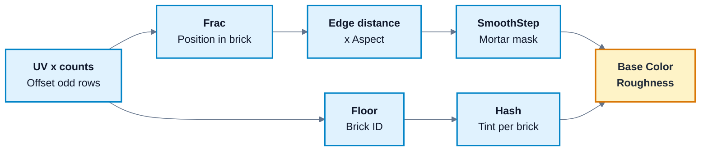

# Lab 5 - Procedural Tiles and Bricks

```yaml
week: 3
session: A
duration: 30 min
prerequisites:
  - "Notes 04, sections 5.1 to 5.5"
  - "Worked Example Part A (6.1)"
  - "The hash graph from Notes 03 section 5.7"
assets_needed:
  - "/Game/GD/Shared/Levels/Lvl_Lab"
```

---

## 1. Overview

You build a brick wall without a single texture. The bricks come from splitting UVs into cells, the running bond comes from shifting every other row by half a brick, and the mortar comes from the distance to each brick's edge. A hash gives every brick its own shade, and the same mortar mask makes the joints rough and the bricks smoother. Because every number is a parameter, an instance can turn the same material into a different wall without opening the graph.

---

## 2. What You Will Learn

| Outcome | Step |
|:---|:---|
| Scale UVs into a non-square grid and read the cell position and cell ID | 2 |
| Offset alternate rows using the row number before `Frac` | 2 |
| Draw an even mortar line from the edge distance, corrected for brick aspect | 3 |
| Anti-alias a procedural edge with `DDX`, `DDY` and `SmoothStep` | 3 |
| Give each brick a stable random tint with a hash | 4 |
| Drive roughness from the same mask as colour, and vary the wall from an instance | 5 |

---

## 3. Before You Start

- [ ] You have read sections 5.1 to 5.5 of Notes 04, because the steps build those graphs without explaining the maths again.
- [ ] You can find `Lvl_Lab` under `/Game/GD/Shared/Levels` in the Content Browser. Every lab uses this level.
- [ ] You have the hash graph from Notes 03 section 5.7 to hand. You build it again in Step 4.

This lab uses no textures, so there is nothing to download or copy.

---

## 4. Plan



| Step | Time |
|:---|:---|
| 1 - Set up the level and folders | 3 min |
| 2 - The brick grid and offset rows | 8 min |
| 3 - Even mortar with clean edges | 8 min |
| 4 - A tint per brick | 5 min |
| 5 - Roughness and an instance | 6 min |

---

## 5. Steps

### Step 1 - Set Up the Level and Folders

1. Open `/Game/GD/Shared/Levels/Lvl_Lab`. Choose **File > Save Current Level As** and save it as `/Game/Student/Lab05/Maps/Lvl_Lab05`, then work in your copy, so the shared level stays unchanged for everyone, as the [lab folder conventions](../supplementary/unreal-lab-folder-conventions.md) explain.
2. In the Content Browser, create `/Game/Student/Lab05/Materials`.
3. Place a **Plane** using **Quickly add to the project > Shapes**. Set **Rotation** X to 90 so it stands upright like a wall, and **Scale** to 3 on every axis.

**Checkpoint:** The level shows a large upright grey plane, and the Content Browser shows `Student/Lab05/Materials`.

### Step 2 - The Brick Grid and Offset Rows

1. In `Lab05/Materials`, create `MM_Env_BrickWall_Opaque` and open it.
2. Add two `ScalarParameter` nodes in a group named `Layout`: `BricksAcross`, default 4, and `BricksDown`, default 8. On a square wall this makes each brick twice as wide as it is tall.
3. Wire `p = TextureCoordinate * AppendVector(BricksAcross, BricksDown)`.
4. Split `p` with two `ComponentMask` nodes into `px` (R) and `py` (G).
5. Offset odd rows:
   1. `py -> Floor`. This is the row number.
   2. `Floor -> Multiply` (0.5) `-> Frac`. This is 0 on even rows and 0.5 on odd rows.
   3. `px -> Add.A`, the `Frac` output `-> Add.B`.
   4. `AppendVector`: the `Add` output on **A**, `py` on **B**. Call this `q`.
6. Wire `Frac(q) -> Base Color` to check the result. Apply and save, and drag the material onto the plane.

**Checkpoint:** The wall shows a grid of colour ramps, red increasing across and green increasing down each cell. Every other row is shifted half a cell sideways, like a running bond.

### Step 3 - Even Mortar With Clean Edges

1. Split `f = Frac(q)` into `fx` and `fy` with `ComponentMask`.
2. Edge distance on each axis:
   1. `dx = Min(fx, OneMinus(fx))`, then `Multiply` by a `ScalarParameter` `Aspect`, default 2, in group `Layout`.
   2. `dy = Min(fy, OneMinus(fy))`.
   3. `d = Min(dx, dy)`.
3. Edge width: `q -> DDX` and `q -> DDY`, `Abs` each, `Add` them, then `ComponentMask` (G). This is `w`, the change in `q` across one pixel, measured on the vertical axis because the mortar width is measured in vertical units.
4. Add a `ScalarParameter` `MortarWidth`, default 0.06, in group `Mortar`.
5. `brick = SmoothStep(MortarWidth - w, MortarWidth + w, d)`: **Min** = `MortarWidth - w`, **Max** = `MortarWidth + w`, **Value** = `d`.
6. `brick -> Lerp.Alpha`, a `VectorParameter` `MortarColour` (0.45, 0.43, 0.4) on **A**, a `VectorParameter` `BrickColour` (0.45, 0.12, 0.07) on **B**, and the `Lerp` into `Base Color`, replacing the test wire.
7. Apply, save, and fly the camera close to the wall and then far from it.

**Checkpoint:** Red bricks sit in grey mortar of the same thickness on all four sides. Close up, the brick edges are sharp. From far away, they do not shimmer.

### Step 4 - A Tint per Brick

1. `q -> Floor`. This is the brick ID, and it is taken after the offset, so each brick gets one value.
2. Build the hash from Notes 03 section 5.7: `Floor -> Dot.A`, `Constant2Vector` (12.9898, 78.233) `-> Dot.B`, `Dot -> Sine` with **Period** 6.283185, `-> Multiply` (43758.5453), `-> Frac`.
3. Add a `VectorParameter` `BrickColourB`, (0.32, 0.08, 0.05), in group `Bricks`, and move `BrickColour` into the same group.
4. `Lerp(BrickColour, BrickColourB, hash)` and wire it into **B** of the mortar `Lerp`, replacing `BrickColour` there.
5. Apply and save.

**Checkpoint:** Every brick has its own shade between the two reds, the shades do not follow any visible pattern, and a brick's shade stays the same as you move the camera.

### Step 5 - Roughness and an Instance

1. Add a second `Lerp` with `brick` on **Alpha**, a `Constant` 0.95 on **A** for the mortar and a `Constant` 0.7 on **B** for the bricks, and wire it into `Roughness`.
2. Apply and save. Orbit until the sun's highlight crosses the wall.
3. Right-click inside `Lab05/Materials`, create a Material Instance named `MI_Env_StoneWall_Opaque` with **Parent** `MM_Env_BrickWall_Opaque`, and apply it to the plane.
4. In the instance, set `BricksAcross` to 3, `BricksDown` to 12 and `Aspect` to 4, and change both brick colours to two greys for a stone wall.

**Checkpoint:** The sun's highlight shows on the bricks but stays dull in the joints, so the mortar reads as matte. Changing the instance turns the red wall into long grey stone courses with no compile.

---

## 6. Debugging and Pitfalls

| Symptom | Likely cause | Fix |
|:---|:---|:---|
| Rows are not offset | The offset was added after `Frac`, or to `py` instead of `px` | Add `Frac(Floor(py) * 0.5)` to `px` before `Frac` |
| Bricks split down the middle on odd rows | The brick ID was taken before the offset | Take `Floor` of `q`, not of `p` |
| Mortar thicker on the top and bottom than on the sides, or the reverse | `Aspect` missing, or multiplied into `dy` | Multiply `dx` by `Aspect` |
| Mortar is a thin bright line or vanishes | `SmoothStep` **Min** and **Max** swapped | **Min** = `MortarWidth - w`, **Max** = `MortarWidth + w` |
| Brick edges shimmer far away | `w` not wired, or taken from `Frac(q)` | Take `DDX` and `DDY` of `q` before `Frac` |
| Every brick has the same shade | Hash fed with `Frac` instead of `Floor` | Feed the brick ID from `Floor(q)` |
| Parameters appear under **None** in the instance | **Group** left empty | Set the group on each parameter in the master |

---

## 7. Production Checklist

| Check | Why |
|:---|:---|
| `MM_Env_BrickWall_Opaque` and `MI_Env_StoneWall_Opaque` are in `/Game/Student/Lab05/Materials` | The names say where the material is used, the pattern it draws and how it shades |
| The material uses no texture samples | The point of the lab is that the pattern comes from UV maths alone |
| Every count, width and colour is a parameter in a group | An instance can make a different wall without a compile or a graph edit |
| The brick ID is taken after the row offset | Each brick then has exactly one random value |
| One mortar mask drives both colour and roughness | The two inputs stay aligned, so the joints read as recessed mortar |
| Every asset is saved and compiles with no errors | An unsaved material reverts the next time you open the project |

---

## 8. Extension

1. **Weathering.** Add a built-in `Noise` node, with its **World Position** input fed from `TextureCoordinate` appended with 0 and multiplied by 4, and use it to darken the bricks slightly in patches. Keep the mortar unchanged.
2. **Recessed mortar.** Use the `brick` mask as a height and wire it through the `NormalFromHeightmap` function, so the joints look sunk into the wall when the light grazes it.
3. **Per-brick roughness.** Use a second hash, with the `Constant2Vector` changed to (39.346, 11.135), to vary roughness slightly per brick.
4. **Floor tiles.** Duplicate the material into a new folder, `Tiles`, set `Aspect` to 1, remove the row offset, and turn it into square floor tiles with glossy tiles and matte grout.
5. **Stack bond and Flemish bond.** Change the offset so that rows do not shift at all, then so that every row alternates a long and a short brick. Write down which node you changed for each.
6. **Starfield.** Create `MM_FX_Starfield_Opaque` with **Shading Model** set to `Unlit`, and apply it to a plane in a dark corner of the level.
   1. `p = TextureCoordinate * StarCells`, a `ScalarParameter` default 20. `id = Floor(p)` and `f = Frac(p)`.
   2. Build the hash from Step 4 four times on `id`, each with a different `Constant2Vector`: (12.9898, 78.233), (39.346, 11.135), (73.156, 52.235) and (27.619, 57.583). Call them `h1` to `h4`.
   3. Star position: `AppendVector(h1, h2) * 0.8 + 0.1`, so no star touches its cell edge. `d = Length(f - position)`.
   4. Star size: `Lerp(0.06, 0.2, h3)`. Star shape: `Power(OneMinus(SmoothStep(0, size, d)), 2)`, a soft dot that is brightest at its centre.
   5. Thin the field: `Step` with `OneMinus(StarDensity)` on **Y** and `h4` on **X**, where `StarDensity` is a `ScalarParameter` default 0.5. Only cells whose hash beats the threshold keep a star.
   6. Twinkle: `0.6 + 0.4 * Sine(Time * TwinkleSpeed + h4 * 6.283185)`, with **Period** 6.283185 and `TwinkleSpeed` default 3. The `h4` term gives every star its own phase.
   7. Multiply the star, the `Step`, the twinkle, a `VectorParameter` `StarColour` (0.85, 0.9, 1) and a `ScalarParameter` `Brightness` default 8, and wire the result into `Emissive Color`.

   Press **Play** or enable **Realtime**. Explain why the stars do not line up in rows, even though there is one cell per star.
7. **Hexagonal shield.** Create `MM_FX_HexShield_Add` with **Blend Mode** `Additive` and **Shading Model** `Unlit`, and apply it to a plane in front of another object.
   1. `p = TextureCoordinate * HexCount`, default 8. Let `r` be a `Constant2Vector` (1, 1.732) and `h` be (0.5, 0.866), half of `r`.
   2. Grid A: `a = Frac(p / r) * r - h`. Grid B, shifted by half a cell: `b = Frac((p - h) / r) * r - h`. Each is the position relative to the nearest cell centre in that grid.
   3. Keep the nearer centre: `s = Step(Dot(a, a), Dot(b, b))`, with `Dot(a, a)` on **Y** and `Dot(b, b)` on **X**. `gv = Lerp(b, a, s)`.
   4. Hexagon distance: `hd = Max(Dot(Abs(gv), (0.5, 0.866)), ComponentMask R of Abs(gv))`. `edge = 0.5 - hd` is 0 on a hexagon's edge.
   5. Edge line: `OneMinus(SmoothStep(LineWidth - w, LineWidth + w, edge))`, with `LineWidth` default 0.04 and `w` from `DDX` and `DDY` of `edge`.
   6. Pulse: `rad = Length(TextureCoordinate - 0.5) * 2` and `front = Frac(Time * PulseSpeed) * 1.5`, with `PulseSpeed` default 0.4. `pulse = OneMinus(SmoothStep(0, 0.08, Abs(rad - front)))`.
   7. `glow = line * 0.6 + line * pulse * 3 + pulse * 0.15`, multiplied by a `VectorParameter` `ShieldColour` (0.2, 0.6, 1), into `Emissive Color`.

   Press **Play**. A ring of light travels outwards from the centre and lights up the hexagon edges as it crosses them. Explain why the additive blend mode needs no `Opacity` input.

---

## 9. Reflective Questions

1. The offset uses `Frac(Floor(py) * 0.5)`. What would `Frac(Floor(py) * 0.25)` produce, and when might you want it?
2. You measured the mortar in vertical units and corrected the horizontal distance with `Aspect`. What goes wrong if you apply this material to a wall that is twice as wide as it is tall, and how would you fix it without changing the graph?
3. The hash gives every brick a different shade, but real walls also have bricks that are slightly larger or smaller. How could the hash vary the mortar width per brick?
4. A scanned brick texture would look more detailed than this material. List two situations where the procedural version is still the better choice.

---

## 10. How This Builds

- **Lab 6** (`lab_6_procedural_wood`) moves from patterns on a grid to patterns around a point, and adds noise.
- **Week 5** uses a brick height to drive parallax, and a procedural mask such as this mortar can provide that height.
- **Week 8** rewrites this brick graph as HLSL in a Custom node, so you can compare the node version and the code version line for line.
