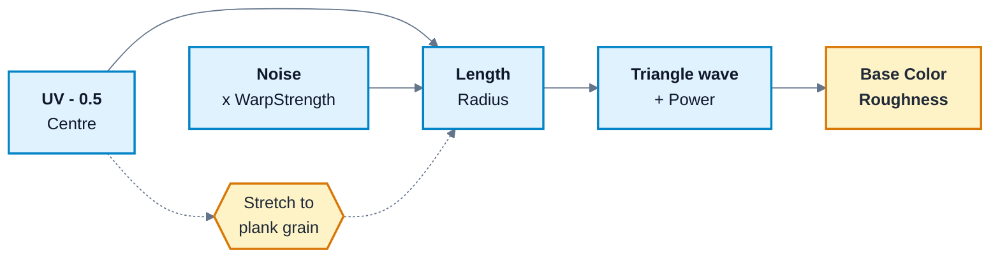

# Lab 6 - Procedural Wood

```yaml
week: 3
session: B
duration: 30 min
prerequisites:
  - "Notes 04, sections 5.6 to 5.10"
  - "Worked Example Part B (6.2)"
  - "Lab 1, because you compare your result with its wood material"
assets_needed:
  - "/Game/GD/Shared/Levels/Lvl_Lab"
  - "Your Lab 1 wood material, /Game/Student/Lab01/Materials/MM_Prop_Wood_Opaque"
```

---

## 1. Overview

You grow wood from maths. A tree trunk is a set of rings around the pith, so you start from the polar radius and repeat it into rings. Perfect rings look like a target, not a tree, so you bend them with noise: domain warping. You then stretch the same graph into the long grain of a sawn plank and place it beside your Lab 1 wood, which came from a scanned texture, to judge where each approach wins.

---

## 2. What You Will Learn

| Outcome | Step |
|:---|:---|
| Build a polar radius from centred UVs and repeat it into rings | 2 |
| Feed the built-in `Noise` node from UVs and control its scale and strength | 3 |
| Warp a pattern by adding noise to its input rather than its output | 3 |
| Map one pattern value to colour and roughness with `Lerp` and `Power` | 4 |
| Stretch the input to turn end grain into plank grain | 5 |

---

## 3. Before You Start

- [ ] You have read sections 5.6 to 5.10 of Notes 04, because the steps use polar coordinates, the triangle wave and domain warping without explaining them again.
- [ ] You can find `Lvl_Lab` under `/Game/GD/Shared/Levels` in the Content Browser.
- [ ] You have your Lab 1 wood material, `MM_Prop_Wood_Opaque`, in `/Game/Student/Lab01/Materials`. You use it for comparison in Step 5.

This lab uses no textures, so there is nothing to download or copy.

---

## 4. Plan



| Step | Time |
|:---|:---|
| 1 - Set up the level and folders | 3 min |
| 2 - Rings from the radius | 6 min |
| 3 - Warp the rings with noise | 8 min |
| 4 - Colour and roughness | 6 min |
| 5 - Plank grain and comparison | 7 min |

---

## 5. Steps

### Step 1 - Set Up the Level and Folders

1. Open `/Game/GD/Shared/Levels/Lvl_Lab`. Choose **File > Save Current Level As** and save it as `/Game/Student/Lab06/Maps/Lvl_Lab06`, then work in your copy, so the shared level stays unchanged for everyone, as the [lab folder conventions](../supplementary/unreal-lab-folder-conventions.md) explain.
2. In the Content Browser, create `/Game/Student/Lab06/Materials`.
3. Place two **Plane** shapes side by side, about 250 units apart, using **Quickly add to the project > Shapes**. Set **Scale** to 2 on both. The first is a sawn log end. The second takes your Lab 1 wood in Step 5.

**Checkpoint:** The level shows two flat grey planes side by side, and the Content Browser shows `Student/Lab06/Materials`.

### Step 2 - Rings From the Radius

1. In `Lab06/Materials`, create `MM_Prop_WoodGrain_Opaque` and open it. The name says it draws wood grain, which tells it apart from the texture-based wood material in Lab 1.
2. Centre the UVs: `TextureCoordinate -> Subtract`, with a `Constant2Vector` (0.5, 0.5) on **B**. Call this `c`.
3. Radius: `c -> Length`.
4. Rings: `Length -> Multiply` by a `ScalarParameter` `RingCount`, default 12, in group `Rings`.
5. Triangle wave: `Frac -> Subtract` (0.5) `-> Abs -> Multiply` (2). Call this `t`.
6. Wire `t -> Base Color`, apply, save, and drag the material onto the first plane.

**Checkpoint:** The plane shows concentric grey rings around its centre, smooth from black to white and back, like a perfect target.

### Step 3 - Warp the Rings With Noise

1. Add a `Noise` node. With it selected, set **Scale** to 1, **Levels** to 4, **Output Min** to -1 and **Output Max** to 1.
2. The node reads a 3D position. Build one from the UVs: `TextureCoordinate -> Multiply` by a `ScalarParameter` `NoiseScale`, default 3, in group `Grain`, then `AppendVector` with a `Constant` 0 on **B**, and wire it into the `Noise` node's **World Position** input.
3. `Noise -> Multiply` by a `ScalarParameter` `WarpStrength`, default 0.05, in group `Grain`.
4. `Length -> Add.A`, the warp `-> Add.B`, and wire the `Add` into the `RingCount` `Multiply` in place of `Length`.
5. Apply and save. Then set `WarpStrength` to 0 and to 0.15 in the material, applying each time, and set it back to 0.05.

**Checkpoint:** The rings wobble like the growth rings on a sawn log, and no two neighbouring rings have exactly the same shape. At 0 they are perfect circles again. At 0.15 they distort into loops.

### Step 4 - Colour and Roughness

1. Sharpen the dark late-wood bands: `t -> Power`, with a `ScalarParameter` `RingSharpness`, default 3, in group `Rings` on **Exp**. Call this `bands`.
2. Add two `VectorParameter` nodes in group `Colour`: `EarlyWood` (0.55, 0.36, 0.2) and `LateWood` (0.25, 0.13, 0.06).
3. `Lerp`: `EarlyWood` on **A**, `LateWood` on **B**, `bands` on **Alpha**, into `Base Color`.
4. A second `Lerp` with a `Constant` 0.55 on **A**, a `Constant` 0.7 on **B** and `bands` on **Alpha**, into `Roughness`. Leave `Metallic` at its default of 0, because wood is a dielectric.
5. Apply and save.

**Checkpoint:** The log end shows warm, light wood with thin, darker rings. In the sun the highlight is broad and dim, and slightly duller along the dark rings.

### Step 5 - Plank Grain and Comparison

A plank is cut along the trunk, so it shows the rings stretched into long lines rather than circles.

1. Stretch `c` before the radius: `c -> Multiply` by a `Constant2Vector` (0.08, 1), and wire the result into `Length` in place of `c`.
2. Apply and save. Drag your Lab 1 `MM_Prop_Wood_Opaque` from `/Game/Student/Lab01/Materials` onto the second plane.
3. Orbit both planes, close up and from a distance, and note one thing the procedural wood does better and one thing the scanned wood does better.

**Checkpoint:** The first plane shows long, slightly wavy grain lines running across it, like a plank. Beside it, the Lab 1 wood shows fine pores and colour variation that the procedural version does not have, while the procedural grain stays sharp however close you get.

---

## 6. Debugging and Pitfalls

| Symptom | Likely cause | Fix |
|:---|:---|:---|
| Rings centred on a corner | UVs not centred | `Subtract` (0.5, 0.5) before `Length` |
| A hard jump between light and dark at every ring | `Frac` used without the triangle wave | `Frac -> Subtract (0.5) -> Abs -> Multiply (2)` |
| Rings look identical with and without noise | The warp is added after `RingCount` or to the colour | Add the noise to the radius, before the `RingCount` `Multiply` |
| Rings shrink or swell overall instead of wobbling | `Noise` **Output Min** left at 0, so the warp only pushes outwards | Set **Output Min** to -1 and **Output Max** to 1 |
| Noise looks like coarse blocks or a flat grey | `NoiseScale` too low or too high for the surface | Keep `NoiseScale` between 2 and 8 |
| Bands are too broad and soft | `RingSharpness` too low | Raise it to between 3 and 6 |
| Grain runs the wrong way on the plank | Stretched the wrong axis | Swap the `Constant2Vector` to (1, 0.08) |

---

## 7. Production Checklist

| Check | Why |
|:---|:---|
| `MM_Prop_WoodGrain_Opaque` is in `/Game/Student/Lab06/Materials` | The name says the material draws wood grain procedurally, so it cannot be mistaken for the Lab 1 texture-based wood |
| The material uses no texture samples | The point of the lab is that the wood comes from UV maths and noise alone |
| `RingCount`, `RingSharpness`, `NoiseScale`, `WarpStrength` and both colours are parameters in groups | An instance can make oak, pine or walnut from the same graph |
| The noise is added to the radius, not to the colour | Warping the input bends the rings, while adding it to the output only stains them |
| `Metallic` is 0 | Wood is a dielectric, so its highlight must stay white |
| Every asset is saved and compiles with no errors | An unsaved material reverts the next time you open the project |

---

## 8. Extension

1. **Your own noise.** Copy `MF_Math_Hash` and `MF_Math_ValueNoise` from `/Game/GD/Notes04/Demo/Materials/Functions` into `/Game/Student/Lab06/Materials/Functions` with **Copy Here**, and replace the `Noise` node with your copy. Compare the look and the instruction count in **Stats**.
2. **Knots.** Add a circle distance field away from the centre, and add `Saturate(1 - d / KnotSize)` multiplied by a strength to the warped radius, so the grain bends around a knot.
3. **Marble.** Replace the radius with the U coordinate, so the rings become straight stripes, raise `WarpStrength` to about 0.3, and change the colours to white and grey.
4. **Hexagon tiles.** Using the grid techniques from Lab 5, build a hexagonal tile pattern. Hint: a hexagon grid is two offset rectangular grids, and each pixel takes whichever cell centre is nearer.
5. **Instances.** Make three instances, for pine, oak and walnut, by changing only parameters.
6. **Molten lava.** Create `MM_Env_MoltenLava_Opaque` and apply it to a plane.
   1. Add a `Noise` node with **Levels** 4, **Output Min** 0 and **Output Max** 1.
   2. Feed its **World Position** with `AppendVector(TextureCoordinate * LavaScale, Time * FlowSpeed)`, with `LavaScale` default 4 and `FlowSpeed` default 0.1. The noise is 3D, so moving through its third axis over time makes the pattern churn rather than slide.
   3. Veins: `crack = OneMinus(SmoothStep(0, CrackWidth, Abs(Noise - 0.5)))`, with `CrackWidth` default 0.04. This is 1 only where the noise crosses 0.5, so it draws thin lines. `crust = OneMinus(crack)`.
   4. `Lerp` from (0.02, 0.01, 0.01) to (0.08, 0.07, 0.065) with `crust` as **Alpha** into `Base Color`, and `Lerp` from 0.3 to 0.9 into `Roughness`.
   5. `crack * LavaColour * EmissiveStrength` into `Emissive Color`, with `LavaColour` (1, 0.3, 0.05) and `EmissiveStrength` default 20.

   Press **Play**. The veins shift and split slowly. Explain why `Abs(Noise - 0.5)` draws lines while `SmoothStep` on the noise alone would draw blobs.
7. **Topographic map.** Create `MM_Prop_TopoMap_Opaque` and apply it to a plane.
   1. Add a `Noise` node with **Levels** 3, **Output Min** 0 and **Output Max** 1, fed with `AppendVector(TextureCoordinate * 2, 0)`. Treat its output as terrain height.
   2. Land colour: `Lerp(Lowland, Highland, SmoothStep(0.45, 0.75, height))`, with `Lowland` (0.25, 0.45, 0.2) and `Highland` (0.5, 0.4, 0.3).
   3. Coast: `Lerp(Water, land colour, SmoothStep(0.34, 0.36, height))`, with `Water` (0.05, 0.2, 0.4).
   4. Contours: `x = height * ContourCount`, default 8. Take the triangle wave of `x`, which is 1 on each whole-number height, and `w = (Abs(DDX(x)) + Abs(DDY(x))) * 2`.
   5. `line = SmoothStep(1 - LineWidth - w, 1 - LineWidth + w, triangle)`, with `LineWidth` default 0.1.
   6. `Lerp(colour, (0.15, 0.1, 0.05), line * 0.8)` into `Base Color`, and 0.8 into `Roughness`.

   Raise `ContourCount` to 20, then raise the noise **Levels** to 5. Explain why the contour lines turn speckled when the terrain gets more detail.

---

## 9. Reflective Questions

1. You warped the radius rather than the final colour. Describe what the wood would look like if you had added the same noise to the colour instead.
2. The procedural grain stays sharp up close, but the Lab 1 texture has more detail at normal distance. Which would you use for a hero prop the player picks up, and which for a hundred background planks?
3. The plank came from stretching one axis by 0.08. What real-world cut of a log does that correspond to, and what would a value of 1 correspond to?
4. Every parameter here is a number an artist can change. Which two would you hide from artists, and why?

---

## 10. How This Builds

- **Week 4** (`05_runtime_materials_and_performance`) drives a dissolve with noise and an emissive edge, and changes material parameters such as `WarpStrength` at runtime from Blueprint.
- **Week 5** uses a procedural height such as these rings to push vertices and to fake depth with parallax.
- **Week 8** rewrites value noise, fBm and this wood pattern in HLSL in a Custom node, where the loop over octaves becomes a few lines of code.
