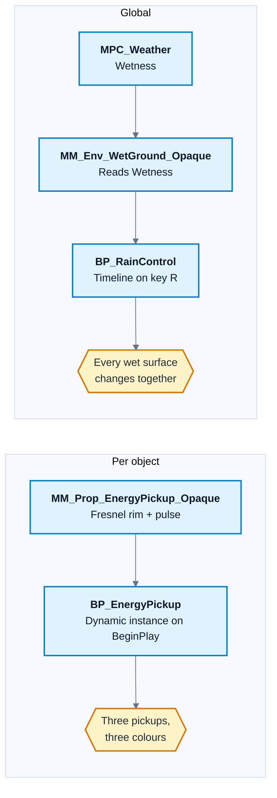

# Lab 7 - Runtime-Driven Effects

```yaml
week: 4
session: A
duration: 30 min
prerequisites:
  - "Notes 05, sections 5.1 to 5.5"
  - "Worked Example Part A (6.1)"
  - "Lab 3, because this lab sets parameters you named yourself"
assets_needed:
  - "/Game/GD/Shared/Levels/Lvl_Lab"
  - "/Game/GD/Shared/Textures/Stone: T_Stone_Albedo, T_Stone_Normal, T_Stone_ORM"
```

---

## 1. Overview

You build two effects that a game changes while it runs. The first is per object: energy pickups that glow and pulse, where each pickup placed in the level has its own colour and speed, set through a dynamic material instance. The second is global: rain that makes every wet-ready surface darken and shine at once, driven by one Material Parameter Collection and a Timeline. Placing the two side by side shows when to reach for each tool.

---

## 2. What You Will Learn

| Outcome | Step |
|:---|:---|
| Build a material whose emissive is driven by parameters, with a Fresnel rim and a pulse | 2 |
| Create a dynamic material instance once and set its parameters from instance-editable variables | 3 |
| Create a Material Parameter Collection and read it in a material | 4 |
| Drive a collection value over time with a Timeline triggered by a key | 5 |

---

## 3. Before You Start

- [ ] You have read sections 5.1 to 5.5 of Notes 05, because the steps use dynamic instances, collections and Timelines without explaining them again.
- [ ] You can find `Lvl_Lab` under `/Game/GD/Shared/Levels` and the stone textures under `/Game/GD/Shared/Textures/Stone`.
- [ ] You know how to create a Blueprint Class from the Content Browser and add a component to it. If not, ask before you start, because Step 3 depends on it.

---

## 4. Plan



| Step | Time |
|:---|:---|
| 1 - Set up the level and folders | 3 min |
| 2 - The pickup material | 6 min |
| 3 - The pickup Blueprint | 9 min |
| 4 - The weather collection and wet ground | 6 min |
| 5 - Rain on a key press | 6 min |

---

## 5. Steps

### Step 1 - Set Up the Level and Folders

1. Open `/Game/GD/Shared/Levels/Lvl_Lab`. Choose **File > Save Current Level As** and save it as `/Game/Student/Lab07/Maps/Lvl_Lab07`, then work in your copy, so the shared level stays unchanged for everyone, as the [lab folder conventions](../supplementary/unreal-lab-folder-conventions.md) explain.
2. In the Content Browser, create `/Game/Student/Lab07/Materials` and `/Game/Student/Lab07/Blueprints`.
3. Place a large **Plane** as a floor, scaled to 10 on X and Y, and a **Cube** scaled to 4 x 0.5 x 2 as a wall standing on it.

**Checkpoint:** The level shows a floor and a wall, and the Content Browser shows `Lab07` with `Maps`, `Materials` and `Blueprints`.

### Step 2 - The Pickup Material

1. In `Lab07/Materials`, create `MM_Prop_EnergyPickup_Opaque` and open it.
2. Rim: add a `Fresnel` node and set its **ExponentIn** to 3. Multiply it by a `VectorParameter` `GlowColour`, default (0, 0.8, 1), in group `Glow`.
3. Pulse: `Time -> Multiply` by a `ScalarParameter` `PulseSpeed`, default 2, in group `Glow`. Then `Sine` with **Period** 6.283185, `Multiply` by 0.5, `Add` 0.5. This runs smoothly from 0 to 1.
4. Multiply the pulse by `GlowColour` and by a `ScalarParameter` `PulseStrength`, default 3.
5. `Add` the rim and the pulse and wire the result into `Emissive Color`. Wire a dark `Constant3Vector` (0.02, 0.02, 0.03) into `Base Color` and 0.3 into `Roughness`.
6. Apply and save. In the preview, the sphere glows at its edges and brightens and dims about every three seconds.

**Checkpoint:** The preview sphere has a bright cyan rim and a steady pulse, and the material compiles with no errors.

### Step 3 - The Pickup Blueprint

1. In `Lab07/Blueprints`, create a Blueprint Class based on **Actor**, named `BP_EnergyPickup`, and open it.
2. Add a **Static Mesh** component. Set **Static Mesh** to `Sphere` and **Element 0** of its materials to `MM_Prop_EnergyPickup_Opaque`. Scale it to 0.5.
3. Add two variables and tick the eye icon beside each, so each is **Instance Editable**:
   - `PickupColour`, type **Linear Color**, default (0, 0.8, 1).
   - `PickupSpeed`, type **Float**, default 2.
4. In the Event Graph, wire:
   1. **Event BeginPlay -> Create Dynamic Material Instance**, with the Static Mesh component as **Target** and **Element Index** 0.
   2. Right-click the **Return Value** and choose **Promote to Variable**. Name it `DynamicMaterial`.
   3. From the promoted Set node, **Set Vector Parameter Value** on `DynamicMaterial`, with **Parameter Name** `GlowColour` and **Value** from `PickupColour`.
   4. Then **Set Scalar Parameter Value** on `DynamicMaterial`, with **Parameter Name** `PulseSpeed` and **Value** from `PickupSpeed`.
5. Compile and save. Place three `BP_EnergyPickup` actors above the floor. Select each in turn and, in the Details panel, set a different `PickupColour` and `PickupSpeed`.
6. Press **Play**.

**Checkpoint:** The three pickups glow in three different colours and pulse at three different rates. In the editor before you press Play, they all look the same, because the dynamic instances only exist while the game runs.

### Step 4 - The Weather Collection and Wet Ground

1. In `Lab07/Materials`, right-click and choose **Materials > Material Parameter Collection**. Name it `MPC_Weather` and open it. Add a **Scalar Parameter** named `Wetness`, default 0. Save.
2. Create `MM_Env_WetGround_Opaque`. Add `T_Stone_Albedo`, `T_Stone_Normal` and `T_Stone_ORM` from `/Game/GD/Shared/Textures/Stone`, and a `TextureCoordinate` with tiling 4 into all three.
3. Add a `CollectionParameter` node. Set **Collection** to `MPC_Weather` and **Parameter Name** to `Wetness`.
4. Wire:
   1. `Base Color = T_Stone_Albedo * Lerp(1, 0.55, Wetness)`, using a `Lerp` with 1 on **A**, 0.55 on **B** and `Wetness` on **Alpha**.
   2. `Roughness = Lerp(T_Stone_ORM.G, 0.08, Wetness)`.
   3. `T_Stone_Normal -> Normal`, `T_Stone_ORM.R -> Ambient Occlusion`, `T_Stone_ORM.B -> Metallic`.
5. Apply and save. Apply the material to both the floor and the wall.
6. Open `MPC_Weather`, set `Wetness` to 1, and look at the viewport. Set it back to 0 and save.

**Checkpoint:** With `Wetness` at 1, the floor and the wall both turn darker and catch sharp reflections of the sky at the same time. At 0 they are dry stone again.

### Step 5 - Rain on a Key Press

1. In `Lab07/Blueprints`, create a Blueprint Class based on **Actor**, named `BP_RainControl`, and open its Event Graph.
2. Right-click and choose **Add Timeline**. Name it `RainTimeline` and double-click it. Add a float track named `Rain` with keys at time 0, value 0 and time 3, value 1. Set **Length** to 3.
3. Add a **Keyboard Event** for `R`. Wire **Pressed -> Play** and **Released -> Reverse** on `RainTimeline`, so holding R brings the rain in and letting go dries the street.
4. Wire `RainTimeline` **Update -> Set Scalar Parameter Value**, the version with a **Collection** pin. Set **Collection** to `MPC_Weather`, **Parameter Name** to `Wetness`, and wire `Rain` into **Value**.
5. Compile and save. Place one `BP_RainControl` in the level. In its Details panel, under **Input**, set **Auto Receive Input** to `Player 0`.
6. Press **Play**, hold R for three seconds, then release it.

**Checkpoint:** While you hold R, the floor and the wall darken and turn glossy together over three seconds. When you release R, they dry over the same time. The pickups are unaffected, because they do not read the collection.

---

## 6. Debugging and Pitfalls

| Symptom | Likely cause | Fix |
|:---|:---|:---|
| All three pickups look the same in Play | The parameters were set on a new instance each time, or not set at all | Create the dynamic instance once on BeginPlay and set both values on the stored `DynamicMaterial` |
| Colour changes but speed does not, or the reverse | A parameter name does not match the material | Copy `GlowColour` and `PulseSpeed` from the material's parameter nodes |
| The variables do not appear in the Details panel | **Instance Editable** not ticked | Click the eye icon beside each variable and compile |
| Setting `Wetness` in the collection changes nothing | The material reads a different collection or parameter | Check **Collection** and **Parameter Name** on the `CollectionParameter` node |
| Pressing R does nothing | The actor does not receive input | Set **Auto Receive Input** to `Player 0` on the placed `BP_RainControl` |
| The street jumps from dry to wet | The Timeline has one key, or its **Length** does not match the keys | Add keys at 0 and 3 and set **Length** to 3 |
| Wet surfaces look grey and flat | Roughness was lowered but base colour was not darkened, or the reverse | Change both from the same `Wetness` value |

---

## 7. Production Checklist

| Check | Why |
|:---|:---|
| `MM_Prop_EnergyPickup_Opaque`, `MM_Env_WetGround_Opaque` and `MPC_Weather` are in `Lab07/Materials`, and both Blueprints are in `Lab07/Blueprints` | The lab folder holds everything for the lab, and each name says what the asset makes |
| `BP_EnergyPickup` creates its dynamic instance once, on BeginPlay | A dynamic instance created repeatedly leaks memory and resets its values |
| Pickup colour and speed are instance-editable variables, not values in the graph | A level designer can vary each pickup without opening the Blueprint |
| Wetness lives in a collection, not in dynamic instances | One call changes every wet surface, however many there are |
| The Timeline drives the collection, not Tick | The Timeline only runs while it plays, and its curve can be reshaped without changing the graph |
| Every asset is saved and compiles with no errors | An unsaved Blueprint loses its graph when the editor closes |

---

## 8. Extension

1. **Collect the pickup.** Add a **Sphere Collision** component to `BP_EnergyPickup`. On **On Component Begin Overlap**, play a Timeline that raises a `Dissolve` parameter from 0 to 1, using the dissolve graph from Notes 05 Worked Example Step 1 added to the pickup material, then **Destroy Actor** when it finishes.
2. **Puddles.** In `MM_Env_WetGround_Opaque`, use `T_Stone_Height` with `OneMinus` as a puddle mask. Where `Wetness` is high and the stone is low, set roughness to 0.02 and darken the base colour further, so water collects in the cracks first.
3. **Second collection value.** Add a vector parameter `RainTint` to `MPC_Weather` and multiply it into the wet ground's base colour, so a storm can turn the street slightly blue.
4. **Highlight on hover.** Use **On Begin Cursor Over** on the pickup to raise its `PulseStrength` through the dynamic instance, and restore it on **On End Cursor Over**. Tick **Enable Mouse Over Events** on the player controller first.

---

## 9. Reflective Questions

1. You set each pickup's colour through a dynamic instance and the wetness through a collection. What would go wrong if you swapped the two approaches?
2. In the editor, before Play, the three pickups looked identical. Why, and how could a level designer preview each colour without pressing Play?
3. Holding R used Play and releasing it used Reverse. How would you make the rain come in slowly and dry quickly without changing the graph?
4. Every material that reads `Wetness` pays for the extra nodes even on a dry day. Is that cost worth it, and when would you use a static switch instead?

---

## 10. How This Builds

- **Lab 8** (`lab_8_post_process_decals_and_profiling`) changes how objects look through a full-screen post-process material instead of their own materials, and measures what each effect costs.
- **Week 6** reuses the Fresnel rim for water and holograms, and drives a landscape's snow cover from a collection value in the same way as `Wetness`.
- **Week 9** (`lab_18_hlsl_dissolve_rewrite`) rewrites the dissolve from the Extension in HLSL and compares its cost with the node version.
