# Lab 8 - Post-Process, Decals and Profiling

```yaml
week: 4
session: B
duration: 30 min
prerequisites:
  - "Notes 05, sections 5.6 to 5.11"
  - "Worked Example Part B (6.2)"
assets_needed:
  - "/Game/GD/Notes05/Lab08/Levels/Lvl_Lab08_Heavy, the expensive scene"
  - "/Game/GD/Notes05/Lab08/Heavy: MM_Prop_HeavyNoise_Opaque and MM_FX_SmokeStack_Trans"
```

---

## 1. Overview

You work in a deliberately slow scene. First you add two pieces of polish that games rely on: an outline that shows one object through walls, built as a post-process material reading the custom stencil, and a scorch-mark decal that lands on whatever is below it. Then you measure the scene, find the two problems that make it expensive, and fix each one, checking the numbers before and after. The lab practises the habit that matters most in optimisation: measure first.

---

## 2. What You Will Learn

| Outcome | Step |
|:---|:---|
| Mark an object for custom depth and stencil, and read the stencil in a post-process material | 1, 2 |
| Build an outline by comparing a pixel's stencil with its neighbours | 2 |
| Build a deferred decal with a procedural mask and place it in the level | 3 |
| Read cost from the shader complexity view, Stats and `stat GPU` | 4 |
| Reduce translucency overdraw and an over-expensive material, and confirm the saving | 5 |

---

## 3. Before You Start

- [ ] You have read sections 5.6 to 5.11 of Notes 05, because the steps use scene textures, decals and the profiling tools without explaining them again.
- [ ] You can find `Lvl_Lab08_Heavy` under `/Game/GD/Notes05/Lab08/Levels`. It is the scene you optimise in Steps 4 and 5.

---

## 4. Plan

```mermaid
%%{init: {"theme": "base", "themeVariables": {"fontFamily": "Arial, Helvetica, sans-serif", "fontSize": "15px", "lineColor": "#64748b", "edgeLabelBackground": "#ffffff"}}}%%
flowchart LR
    accTitle: Lab 8 plan
    accDescr: Save a copy of the heavy scene and enable the custom depth and stencil pass. Build PPM_Outline and apply it through an unbound post-process volume, so a marked crate is outlined. Build a scorch decal and place it on the floor. Measure the scene with shader complexity, Stats and stat GPU, then fix the stacked smoke and the heavy prop material and measure again.

    setup["<b>Copy heavy scene</b><br/>Enable stencil"]
    pp["<b>PPM_Outline</b><br/>Stencil neighbours"]
    decal["<b>MM_Decal_Scorch_Decal</b><br/>Procedural mask"]
    measure{{"Measure<br/>complexity, Stats, GPU"}}
    fix["<b>Fix</b><br/>Smoke overdraw<br/>Heavy material"]
    again{{"Measure again"}}

    setup --> pp --> decal --> measure --> fix --> again

    classDef build fill:#e0f2fe,stroke:#0284c7,stroke-width:2px,color:#0f172a
    classDef check fill:#fef3c7,stroke:#d97706,stroke-width:2px,color:#1f2937
    class setup,pp,decal,fix build
    class measure,again check
```



| Step | Time |
|:---|:---|
| 1 - Set up the scene and the stencil | 4 min |
| 2 - A stencil outline | 9 min |
| 3 - A scorch decal | 5 min |
| 4 - Measure the scene | 5 min |
| 5 - Fix the two problems | 7 min |

---

## 5. Steps

### Step 1 - Set Up the Scene and the Stencil

1. Open `/Game/GD/Notes05/Lab08/Levels/Lvl_Lab08_Heavy`. Choose **File > Save Current Level As** and save it as `/Game/Student/Lab08/Maps/Lvl_Lab08`, then work in your copy, so the supplied scene stays unchanged for everyone, as the [lab folder conventions](../supplementary/unreal-lab-folder-conventions.md) explain.
2. Create `/Game/Student/Lab08/Materials`.
3. Open **Project Settings > Engine > Rendering > Postprocessing** and set **Custom Depth-Stencil Pass** to `Enabled with Stencil`. The setting belongs to the project, so it may already be on.
4. Select the crate labelled `Crate_Target`. In its Details panel, under **Rendering**, tick **Render CustomDepth Pass** and set **CustomDepth Stencil Value** to 1.

**Checkpoint:** You are working in `Lvl_Lab08` in your own folder, and `Crate_Target` has Render CustomDepth Pass ticked with stencil value 1.

### Step 2 - A Stencil Outline

1. In `Lab08/Materials`, create `PPM_Outline` and open it. With nothing selected, set **Material Domain** to `Post Process` and **Blendable Location** to `Scene Color After Tonemapping`.
2. Add a `ScreenPosition` node. Its **ViewportUV** output is this pixel's position on screen, from 0 to 1.
3. Add a `SceneTexture` node with **Scene Texture Id** `CustomStencil`, and leave its **UVs** empty. This is the centre stencil. Take its **Color** output through `ComponentMask` (R) and `Saturate`: 1 on the marked crate and 0 elsewhere.
4. Add a second `SceneTexture` with **Scene Texture Id** `PostProcessInput0`. Its **InvSize** output is the size of one pixel in UV units.
5. Build four neighbours. For each of the offsets (1, 0), (-1, 0), (0, 1) and (0, -1):
   1. `Constant2Vector` (the offset) `-> Multiply.A`, `InvSize -> Multiply.B`.
   2. `Multiply -> Add.A`, `ViewportUV -> Add.B`.
   3. `Add -> SceneTexture.UVs` on a new `SceneTexture` with **Scene Texture Id** `CustomStencil`, then `ComponentMask` (R) and `Saturate`.
6. `Add` the four neighbour values together, `Saturate` the total, then `Subtract` the centre value. The result is 1 just outside the crate's edge and 0 everywhere else.
7. `Lerp`: `PostProcessInput0` **Color** on **A**, a `VectorParameter` `OutlineColour` (1, 0.6, 0) on **B**, the outline value on **Alpha**, into `Emissive Color`.
8. Apply and save. Place a **Post Process Volume**, tick **Infinite Extent (Unbound)**, and add `PPM_Outline` under **Rendering Features > Post Process Materials**.
9. Move the camera so another object hides part of the crate.

**Checkpoint:** `Crate_Target` has a thin orange outline, and the outline still shows where another object hides the crate. No other object is outlined.

### Step 3 - A Scorch Decal

1. Create `MM_Decal_Scorch_Decal`. Set **Material Domain** to `Deferred Decal` and **Blend Mode** to `Translucent`.
2. Mask: `TextureCoordinate - (0.5, 0.5) -> Length -> Multiply` (2). Then `1 - SmoothStep(0.5, 1, that)`, a soft disc.
3. Break up its edge: a `Noise` node with **Levels** 3, fed with `AppendVector(TextureCoordinate * 6, 0)` and with **Output Min** 0.6 and **Output Max** 1. `Multiply` it into the disc, and wire the result into `Opacity`.
4. `Constant3Vector` (0.02, 0.018, 0.015) into `Base Color`, and 0.95 into `Roughness`.
5. Apply and save. Place a **Decal Actor** on the floor near the crate, set **Decal Material** to the new material, and rotate it so its arrow points down into the floor. Scale it to about 2 on Y and Z.

**Checkpoint:** A soft, ragged black scorch mark lies on the floor. Move the decal over the edge of a step or a box and the mark wraps over both surfaces.

### Step 4 - Measure the Scene

1. Fly the camera so the stack of smoke planes and the heavy prop, labelled `Prop_Heavy`, are both in view.
2. Open the view mode menu, labelled **Lit**, and choose **Optimization Viewmodes > Shader Complexity**. Write down the colour of the overlapping smoke and of `Prop_Heavy`.
3. Open `MM_Prop_HeavyNoise_Opaque` from `/Game/GD/Notes05/Lab08/Heavy` and click **Stats**. Write down the base pass instruction count and the number of texture samplers.
4. Press **Play**, open the console with the backquote key, type `stat GPU` and press Enter. Write down the times for the translucency and base pass rows. Type `stat GPU` again to hide it, and stop Play.

**Checkpoint:** You have a short table of five numbers: two colours, an instruction count, a sampler count and two GPU times. The smoke shows white or pale pink where many planes overlap, and `Prop_Heavy` shows red.

### Step 5 - Fix the Two Problems

1. **Smoke overdraw.** In the Outliner, open the `Smoke` folder. Delete all but three of the smoke planes, keeping the front, middle and back ones, and scale those three up by 1.5 so the cloud keeps its size.
2. **Heavy material.** Copy `MM_Prop_HeavyNoise_Opaque` into `Lab08/Materials` with **Copy Here** and rename the copy `MM_Prop_LightNoise_Opaque`. Open it and:
   1. Set **Levels** on every `Noise` node from 6 to 2.
   2. Delete the `Noise` node with a scale of 11 and the `Lerp` and `Multiply` it feeds. It adds fine variation that is invisible at this distance.
   3. Delete the duplicate stone `Texture Sample` nodes so that one sample each of `T_Stone_Albedo`, `T_Stone_Normal` and `T_Stone_ORM` remains, with one `TextureCoordinate`, and rewire their outputs. Remove the `Divide` nodes that averaged the duplicates.
   4. Apply and save, and apply the new material to `Prop_Heavy`.
3. Repeat the measurements from Step 4 and write the new numbers beside the old ones.

**Checkpoint:** In Shader Complexity, the white and pink patches in the smoke have gone, and `Prop_Heavy` is a darker red than before. The new material's Stats show about a quarter fewer instructions and three texture samples instead of nine, and the translucency time in `stat GPU` has dropped by far more than the base pass time.

---

## 6. Debugging and Pitfalls

| Symptom | Likely cause | Fix |
|:---|:---|:---|
| No outline at all | Custom Depth-Stencil Pass disabled, or the crate not marked | Enable it with stencil in Project Settings, and tick Render CustomDepth Pass with stencil value 1 on the crate |
| The whole screen turns orange | The outline uses the centre value without subtracting it, or the `Lerp` inputs are swapped | Subtract the centre from the neighbour total, and put the scene colour on **A** |
| The outline is drawn inside the crate instead of around it | Centre and neighbour roles swapped | Use neighbours minus centre, not centre minus neighbours |
| The effect only shows inside a box | **Infinite Extent (Unbound)** not ticked on the volume | Tick it |
| The decal shows nothing | The material is not in the Deferred Decal domain, or the decal box does not reach the floor | Set **Material Domain** and rotate the decal to project into the floor |
| The decal is a hard-edged black square | `Opacity` is not wired, so the decal covers its whole box | Wire the disc mask into `Opacity` |
| Numbers barely change after a fix | The fix was applied to the supplied asset, or the level still uses the old material | Edit your copy and apply it to `Prop_Heavy` in your level |

---

## 7. Production Checklist

| Check | Why |
|:---|:---|
| `PPM_Outline`, `MM_Decal_Scorch_Decal` and `MM_Prop_LightNoise_Opaque` are in `Lab08/Materials` | The prefix and name say what each asset is, and the lab folder holds all three |
| Only `Crate_Target` writes custom stencil | Every marked object costs custom depth rendering, so mark only what needs an outline |
| The outline is applied through one unbound post-process volume | One volume covers the whole level, so the effect cannot switch off when the camera moves |
| The decal uses a soft opacity mask | A hard mask shows the decal box, and the soft edge makes it sit into the floor |
| The supplied heavy assets in `/Game/GD` are unchanged | The next student starts from the same slow scene |
| You recorded measurements before and after each fix | A fix without a measurement is a guess |

---

## 8. Extension

1. **Two outline colours.** Mark a second object with stencil value 2. In `PPM_Outline`, read the stencil value before `Saturate` and use it to choose orange for 1 and green for 2.
2. **Outline through walls only.** Compare `CustomDepth` with `SceneDepth`. Where the custom depth is greater, the crate is hidden, so fill those pixels with a faint orange as well as drawing the outline.
3. **Quality switch.** Add a `QualitySwitch` to `MM_Prop_LightNoise_Opaque` so `Low` uses a flat colour and `High` uses the full texture set. Change **Settings > Engine Scalability Settings** to Low and back to compare.
4. **Masked smoke.** Make a copy of the smoke material with **Blend Mode** `Masked` and **Dithered Opacity Mask** ticked, apply it to the three planes, and compare shader complexity and appearance with the translucent version.
5. **Profile with ProfileGPU.** Run the `ProfileGPU` console command in Play and find the pass that takes the most time. Compare it with what `stat GPU` reported.

---

## 9. Reflective Questions

1. The outline costs the same with one outlined object or fifty. Why, and what part of its cost does grow with more outlined objects?
2. The decal changed the floor's base colour and roughness but not its normal. What would wiring a normal into the decal add to a scorch mark?
3. Removing nine smoke planes saved more time than simplifying the heavy material. Before you measured, which would you have guessed, and what does that tell you?
4. `Prop_Heavy` showed red in Shader Complexity, but it covers little of the screen. When is an expensive material not worth optimising?

---

## 10. How This Builds

- **Week 5** (`06_geometry_and_scene_aware_materials`) reads `SceneDepth` again for soft intersections and depth fade, and Lab 10 profiles the cost of depth-aware effects.
- **Week 6** builds a toon shader as a post-process material, using the same scene texture reads as the outline.
- **Week 7** (`08_screen_space_post_processing`) uses the stencil from this lab to keep one object in colour in a greyscale world, with a depth test so it does not show through walls.
- **Week 9** rewrites expensive node graphs in HLSL and compares their instruction counts with the numbers you recorded here.
