# Lab 9 - World Position Offset and Parallax

```yaml
week: 5
session: A
duration: 30 min
prerequisites:
  - "Notes 06, sections 5.1 to 5.7"
  - "Worked Example Part A (6.1)"
assets_needed:
  - "/Game/GD/Shared/Levels/Lvl_Lab"
  - "/Game/GD/Shared/Meshes/SM_Plane_Dense"
  - "/Game/GD/Shared/Textures/Stone: T_Stone_Albedo, T_Stone_Normal, T_Stone_ORM, T_Stone_Height"
```

---

## 1. Overview

You make a surface move and another look deep, without adding any geometry. First you build a flag that waves in the wind, pinned at its pole, and bend its normal so the folds catch the light. Then you give a cobbled floor depth twice: once with Bump Offset and once with parallax occlusion mapping. You compare the two from above and from a low angle, and measure what each costs.

---

## 2. What You Will Learn

| Outcome | Step |
|:---|:---|
| Offset vertices with World Position Offset, using a travelling wave and a mask | 2 |
| Turn a local-space direction into world space with `TransformVector` | 2 |
| Bend a normal by the slope of the offset, and fix culling with Bounds Scale | 3 |
| Fake depth with `BumpOffset` | 4 |
| Fake depth with the `ParallaxOcclusionMapping` function, and compare its look and cost | 5 |

---

## 3. Before You Start

- [ ] You have read sections 5.1 to 5.7 of Notes 06, because the steps build those graphs without explaining the maths again.
- [ ] You can find `SM_Plane_Dense` in `/Game/GD/Shared/Meshes` and the stone set, including `T_Stone_Height`, in `/Game/GD/Shared/Textures/Stone`.

---

## 4. Plan

```mermaid
%%{init: {"theme": "base", "themeVariables": {"fontFamily": "Arial, Helvetica, sans-serif", "fontSize": "15px", "lineColor": "#64748b", "edgeLabelBackground": "#ffffff"}}}%%
flowchart LR
    accTitle: Lab 9 plan
    accDescr: Build a waving flag on the dense plane with a travelling sine wave masked by U, then bend its normal by the wave's slope and raise its Bounds Scale. Then build two cobbled floor materials, one with Bump Offset and one with parallax occlusion mapping, place them side by side, and compare them from above and from a low angle, and with stat GPU.

    flag["<b>MM_Prop_WavingFlag_Opaque</b><br/>WPO wave"]
    norm["<b>Normal + bounds</b><br/>Slope, Bounds Scale"]
    bump["<b>MM_Env_BumpOffsetStone_Opaque</b><br/>One lookup"]
    pom["<b>MM_Env_POMStone_Opaque</b><br/>Ray march"]
    cmp{{"Compare<br/>look and cost"}}

    flag --> norm --> bump --> pom --> cmp

    classDef build fill:#e0f2fe,stroke:#0284c7,stroke-width:2px,color:#0f172a
    classDef check fill:#fef3c7,stroke:#d97706,stroke-width:2px,color:#1f2937
    class flag,norm,bump,pom build
    class cmp check
```



| Step | Time |
|:---|:---|
| 1 - Set up the level and folders | 3 min |
| 2 - The waving flag | 9 min |
| 3 - Normals and bounds | 5 min |
| 4 - Bump Offset | 6 min |
| 5 - Parallax occlusion mapping | 7 min |

If you are short of time, finish Step 4 and move Step 5 to the Extension. Steps 2 to 4 cover the core skills.

---

## 5. Steps

### Step 1 - Set Up the Level and Folders

1. Open `/Game/GD/Shared/Levels/Lvl_Lab`. Choose **File > Save Current Level As** and save it as `/Game/Student/Lab09/Maps/Lvl_Lab09`, then work in your copy, so the shared level stays unchanged for everyone, as the [lab folder conventions](../supplementary/unreal-lab-folder-conventions.md) explain.
2. Create `/Game/Student/Lab09/Materials`.
3. Place a **Cylinder** as a flag pole, scaled to 0.08 x 0.08 x 3. Drag `SM_Plane_Dense` into the level beside it. Set its **Rotation** X to -90 so it stands upright and faces you, and move it so its left edge touches the pole near the top.
4. Place two **Plane** shapes on the floor side by side, each scaled to 4.4 on X and Y. These take the two stone materials.

**Checkpoint:** The level shows a pole with a flat grey rectangle beside it, and two large grey tiles on the floor.

### Step 2 - The Waving Flag

1. In `Lab09/Materials`, create `MM_Prop_WavingFlag_Opaque` and open it. With nothing selected, tick **Two Sided**, so the back of the flag renders.
2. `x = ComponentMask (R) of TextureCoordinate`. This is 0 at the pole and 1 at the free edge.
3. Add three `ScalarParameter` nodes in group `Wave`: `WaveCount` default 1.5, `WaveSpeed` default 4 and `Amplitude` default 12.
4. `arg = x * WaveCount * 6.283185 - Time * WaveSpeed`.
5. `height = Sine(arg) * Amplitude * x`, with the `Sine` **Period** set to 6.283185.
6. Add a `TransformVector` node with **Source** `Local Space` and **Destination** `World Space`, and wire a `Constant3Vector` (0, 0, 1) into it. On this mesh, local Z points out of the cloth.
7. `TransformVector * height -> World Position Offset`.
8. A `VectorParameter` `FlagColour` (0.6, 0.05, 0.05) into `Base Color`, and 0.7 into `Roughness`.
9. Apply and save, and apply it to the flag. Click **Simulate** in the toolbar, or enable **Realtime** in the viewport.

**Checkpoint:** Waves travel along the flag away from the pole, the edge at the pole stays still, and the free edge flaps furthest. The flag's shading is still flat: no light and dark bands follow the folds.

### Step 3 - Normals and Bounds

1. Compute the slope of the wave: `slope = Cosine(arg) * WaveCount * 6.283185 * Amplitude * x / 200`, with **Period** 6.283185 on the `Cosine`. 200 is the length of `SM_Plane_Dense` in centimetres.
2. Multiply `slope` by a `ScalarParameter` `NormalStrength`, default 1, in group `Wave`.
3. Build the normal: `AppendVector(AppendVector(-slope, 0), 1)`, then `Normalize`, into `Normal`.
4. Apply, save and simulate. Then orbit until you look along the edge of the flag.
5. If the flag flickers out of view near the edge of the screen, select it and set **Bounds Scale**, under **Rendering**, to 2.

**Checkpoint:** Light and dark bands now follow the folds as they travel along the flag. Setting `NormalStrength` to 0 makes it flat again. With Bounds Scale at 2, the flag does not disappear at any camera angle.

### Step 4 - Bump Offset

1. Create `MM_Env_BumpOffsetStone_Opaque`. Add a `TextureCoordinate` with **U Tiling** and **V Tiling** 4.
2. Sample `T_Stone_Height` with those UVs. Its sampler type is `Linear Grayscale`.
3. Add a `BumpOffset` node. Wire the tiled UVs into **Coordinate**, the height's R into **Height**, and a `ScalarParameter` `HeightRatio`, default 0.05, into **HeightRatioInput**.
4. Sample `T_Stone_Albedo`, `T_Stone_Normal` and `T_Stone_ORM`, all with the `BumpOffset` output on **UVs**. Wire them as in Notes 01: base colour, normal, and ORM channels R, G and B into `Ambient Occlusion`, `Roughness` and `Metallic`.
5. Apply and save, and apply it to the first floor tile.

**Checkpoint:** From above, the stones look raised from the gaps between them. As you move the camera, the stone tops shift slightly against the gaps, which reads as depth.

### Step 5 - Parallax Occlusion Mapping

1. Create `MM_Env_POMStone_Opaque` with the same tiled `TextureCoordinate`.
2. Add the `ParallaxOcclusionMapping` function from the Palette. Wire:
   1. A `TextureObject` set to `T_Stone_Height` into `Heightmap Texture`.
   2. The tiled UVs into `UVs`.
   3. `ScalarParameter` nodes into `Height Ratio` (default 0.05), `Min Steps` (8) and `Max Steps` (32).
   4. A `Constant4Vector` (1, 0, 0, 0) into `Heightmap Channel`, because the height is in R.
3. Sample the three stone textures with `Parallax UVs` on **UVs**, wired as in Step 4.
4. Apply and save, and apply it to the second tile.
5. Compare: look down at both tiles from above, then lower the camera until you look almost along the floor.
6. Open **Stats** on both materials and note the instruction counts. Then press **Play**, fill the screen with each tile in turn, and read the base pass time in `stat GPU`.

**Checkpoint:** From above, the two tiles look alike. From a low angle, the Bump Offset stones smear and swim while the POM stones stand up, with the gaps between them hidden behind the stones in front. Stats shows POM only about 10% more expensive, but `stat GPU` shows a larger difference, because the ray-march loop runs many times per pixel and Stats counts it once.

---

## 6. Debugging and Pitfalls

| Symptom | Likely cause | Fix |
|:---|:---|:---|
| The flag does not move | The mesh is the four-vertex engine plane, or Realtime is off | Use `SM_Plane_Dense`, and click **Simulate** or enable **Realtime** |
| The pole edge flaps too | The height is not multiplied by `x` | Multiply by `x`, which is 0 at the pole |
| The flag waves sideways or along its length | The offset direction is not out of the cloth | Transform (0, 0, 1) from local to world and multiply by the height |
| Waves travel towards the pole | Time is added instead of subtracted | Use `x * WaveCount * 6.283185 - Time * WaveSpeed` |
| Folds are lit the wrong way round | The slope sign is wrong | Use `-slope` in the normal |
| The stones swim in Bump Offset | Expected at low angles | Use POM where the camera gets low |
| POM shows layered slices | **Max Steps** too low | Raise it towards 32 |
| POM tile is flat | `Heightmap Channel` not set, or `Height Ratio` 0 | Wire (1, 0, 0, 0) and a height ratio of about 0.05 |

---

## 7. Production Checklist

| Check | Why |
|:---|:---|
| All three materials are in `Lab09/Materials` | The lab folder holds everything for the lab, and each name says what the material makes |
| The flag uses `SM_Plane_Dense`, not the engine plane | World Position Offset can only move vertices that exist |
| The offset is multiplied by `x` | The cloth stays attached to the pole |
| The flag's normal is bent by the slope | Without it the folds light as if flat |
| The flag's Bounds Scale covers its movement | Otherwise it can be culled while visible |
| Both stone materials apply the parallax UVs to every texture sample | A sample left on the original UVs slides against the others |
| You recorded Stats and `stat GPU` for both stone materials | Stats alone hides the cost of the POM loop |

---

## 8. Extension

1. **Two-direction wave.** Add a second, smaller wave along V, and add its slope to the normal's G component.
2. **Wind on foliage.** Build the wind sway from Notes 06 Worked Example Step 1 on a leaf card, using `ObjectPosition` for phase so several cards sway out of step.
3. **POM cost against steps.** Set `Max Steps` to 8, 16 and 64, and record `stat GPU` for each with the tile filling the screen. Plot cost against steps.
4. **Pixel depth offset.** Wire the POM function's `Pixel Depth Offset` output into the material's `Pixel Depth Offset` input, then push a cube into the tile. The cube now sinks between the stones instead of sitting on a flat plane.
5. **World-aligned mapping.** Replace the stone base colour sample with Epic's `WorldAlignedTexture` function, then scale a cube unevenly and compare it with UV mapping.

---

## 9. Reflective Questions

1. The flag's vertices move, but its collision does not. Name a gameplay situation where that would matter, and one where nobody would notice.
2. You bent the normal with a formula derived from the wave. Why can a texture-based normal map not do the same job here?
3. Stats showed only a small difference between Bump Offset and POM, but `stat GPU` showed a bigger one. What does that tell you about trusting a single measurement?
4. Where in a typical third-person game level would you use POM, and where Bump Offset?

---

## 10. How This Builds

- **Lab 10** (`lab_10_depth_effects_and_flipbooks`) moves from changing geometry to reading it, with depth-aware materials.
- **Week 6** uses World Position Offset again for water waves, with the same normal correction.
- **Week 9** (`lab_17_loops_sampling_and_pom`) writes parallax occlusion mapping as an HLSL loop, where you control each ray step yourself.
