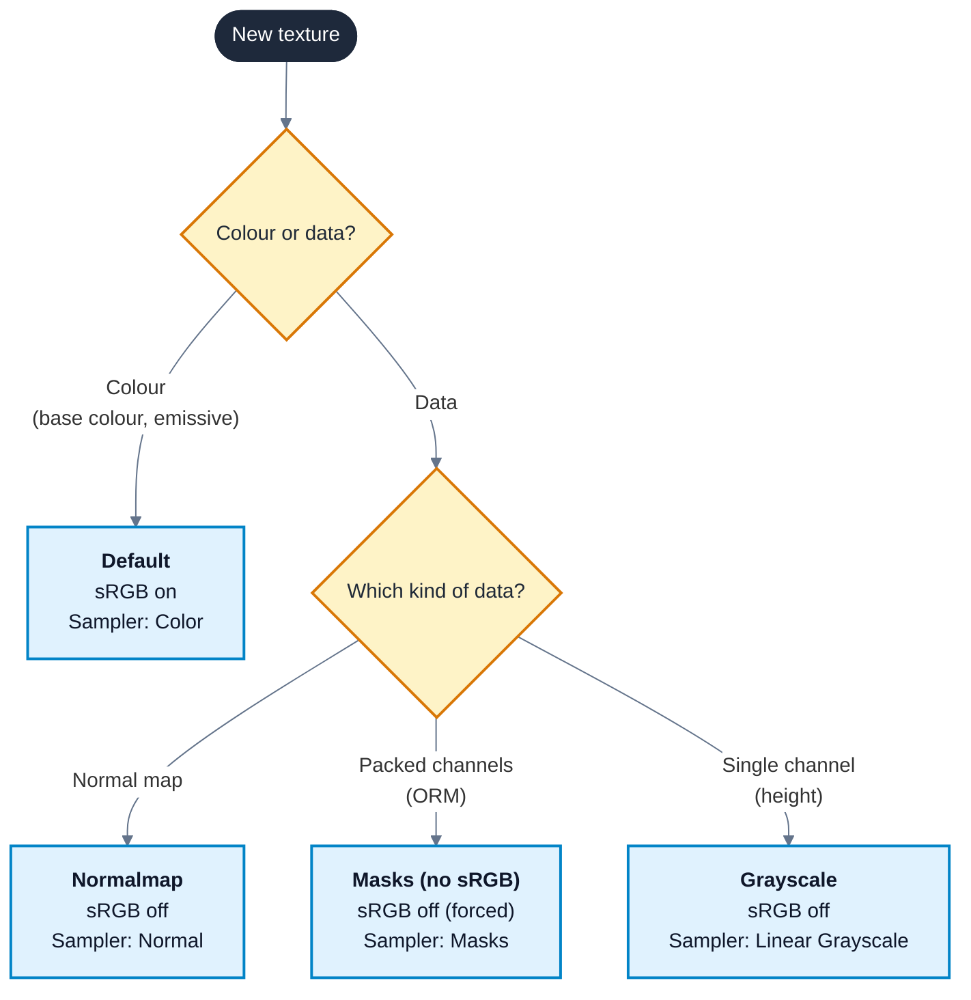
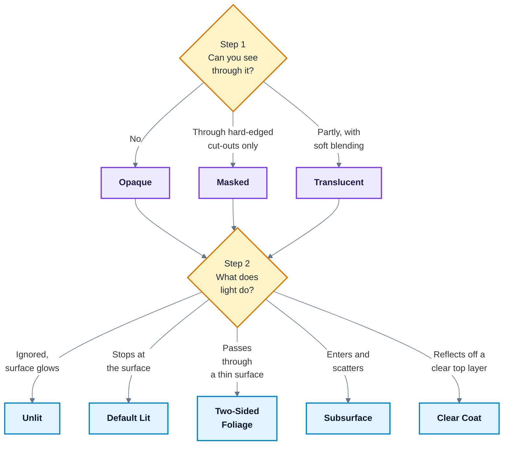

# PBR Foundations and the Material Editor

---

## 1. Key Concepts

1. **Set texture settings before you build the graph.** A wrong compression or colour space setting corrupts every material that samples the texture, and no graph can fully undo it.
2. **Colour is sRGB, data is linear.** Base colour and emissive textures store colours a person painted. Normal, roughness, metallic and AO textures store numbers, so the engine must read them unchanged.
3. **Normal maps use Normalmap compression.** Any other setting stores the vectors wrongly and the lighting tilts.
4. **Metallic is 0 or 1.** A surface is either a metal or it is not. Values in between only belong at a blend between the two, such as paint over steel.
5. **Roughness carries the look.** Two surfaces with the same base colour read as different materials when their roughness differs, so spend your time on the roughness map.
6. **Base colour holds no lighting.** Baked shadows or highlights in a base colour texture fight the real lighting and look wrong as soon as a light moves.
7. **Pack your masks.** Put AO, roughness and metallic into one ORM texture, because one texture costs one sample instead of three.
8. **Use Masked before Translucent.** Masked is far cheaper and sorts correctly. Use Translucent only when you need partial see-through.
9. **Use the simplest shading model that gives the look.** Every non-default shading model adds cost and inputs to manage.
10. **Move UVs, not meshes.** Tile, offset, pan and rotate textures in the graph with UV nodes, so one mesh serves many looks.

---

## 2. Framing Question

You download a texture set, plug every texture into the matching input on a new material, and the result looks plastic and slightly wrong. The texture set is fine. What did the engine do with your textures that you did not tell it to do?

---

## 3. What You Will Learn

| Outcome | Where |
|:---|:---|
| Explain what each PBR input controls and why the model conserves energy | 5.2, 5.3 |
| Tell colour textures from data textures, and set colour space and compression to match | 5.4, 5.5 |
| Read and use an ORM packed texture | 5.6 |
| Build and edit a graph in the Material Editor | 5.1, 5.7 |
| Choose a material domain, blend mode and shading model for a surface | 5.8, 5.9, 5.10 |
| Tile, offset, pan and rotate a texture with UV nodes | 5.11 |
| Diagnose the two most common texture setting faults by their symptoms | 6.1 |

---

## 4. Why This Matters

Every visible surface in an Unreal game is drawn by a material. Artists hand you texture sets authored for a physically based renderer, and the engine assumes you configure them the way the renderer expects. When you do not, nothing fails to compile. The game just looks cheap: metals look like plastic, rough stone looks wet, and normal-mapped detail lights from the wrong side.

These faults are the first thing a lead artist or technical artist spots in a portfolio piece. They are also the cheapest faults to fix, because each one is a setting rather than a rebuild. This week gives you the model the renderer uses, so you can predict what a setting does before you change it.

---

## 5. Core Ideas

Sections 5.1 to 5.7 are Session A. Sections 5.8 to 5.11 are Session B.

### 5.1 What a Material Is

A **material** is a graph of nodes that Unreal compiles into a **shader**, a small program the GPU runs for every pixel a surface covers. You build the graph in the **Material Editor**, which opens when you double-click a material asset in the Content Browser.

The editor has four areas you use constantly:

- **Viewport** (top left). A preview mesh using the material.
- **Details** (bottom left). Properties of the selected node, or of the material itself when nothing is selected.
- **Graph** (centre). The nodes and wires.
- **Palette** (right). A searchable list of every node. You can also right-click the graph to search.

Every graph ends at the **main material node**, the large node labelled with the material's name. Its input pins (Base Color, Metallic, Roughness and so on) are where your results go. Changes do not reach the level until you click **Apply**, because Apply triggers the shader compile.

Unreal 5.7 also includes **Substrate**, a newer material framework that replaces the fixed list of inputs and shading models with layered surface descriptions. These notes use the classic material inputs, because they are what most existing content, tutorials and documentation use, and because Substrate builds on the same PBR ideas. The demo project has Substrate turned off, so your main material node matches the screenshots. 

### 5.2 The PBR Model

**Physically based rendering (PBR)** describes a surface with a small set of measurable properties and lets the lighting model work out the result under any light. You describe what the surface is, not how it looks in one scene. That is why a PBR material looks right in daylight, at night and under a torch without changes.

| Input | Range | What it controls |
|:---|:---|:---|
| `Base Color` | RGB, 0-1 | The colour of diffuse light for non-metals, and the colour of reflections for metals |
| `Metallic` | 0 or 1 | Whether the surface is a metal (1) or a non-metal, also called a **dielectric** (0) |
| `Roughness` | 0-1 | How scattered reflections are. 0 is a mirror and 1 is fully matte |
| `Normal` | Tangent-space vector | Per-pixel surface direction, adding detail the mesh does not have |
| `Ambient Occlusion` | 0-1 | How much ambient light reaches small crevices. 1 is fully exposed |
| `Specular` | 0-1, default 0.5 | Reflectance of non-metals. Leave it at 0.5 for nearly every surface |

Leave `Specular` at its default of 0.5, which equals 4% reflectance head-on. That value suits almost every non-metal, from skin to stone. Change it only for a measured reason, such as killing reflections in a deep cavity that AO alone cannot darken.

### 5.3 Energy Conservation, Metals and Dielectrics

**Energy conservation** means a surface never reflects more light than it receives. The renderer enforces this for you, and two visible consequences follow:

- **Rough surfaces have wide, dim highlights. Smooth surfaces have small, bright highlights.** The same amount of light is spread over a larger or smaller area.
- **Light either reflects off the surface or enters it.** Light that enters a dielectric scatters and leaves as the diffuse colour. Metals absorb light that enters, so a metal has no diffuse colour at all. Its base colour tints its reflections instead.

This is why `Metallic` is a switch rather than a slider. At 1, `Base Color` becomes reflection colour. At 0, `Base Color` becomes diffuse colour and reflections are white. A value of 0.5 describes a surface that is half each, which no clean real material is.

Keep base colour in a plausible range, because real surfaces are neither pitch black nor pure white:

| Surface | Base colour (sRGB, 0-255) |
|:---|:---|
| Darkest dielectric (charcoal) | About 30-50 |
| Brightest dielectric (fresh snow) | About 240 |
| Metals | About 180-255 |

A base colour below about 30 or a metal below about 180 makes the lighting model produce surfaces too dark to exist, and they look like holes in the scene.

### 5.4 Linear and sRGB Colour

Monitors and image files store colour in **sRGB**, a non-linear encoding that spends more of its values on dark tones because eyes are more sensitive there. Lighting maths needs **linear** values, where doubling a number doubles the light.

When a texture has the **sRGB** checkbox ticked, the engine converts it from sRGB to linear as it samples. That conversion is correct for colour and wrong for data:

- **Colour textures** (base colour, emissive) were painted by eye on an sRGB monitor. Leave sRGB ticked.
- **Data textures** (normal, roughness, metallic, AO, masks) store numbers. Untick sRGB, so a stored 0.5 arrives as 0.5.

If a roughness map is left as sRGB, a stored 0.5 arrives as about 0.21. Every surface using it turns glossier than the artist intended, with no error to warn you.

### 5.5 Texture Compression Settings

Open any texture asset and the Details panel shows **Compression Settings**. This chooses the GPU format the texture is stored in, and it also decides how the engine reads the texture back. Use these four settings for nearly everything you import:

| Compression setting | Use for | sRGB | Why |
|:---|:---|:---|:---|
| `Default (DXT1/5, BC1/3 on DX11)` | Base colour, emissive | On | General colour compression with optional alpha |
| `Normalmap (DXT5, BC5 on DX11)` | Normal maps | Off | Stores only X and Y at high quality and rebuilds Z, and remaps 0-1 to -1 to 1 on sampling |
| `Masks (no sRGB)` | ORM and other packed data | Off (forced) | Keeps each channel independent and linear |
| `Grayscale (G8/16, RGB8 sRGB)` | Single-channel data such as a height map | Off for data | Stores one channel, so it costs less memory than RGB |

<!-- VERIFY: Confirm the four Compression Settings labels match the UE 5.7 dropdown text exactly. -->

The **Sampler Type** on a `Texture Sample` node must agree with the texture. Unreal sets it when you first assign a texture. If you later change the texture's settings, the node shows an error and the material refuses to compile until you set the matching sampler type (`Color`, `Normal`, `Masks`, `Linear Color` and so on).

Follow this chart every time you import a texture. Each path ends at the compression setting, the sRGB setting and the sampler type that belong together.

<!-- VERIFY: Confirm a Grayscale texture with sRGB off takes the "Linear Grayscale" sampler type in UE 5.7. -->

Unreal often recognises normal maps on import and sets Normalmap compression for you, but not always. Check every normal map by opening it, because a missed one is the most common material fault there is.

### 5.6 ORM Packing

A texture has up to four channels (R, G, B, A). Roughness, metallic and AO each need only one. **Channel packing** puts three greyscale maps into one texture, so the material does one texture sample instead of three, and the texture uses one sampler slot instead of three.

The common layout is **ORM**:

| Channel | Map |
|:---|:---|
| R | Ambient **O**cclusion |
| G | **R**oughness |
| B | **M**etallic |

Set an ORM texture to `Masks (no sRGB)`, because all three channels are data. In the graph, wire each channel to its own input:

1. `TextureSample (T_Name_ORM).R -> Ambient Occlusion`
2. `TextureSample (T_Name_ORM).G -> Roughness`
3. `TextureSample (T_Name_ORM).B -> Metallic`

Some sources pack in a different order, for example ARM or MRA. Check the texture's documentation or open each channel in the Texture Editor before wiring, because a swapped channel turns roughness into metallic.

### 5.7 Graph Basics

Nodes have **output pins** on the right and **input pins** on the left. Drag from an output to an input to connect them. Values flow left to right and end at the main material node.

Values have a width. A `Constant` is one float, a `Constant3Vector` is three (RGB). When you multiply a three-wide value by a one-wide value, Unreal applies the single float to every channel. Mixing other widths, such as two-wide with three-wide, gives a compile error, which is the most common error you will see this block.

Learn these shortcuts now, because you will place these nodes in every lab. Hold the key and left-click the graph:

| Key | Node | Use |
|:---|:---|:---|
| `1` | `Constant` | A single number |
| `3` | `Constant3Vector` | A colour |
| `T` | `Texture Sample` | Read a texture |
| `U` | `TextureCoordinate` | UV coordinates |
| `M` | `Multiply` | Scale or tint a value |
| `A` | `Add` | Offset a value |
| `L` | `Lerp` (`LinearInterpolate`) | Blend between two values by an alpha |
| `S` | `ScalarParameter` | A number you can change in an instance |
| `V` | `VectorParameter` | A colour you can change in an instance |

Right-click any node and choose **Start Previewing Node** to show that node's output on the preview mesh. This is how you debug a graph: preview each step until you find the one that is wrong.

### 5.8 Material Domains

**Material Domain**, in the material's Details panel, tells Unreal what kind of thing the material draws. It changes which inputs the main material node offers.

| Domain | Draws | Covered in |
|:---|:---|:---|
| `Surface` | Meshes. The default, and the domain for everything this week | Week 1 |
| `Deferred Decal` | Projections onto other surfaces, such as stains | Week 3 |
| `Post Process` | Full-screen effects after the scene renders | Weeks 3 and 5 |
| `User Interface` | UMG widgets | - |
| `Light Function` | Patterns projected by a light | - |

### 5.9 Blend Modes

**Blend Mode** decides how the material combines with what is already drawn behind it.

| Blend mode | Input used | Behaviour | Cost |
|:---|:---|:---|:---|
| `Opaque` | - | Fully solid. Hides everything behind it | Cheapest |
| `Masked` | `Opacity Mask` | Each pixel is fully solid or fully cut out, decided by comparing the mask with **Opacity Mask Clip Value** (default 0.3333) | Low |
| `Translucent` | `Opacity` | Pixels are partly see-through and blend with the scene | Highest |

Masked suits leaves, chain-link fences and torn cloth, where edges are hard. It stays in the opaque pass, so it gets full lighting and sorts correctly.

Translucent suits glass, water and smoke. It costs more for three reasons. Every translucent layer is drawn on top of the last, so overlapping layers multiply the work. Translucent surfaces do not write depth, so they can sort wrongly against each other. They are also lit by a separate, simpler path than opaque surfaces, controlled by **Lighting Mode**.

### 5.10 Shading Models

**Shading Model** chooses the lighting maths. Changing it adds or removes inputs on the main material node.

| Shading model | Use for | Extra inputs |
|:---|:---|:---|
| `Default Lit` | Almost every surface | - |
| `Unlit` | Emissive-only surfaces, UI, effects that ignore light | Only `Emissive Color` matters |
| `Subsurface` | Wax, jade, thin plastics, where light scatters inside | `Subsurface Color`, `Opacity` (scatter strength) |
| `Two Sided Foliage` | Leaves, where light passes through from behind | `Subsurface Color` |
| `Clear Coat` | Car paint, varnished wood, a clear layer on top of a base | `Clear Coat`, `Clear Coat Roughness` |

Pick by asking what the light does in the real surface. If light stops at the surface, use `Default Lit`. If light passes through a thin surface, use `Two Sided Foliage`. If light enters and scatters, use `Subsurface`. If there is a second transparent layer, use `Clear Coat`.

Choose the blend mode first and the shading model second, because the blend mode limits what the shading model has to do. This chart combines 5.9 and 5.10.

### 5.11 UV Manipulation

**UVs** are 2D coordinates on the mesh that tell a texture where to land. `U` runs across and `V` runs down, from 0 to 1 over one copy of the texture. The `TextureCoordinate` node (shown as `TexCoord[0]` in the graph) outputs the mesh's UVs, and you change them before they reach a `Texture Sample`'s `UVs` input.

| Operation | Graph | Effect |
|:---|:---|:---|
| Tiling | Set **U Tiling** and **V Tiling** on `TextureCoordinate`, or `TextureCoordinate -> Multiply.A`, `Constant2Vector -> Multiply.B` | Values above 1 repeat the texture more often |
| Offset | `TextureCoordinate -> Add.A`, `Constant2Vector -> Add.B` | Slides the texture without animating |
| Panning | `TextureCoordinate -> Panner.Coordinate`, then set **Speed X** and **Speed Y** | Slides the texture continuously over time |
| Rotation | `TextureCoordinate -> Rotator.Coordinate`, then set **Center X**, **Center Y** and **Speed** | Spins the texture around a centre point |

`Panner` and `Rotator` read engine time internally, so you do not wire a `Time` node unless you want to control the time value yourself. For a fixed rotation instead of a spin, set **Speed** on `Rotator` to 1 and wire a `Constant` into its `Time` input. The rotator multiplies time by speed, so the constant becomes the angle. <!-- VERIFY: Confirm the Rotator angle is Time x Speed and whether the unit is radians, so Exercise 5 can state the value for 45 degrees. -->

---

## 6. Worked Example

This is the in-class demo. Open `DEMO_MAP_PATH` in the demo project and create a folder `/Game/Student/Week01` for your own assets, so you do not edit shared content.

Name assets with the standard prefixes and suffixes: `M_` for materials, `T_` for textures, and `_BC`, `_N` and `_ORM` for base colour, normal and ORM. Consistent names let you check a texture's type at a glance in the Content Browser.

### 6.1 Part A - A Surface From a Texture Set (Session A)

The texture set is in `TEXTURE_SET_PATH` and contains `T_..._BC`, `T_..._N` and `T_..._ORM`.

**Step 1 - Check the textures.** Open each texture and set:

| Texture | Compression Settings | sRGB |
|:---|:---|:---|
| `_BC` | `Default (DXT1/5, BC1/3 on DX11)` | On |
| `_N` | `Normalmap (DXT5, BC5 on DX11)` | Off |
| `_ORM` | `Masks (no sRGB)` | Off |

Save each texture after changing it.

**Step 2 - Create the material.** Right-click in `/Game/Student/Week01` and choose **Material**. Name it `M_Week01_Surface` and open it.

**Step 3 - Build the graph.** Drag all three textures from the Content Browser into the graph. Each becomes a `Texture Sample` node with the right sampler type. Wire:

1. `TextureSample (_BC).RGB -> Base Color`
2. `TextureSample (_N).RGB -> Normal`
3. `TextureSample (_ORM).R -> Ambient Occlusion`
4. `TextureSample (_ORM).G -> Roughness`
5. `TextureSample (_ORM).B -> Metallic`

Click **Apply**, then save. Drag the material onto a mesh in the level and rotate the directional light. The highlights move across the surface detail, which shows the normal map is working.

**Step 4 - Break the normal map.** Open `_N`, set Compression Settings to `Default (DXT1/5, BC1/3 on DX11)`, tick sRGB and save. Return to the material:

- The normal `Texture Sample` shows a sampler type error and the material does not compile.
- Change its **Sampler Type** to `Color` and click Apply. The material now compiles, but the whole surface is lit as if tilted towards one corner, and the detail looks smeared.

The cause is that `Color` sampling returns 0-1 values. A flat normal stored as (0.5, 0.5, 1) should arrive as (0, 0, 1), pointing straight out. Instead the remap to -1 to 1 never happens, and the sRGB conversion shrinks the mid values, so it arrives as about (0.21, 0.21, 1) and every pixel leans sideways. Restore the texture to `Normalmap` and the sampler type to `Normal`.

**Step 5 - Break the ORM.** Open `_ORM`, set Compression Settings to `Default (DXT1/5, BC1/3 on DX11)`, tick sRGB and save. Fix the sampler type error by choosing `Color`, then apply.

The surface turns glossier and its crevices darker. The sRGB conversion pushes every mid value down, so a roughness of 0.5 arrives as about 0.21, and AO darkens in the same way. Nothing errors, which is why this fault ships. Restore `Masks (no sRGB)` and set the sampler type back to `Masks`.

**Step 6 - Check with buffer views.** In the level viewport, open **View Mode > Buffer Visualization** and pick **Roughness**, then **Metallic**. Metals should show white in Metallic and non-metals black. Grey in the Metallic buffer means a channel is wired wrongly or the texture is set as sRGB. <!-- VERIFY: Confirm the UE 5.7 viewport menu path and labels for Buffer Visualization Roughness and Metallic. -->

### 6.2 Part B - Masked, Panning and Refractive Materials (Session B)

**Step 7 - Masked foliage card.** Create `M_Week01_Foliage`. With nothing selected, set in Details:

- **Blend Mode:** `Masked`
- **Shading Model:** `Two Sided Foliage`
- **Two Sided:** ticked, so both faces of the card render

Drag in the leaf texture from `FOLIAGE_TEXTURE_PATH`, which has the leaf shape in its alpha channel. Wire:

1. `TextureSample (leaf).RGB -> Base Color`
2. `TextureSample (leaf).A -> Opacity Mask`
3. `Constant3Vector` (a mid green, about 0.3, 0.5, 0.1) `-> Subsurface Color`
4. `Constant` (0.6) `-> Roughness`

Apply it to a plane in the level and put a light behind the plane. The leaf edges are hard, the background shows through the cut-outs, and the leaf glows green where light passes through. Raise **Opacity Mask Clip Value** and watch the leaf edges eat inwards.

**Step 8 - Panning emissive surface.** Create `M_Week01_Emissive`. Wire:

1. `TextureCoordinate` with **U Tiling** 4 and **V Tiling** 1 `-> Panner.Coordinate`
2. On `Panner`, set **Speed X** to 0.2 and **Speed Y** to 0
3. `Panner -> TextureSample (EMISSIVE_TEXTURE_PATH).UVs`
4. `TextureSample.RGB -> Multiply.A`
5. `ScalarParameter` named `EmissiveStrength`, default 10, `-> Multiply.B`
6. `Multiply -> Emissive Color`
7. `Constant3Vector` (black) `-> Base Color`

Apply it to a long mesh. The pattern scrolls along it and glows. Raise `EmissiveStrength` above 1 and bright areas bloom, because emissive values above 1 are brighter than white. Swap `Panner` for `Rotator` to show the same texture spinning instead.

**Step 9 - Refractive glass.** Create `M_Week01_Glass`. Set in Details:

- **Blend Mode:** `Translucent`
- **Lighting Mode:** `Surface ForwardShading`, so the glass gets sharp specular highlights rather than the soft volume lighting translucency uses by default <!-- VERIFY: Confirm the UE 5.7 Lighting Mode label "Surface ForwardShading" and that it is under the Translucency category. -->
- **Refraction Method:** `Index Of Refraction` <!-- VERIFY: Confirm the UE 5.7 property label "Refraction Method" and its option text "Index Of Refraction". -->

Wire:

1. `Constant3Vector` (near black, about 0.02, 0.02, 0.02) `-> Base Color`
2. `Constant` (0.05) `-> Roughness`
3. `Constant` (0.1) `-> Opacity`
4. `Constant` (1.5) `-> Refraction`

Apply it to a sphere in front of a detailed background. The background bends through the sphere and flips near the edges, as it does through a real glass ball. Set `Refraction` to 1.0 and the bending disappears, because an index of 1.0 is air. Index Of Refraction mode suits small curved objects like this. It gives artefacts on large flat surfaces such as windows and water, which you meet again in Week 5.

---

## 7. Common Pitfalls

| Pitfall | Symptom | Fix |
|:---|:---|:---|
| Normal map not set to Normalmap compression | Whole surface lit as if tilted, detail smeared, or a sampler type error | Set `Normalmap (DXT5, BC5 on DX11)`, untick sRGB, set Sampler Type to `Normal` |
| ORM or mask texture left as sRGB | Surface too glossy, crevices too dark, no error | Set `Masks (no sRGB)`, set Sampler Type to `Masks` |
| ORM channels swapped | Rough areas look metallic, or metal looks matte | Check the source's channel order and rewire R, G and B |
| Sampler type error after changing a texture | Red error on the `Texture Sample`, material will not compile | Set the node's Sampler Type to match the texture's new settings |
| Metallic between 0 and 1 across a whole surface | Surface looks grey and dirty, neither metal nor plastic | Use 0 or 1, and only blend at true transitions such as worn paint |
| Base colour too dark | Surface looks like a hole in the scene under strong light | Keep dielectrics above about 30 sRGB and metals above about 180 |
| Width mismatch | Compile error naming two different float widths | Use `ComponentMask` or `Append` to make both widths match |
| Changes not visible in the level | Level still shows the old look | Click Apply, then save |
| Masked card shows only one side | Leaves vanish when viewed from behind | Tick **Two Sided** |
| Translucent objects sort wrongly | One glass object draws over another that is in front of it | Reduce overlapping translucency, or use Masked where hard edges are acceptable |

---

## 8. Exercises

1. Take any CC0 texture set with separate AO, roughness and metallic maps. Describe which channel of an ORM texture each map goes to, and the compression and sRGB settings for every texture in the set. Give a reason for each setting.
2. A roughness texture stores 0.5 in every pixel. State the roughness the material receives with sRGB on and with sRGB off, and describe how the two surfaces differ under a single light.
3. Build a material with no textures that looks like brushed gold, then change only roughness and metallic to make it look like yellow plastic. Record the values you used.
4. For each of these surfaces, choose a blend mode and a shading model and give a reason: a chain-link fence, a candle, a car body, a neon sign, a frosted shower screen.
5. Build a material that tiles a texture 8 times across and 2 times down, and rotates it by a fixed 45 degrees without spinning.

---

## 9. Reflective Questions

1. Why does a PBR material look correct in lighting conditions the artist never tested, and what kind of texture content breaks that guarantee?
2. Texture setting faults rarely produce errors. What checks would you build into your own workflow so you catch them before anyone else does?
3. Masked and Translucent can both make a leaf. When would the extra cost of Translucent be worth paying?
4. Substrate replaces fixed shading models with layered surfaces. Which of this week's shading models do you think it will most change, and why?

---

## 10. How This Builds

- **Lab 1** (`lab_1_pbr_surface_materials`) applies Session A. You build a dielectric, a metal and a roughness variant, each matched to a reference photo.
- **Lab 2** (`lab_2_blend_modes_and_shading_models`) applies Session B. You build one material per blend mode and one using a non-default shading model.
- **Week 2** turns this week's separate materials into one master material with parameters and switches, and adds material functions and layered blending.
- **Week 3** uses the `Deferred Decal` and `Post Process` domains, and measures the cost differences between blend modes that this week only described.
- **Week 5** returns to refraction and Fresnel to build water, where Index Of Refraction mode no longer suits the surface.

---

## 11. Glossary

| Term | Meaning |
|:---|:---|
| **Blend Mode** | How a material combines with what is drawn behind it: `Opaque`, `Masked` or `Translucent` |
| **Channel packing** | Storing several greyscale maps in the separate channels of one texture |
| **Dielectric** | A non-metal. Has diffuse colour and white reflections |
| **Energy conservation** | The rule that a surface never reflects more light than it receives |
| **Linear** | A colour encoding where values are proportional to light intensity |
| **Main material node** | The node every graph ends at, holding the inputs such as `Base Color` and `Roughness` |
| **Material** | A node graph Unreal compiles into a shader |
| **Material Domain** | What kind of thing a material draws, such as `Surface` or `Post Process` |
| **Material Editor** | The Unreal editor window for building material graphs |
| **ORM** | A packed texture with AO in R, roughness in G and metallic in B |
| **PBR** | Physically based rendering. Describing surfaces by measurable properties so they light correctly anywhere |
| **Sampler Type** | The `Texture Sample` setting that must match how the texture is stored |
| **Shader** | A program the GPU runs to draw a surface |
| **Shading Model** | The lighting maths a material uses, such as `Default Lit` or `Clear Coat` |
| **sRGB** | A non-linear colour encoding used by monitors and image files |
| **Substrate** | Unreal's newer material framework, built from layered surface descriptions |
| **UVs** | 2D coordinates on a mesh that place a texture |

---

