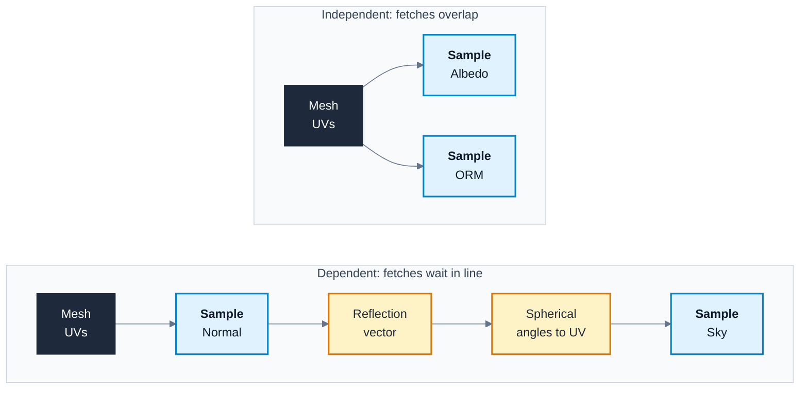

# Texture Packing, Spherical Coordinates and the Cost of a Lookup

---

## 1. Key Concepts

1. **A texture lookup is the most expensive thing most materials do.** Arithmetic is cheap. Fetching texels from memory is slow, so count your samples before you count your nodes.
2. **One sample returns four channels.** Reading R alone costs the same as reading RGBA, so put unrelated greyscale maps into the channels of one texture.
3. **Compression format decides channel quality.** In BC1 the green channel gets 6 bits and red and blue get 5, so put the map that needs the most precision in green.
4. **Never pack colour with data.** sRGB is a per-texture setting, so a texture cannot hold an sRGB colour and a linear mask at once.
5. **A unit direction has two degrees of freedom.** Two numbers are enough to store it, which is why a normal map needs only two channels.
6. **Spherical coordinates turn a direction into two angles, and two angles into a UV.** That is how a flat image wraps a sky around the world.
7. **Every mapping from a sphere to a square has a cost.** Lat-long mapping pinches at the poles and has a seam. Choose the mapping knowing where its errors go.
8. **Angles cannot be filtered.** Averaging 359 degrees and 1 degree gives 180 degrees. Store directions in a form that blends safely.
9. **A dependent lookup waits for the one before it.** When a sample's UVs come from another sample, the two fetches run in sequence, not in parallel.
10. **Measure before and after.** The material Stats panel shows sampler and instruction counts, so every packing decision can be checked in seconds.

---

## 2. Framing Question

Your material samples five textures. You pack three of them into one ORM texture and the material gets cheaper. Then you add a reflection that samples a sky texture using the per-pixel normal, and the material gets noticeably more expensive, even though you added only one sample. Why does that one sample cost more than the two you removed?

---

## 3. What You Will Learn

| Outcome | Where |
|:---|:---|
| Explain what a texture lookup costs and why it outweighs arithmetic | 5.1 |
| Calculate texture memory for a block compression format and compare packed with unpacked sets | 5.2 |
| Choose a channel layout for packed data based on per-channel precision | 5.3 |
| Recognise and avoid the per-material sampler limit | 5.4 |
| Convert between spherical and Cartesian coordinates in Unreal's axes | 5.5 |
| Map a direction to a lat-long UV and predict pole pinching and the seam | 5.6 |
| Compare ways of storing a normal in two channels | 5.7 |
| Identify dependent texture lookups and explain their cost | 5.8 |

---

## 4. Why This Matters

Texture memory and texture bandwidth are the budgets that run out first on most games, and on consoles and mobile they run out early. A level with 200 materials, each wasting two samples and 20 MB of unpacked masks, is a level that streams in blurry textures and misses its frame rate.

Spherical coordinates look like maths for its own sake until you meet them in a material. They are behind every sky sphere, every lat-long reflection, every normal map stored in two channels, and every effect that turns a direction into a texture coordinate. Each of those also creates a dependent lookup, which is the most common reason a material that looks simple turns out to be slow.

---

## 5. Core Ideas

This is extra reading for Week 2, not delivered in class. Read sections 5.1 to 5.4 (texture packing and cost) first, then 5.5 to 5.8 (spherical coordinates and dependent lookups).

### 5.1 What a Texture Lookup Costs

When a `Texture Sample` node runs, the GPU does far more than read one value:

1. It works out which mip level to use, from how fast the UVs change between neighbouring pixels.
2. It reads texels from memory: 8 for trilinear filtering (4 from each of two mips), and more with anisotropic filtering.
3. It decompresses the blocks those texels sit in.
4. It blends the texels together and returns four channels.

Steps 3 and 4 run in dedicated hardware and are fast. Step 2 is the problem. If the texels are already in the texture cache, the read is quick. If they are not, the GPU waits hundreds of cycles for video memory. During that wait it can run other pixels, but only if it has enough of them in flight.

A `Multiply` costs one instruction. A cache miss costs the time of hundreds. That is why the first question to ask about an expensive material is how many textures it samples, and how.

The [Texel Path Explorer](../interactive/texel_path_explorer.html) follows one sample from shader to memory and back, and shows when the cache hits and misses.

### 5.2 Block Compression and What Packing Buys

GPU textures are stored in **block compression (BC)** formats. Each format splits the image into 4 x 4 pixel blocks and stores every block in a fixed number of bits. The GPU decompresses blocks on the fly, so a compressed texture costs less memory and less bandwidth on every sample.

| Format | Channels | Bits per pixel | Unreal uses it for |
|:---|:---|:---|:---|
| Uncompressed RGBA8 | 4 | 32 | `UserInterface2D (RGBA)` |
| G8 | 1 | 8 | `Grayscale (G8/16, RGB8 sRGB)` |
| BC1 | 3 (RGB) | 4 | `Default` and `Masks` without alpha |
| BC3 | 4 (RGBA) | 8 | `Default` and `Masks` with alpha |
| BC4 | 1 | 4 | `Alpha (no sRGB, BC4 on DX11)` |
| BC5 | 2 | 8 | `Normalmap (DXT5, BC5 on DX11)` |
| BC7 | 3 or 4 | 8 | `BC7 (DX11, optional A)` |

<!-- VERIFY: Confirm UE 5.7 Masks compression selects BC1 for textures without alpha and BC3 for textures with alpha on desktop, and that Grayscale stores uncompressed G8. -->

Work out the memory for a 2048 x 2048 texture by multiplying pixels by bits, then adding a third for the mip chain:

```text
2048 x 2048 = 4,194,304 pixels
BC1:  4,194,304 x 4 bits = 2 MiB,  x 4/3 for mips = 2.7 MiB
G8:   4,194,304 x 8 bits = 4 MiB,  x 4/3 for mips = 5.3 MiB
```

Now compare two ways of storing AO, roughness and metallic at that size:

| Layout | Textures | Samples | Memory |
|:---|:---|:---|:---|
| Three `Grayscale` textures | 3 | 3 | 16 MiB |
| One ORM texture with `Masks` (BC1) | 1 | 1 | 2.7 MiB |

Packing cuts the memory by a factor of six and the samples by a factor of three, with no visible loss for most surfaces. This is why texture sets ship ORM textures and why Notes 01 told you to use them.

### 5.3 Choosing a Channel Layout

BC1 does not store each channel separately. It stores two endpoint colours per block in **RGB565** (5 bits red, 6 bits green, 5 bits blue) and picks each pixel from a line between them. Two consequences follow:

- **Green is the most precise channel.** Put the map whose small steps matter most in green. That is why ORM puts roughness in G: banding in roughness shows as stepped highlights, while banding in AO or metallic rarely shows.
- **Channels interfere.** A block has one line through colour space, so detail in one channel can reduce accuracy in the others. Packing two busy, unrelated maps into one BC1 texture can produce blocky artefacts that neither map has alone.

Follow these rules when you pack your own textures:

| Rule | Reason |
|:---|:---|
| Pack only linear data together | sRGB is set per texture, so a colour channel and a data channel cannot share one |
| Put the most sensitive map in G | G has 6 bits in BC1, R and B have 5 |
| Pack maps that share a resolution and UV layout | Every channel is sampled at the same UV and mip, so a map that needs higher resolution forces the whole texture up |
| Use alpha only when you need a fourth map | An alpha channel moves BC1 (4 bits per pixel) to BC3 (8 bits per pixel), doubling memory |
| Record the layout in the name | `_ORM` tells everyone which channel holds what, so nobody wires roughness to metallic |

### 5.4 The Sampler Limit

A **sampler** is the hardware state that says how to filter and wrap a texture. On Direct3D 11 and 12 class hardware a single shader can use at most 16 samplers. A material that samples 17 textures with their own samplers fails to compile.

Unreal works around this with **Sampler Source** on the `Texture Sample` node. The default, `From texture asset`, uses a sampler per texture. Setting it to `Shared: Wrap` or `Shared: Clamp` makes the sample use a shared sampler that does not count towards the 16. <!-- VERIFY: Confirm the UE 5.7 Sampler Source property name and its options "From texture asset", "Shared: Wrap" and "Shared: Clamp". -->

Shared samplers remove the compile error, but not the cost: every sample still fetches texels. Packing reduces both, so pack first and share samplers second.

### 5.5 Spherical and Cartesian Coordinates

A point in 3D can be written in **Cartesian coordinates** `(x, y, z)` or in **spherical coordinates** `(r, theta, phi)`:

| Symbol | Name | Range | Meaning |
|:---|:---|:---|:---|
| `r` | Radius | 0 and up | Distance from the origin. Directions and normals use `r = 1` |
| `theta` | Polar angle | 0 to 180 degrees | Angle down from +Z. 0 is straight up, 90 is the horizon |
| `phi` | Azimuth | 0 to 360 degrees | Angle around Z, from +X towards +Y |

These notes use **Unreal's axes**: X forward, Y right, Z up, left-handed. Most maths texts use Y up or a right-handed system, so check the axes before you copy a formula.

**Spherical to Cartesian.** Drop the point straight down onto the XY plane. Its shadow lies `r * sin(theta)` from the origin, and `phi` spins that shadow around Z like 2D polar coordinates. Its height is `r * cos(theta)`:

```text
x = r * sin(theta) * cos(phi)
y = r * sin(theta) * sin(phi)
z = r * cos(theta)
```

**Cartesian to spherical.** Reverse each step:

```text
r     = sqrt(x*x + y*y + z*z)
theta = acos(z / r)
phi   = atan2(y, x)        returns -180 to 180 degrees; add 360 to negatives
```

A unit direction has `r = 1`, so it needs only `theta` and `phi`. Three Cartesian numbers carry two numbers' worth of information. That fact is behind both lat-long mapping and two-channel normal maps.

Open the [Spherical Coordinates Explorer](../interactive/spherical_coordinates_explorer.html) in a browser from your local copy of the repository. Station 1 shows these formulas with the current numbers substituted as you move the sliders. Try the `(1,1,1)` preset and check the result against the formulas by hand.

### 5.6 Lat-Long Mapping

Divide each angle by its range and you have a UV coordinate:

```text
u = phi / 360 degrees      (0 to 1 around the horizon)
v = theta / 180 degrees    (0 at the top, 1 at the bottom)
```

This is **lat-long** or **equirectangular** mapping, the layout of most sky and HDRI images. Give it any direction, such as the view direction or a reflection vector, and it returns where to sample the sky texture. Station 2 of the explorer shows the same point on the globe and on the flat texture.

Lat-long mapping has two flaws you must design around:

- **Pole pinching.** Every row of the texture has the same number of texels, but the circle each row wraps around shrinks to a point at the poles. At `theta = 30` degrees a texel is half as wide as at the horizon. Near the poles, detail is crushed and the GPU reads many texels for one pixel, which wastes bandwidth. Sky images are authored with plain sky at the top for this reason.
- **The seam.** At `phi = 0` the `u` value jumps from 1 back to 0. The GPU picks a mip from how fast `u` changes between neighbouring pixels. At the seam it sees a jump of nearly 1, picks the smallest mip, and draws a thin line of blurred colour. Station 2's checker shows the jump.

### 5.7 Packing a Direction Into Two Channels

A tangent-space normal is a unit direction that always points out of the surface (`z >= 0`). Since it has two degrees of freedom, two channels can store it. Station 3 of the explorer compares three schemes by angular error at every direction:

| Scheme | Stores | Decode | Filters safely | Notes |
|:---|:---|:---|:---|:---|
| Spherical | `theta / 90`, `phi / 360` | `sin`, `cos` | No | Angles wrap, so filtering and mips break it |
| XY, derive Z | `x`, `y` | `z = sqrt(1 - x*x - y*y)` | Yes | Unreal's default. Error grows near the horizon |
| Octahedral | `x`, `y` after folding onto a diamond | `abs`, normalise | Yes | Most even error. Common in engines for G-buffer normals |

The spherical scheme fails for a reason that applies to any angle stored in a texture. Two neighbouring texels hold `phi` values of 358 and 2 degrees. Bilinear filtering averages them to 180 degrees, which decodes to a normal pointing the opposite way. Mip generation averages texels in the same way, so the fault shows at a distance even without filtering.

Unreal uses the XY scheme. A texture with `Normalmap` compression is stored in BC5, which keeps two independent channels at full 8-bit quality. When the `Texture Sample` node's Sampler Type is `Normal`, the engine rebuilds Z from X and Y for you. When you store X and Y yourself, for example in two channels of a packed mask texture, the `DeriveNormalZ` node performs the same rebuild. <!-- VERIFY: Confirm a UE 5.7 Texture Sample with Sampler Type Normal reconstructs Z automatically for BC5 normal maps, and the DeriveNormalZ node's input name. -->

### 5.8 Dependent Texture Lookups

A **dependent texture lookup** is a sample whose UVs are computed from the result of another texture sample. Common examples:

- A reflection that samples a sky texture with a reflection vector built from the per-pixel normal map.
- A distortion or flow map, where one texture's value offsets the UVs of another.
- Parallax and bump offset, where a height texture shifts the UVs used by every other texture.

A lookup that uses the mesh UVs, even after a `Panner` or `Multiply`, is not dependent, because its UVs are known before any sample runs.



Dependent lookups cost more than their sample count suggests, for three reasons:

| Cost | Why it happens |
|:---|:---|
| **Latency adds up** | Independent fetches can all be in flight at once, so the pixel waits for the slowest one. A dependent fetch cannot start until the one before it returns, so the pixel waits for both in turn |
| **Cache misses rise** | Mesh UVs move smoothly across the screen, so neighbouring pixels read neighbouring texels. Computed UVs, such as a reflection off a bumpy surface, jump around, so neighbouring pixels read texels far apart and miss the cache |
| **Mip selection breaks** | The GPU picks mips from how fast UVs change between pixels. Computed UVs can change abruptly, as at the lat-long seam, and select the wrong mip |

The GPU hides latency by switching to other pixels while one waits. Long chains of dependent lookups use more registers, which leaves room for fewer pixels in flight, so there is less work to switch to. On older mobile GPUs the gap is wider still, because independent lookups could be fetched before the pixel shader even started.

Dependent lookups are not wrong. Reflections, distortion and parallax all need them. Use them where the effect needs them, keep chains short, and do not stack several on one surface without measuring.

---

## 6. Worked Example

Work through this example in the demo project after reading section 5. Create a folder `/Game/Student/Week02` for your own assets.

### 6.1 Part A - Measuring What Packing Saves

The texture set in `unreal/Content/Textures/PACKING_SET_NAME` contains both separate maps (`_AO`, `_Roughness`, `_Metallic`) and the same data packed as `_ORM`.

**Step 1 - Compare the textures.** Open `_Roughness` and `_ORM` side by side. In each Texture Editor, read the format and resource size in the Details panel or the info overlay in the viewport. Note both values for all four textures. <!-- VERIFY: Confirm where the UE 5.7 Texture Editor shows the compressed format and resource size. -->

**Step 2 - Build the separate version.** Create `M_Week02_Separate`. Wire:

1. `TextureSample (_AO).R -> Ambient Occlusion`
2. `TextureSample (_Roughness).R -> Roughness`
3. `TextureSample (_Metallic).R -> Metallic`

**Step 3 - Build the packed version.** Create `M_Week02_Packed`. Wire:

1. `TextureSample (_ORM).R -> Ambient Occlusion`
2. `TextureSample (_ORM).G -> Roughness`
3. `TextureSample (_ORM).B -> Metallic`

**Step 4 - Read the Stats.** In each material, click **Stats** in the toolbar. Compare the instruction counts and the texture sampler counts. The packed version uses one sampler instead of three for an identical result in the preview. Its instruction count changes little, because the saving is in memory traffic, which the instruction count does not show. Week 3 measures that with GPU profiling. <!-- VERIFY: Confirm the UE 5.7 Material Editor Stats panel lists texture sampler usage as "Texture samplers: n/16" and pixel shader instruction counts. -->

### 6.2 Part B - A Dependent Lookup Through Spherical Coordinates

You build a material that reflects a lat-long sky image using the per-pixel normal. Every stage of the dependent chain in 5.8 appears in this graph.

The sky image is `unreal/Content/Textures/SKY_TEXTURE_NAME`, a lat-long image imported as a 2D texture with `HDR (RGBA16F, no sRGB)` compression. <!-- VERIFY: Confirm the sky asset is a Texture2D rather than a TextureCube, because Unreal imports lat-long .hdr files as cube maps by default. -->

**Step 5 - Build the direction.** Create `M_Week02_SkyReflect`. Wire:

1. `TextureSample (WOOD_SET_NAME _Normal).RGB -> Normal`
2. Add a `ReflectionVectorWS` node. It returns the world-space reflection of the view direction about the per-pixel normal, so it depends on the normal map sample. <!-- VERIFY: Confirm ReflectionVectorWS uses the per-pixel normal from the material's Normal input in UE 5.7. -->
3. `ReflectionVectorWS -> ComponentMask (R)`, `ComponentMask (G)` and `ComponentMask (B)`, giving `x`, `y` and `z`

**Step 6 - Convert to angles and UV.** Wire:

1. `ComponentMask (G) -> Arctangent2.Y` and `ComponentMask (R) -> Arctangent2.X`. This is `phi`, from -pi to pi. <!-- VERIFY: Confirm the UE 5.7 Arctangent2 node's input pin names are Y and X. -->
2. `Arctangent2 -> Divide.A`, `Constant` 6.283185 (2 pi) `-> Divide.B`
3. `Divide -> Frac`. This is `u`, wrapped into 0 to 1.
4. `ComponentMask (B) -> Clamp`, with **Min Default** -1 and **Max Default** 1. The clamp stops `Arccosine` returning NaN when rounding pushes `z` just past 1.
5. `Clamp -> Arccosine -> Divide.A`, `Constant` 3.141593 (pi) `-> Divide.B`. This is `v`.
6. `Frac -> AppendVector.A`, `Divide (v) -> AppendVector.B`

**Step 7 - Sample the sky.** Wire:

1. `AppendVector -> TextureSample (SKY_TEXTURE_NAME).UVs`
2. `TextureSample (sky).RGB -> Emissive Color`
3. `Constant3Vector` (black) `-> Base Color`

Apply the material to a sphere. The sky wraps around it, and the wood grain from the normal map breaks up the reflection.

**Step 8 - Find the seam and read the cost.** Orbit until you look at the side of the sphere that reflects +X. A thin line runs down the reflection, where `u` wraps from 1 to 0 and the GPU picks the smallest mip. Open **Stats** and compare the instruction count with `M_Week02_Packed`: two samples, but a far higher count, from the trigonometry and the chain. Set the sky sample's **MipValueMode** to `MipLevel` with a level of 0 and the seam disappears, at the cost of shimmer on distant spheres. A correct fix uses explicit derivatives, which you write in HLSL in Week 7. <!-- VERIFY: Confirm the UE 5.7 Texture Sample property name MipValueMode and the option label for an absolute mip level. -->

---

## 7. Common Pitfalls

| Pitfall | Symptom | Fix |
|:---|:---|:---|
| Packed texture left as sRGB | All packed maps darker than authored, surfaces too glossy | Set `Masks (no sRGB)` |
| Colour packed with data | Either the colour or the masks look wrong, whichever setting you choose | Keep colour in its own sRGB texture |
| Sensitive map in R or B | Stepped highlights or banding in a smooth gradient | Move the map to G, or use BC7 |
| Alpha added to a packed texture for a minor map | Texture memory doubles | Drop the alpha map, or move it to another packed texture |
| More than 16 samplers | Material fails to compile with a sampler count error | Pack textures, then set **Sampler Source** to a shared sampler |
| `atan2` arguments swapped | Reflection or sky mirrored about the 45 degree line | Wire `y` to `Arctangent2.Y` and `x` to `Arctangent2.X` |
| Negative `u` | Half the sky missing or repeated | Wrap with `Frac` after dividing by 2 pi |
| `Arccosine` of a value just above 1 | Black pixels or black speckles | `Clamp` the input to -1 to 1 first |
| Lat-long seam | Thin blurred line in the sky or reflection | Force a mip level, or use explicit derivatives (Week 7) |
| Formula copied from a Y-up source | Sky upside down or rotated 90 degrees | Re-derive with Unreal's Z-up axes |
| Spherical angles stored in a texture | Normals flip to the opposite direction at a distance or where filtering blends texels | Store XY or octahedral instead |

---

## 8. Exercises

1. A 4096 x 4096 texture set has albedo, normal, AO, roughness and metallic. Calculate the memory with the masks as three `Grayscale` textures, then with the masks packed as one BC1 ORM texture. Include mips.
2. Convert `theta = 60` degrees, `phi = 135` degrees, `r = 1` to Cartesian by hand. Check your answer in station 1 of the [Spherical Coordinates Explorer](../interactive/spherical_coordinates_explorer.html).
3. Convert the direction `(0, -1, 0)` to `theta`, `phi`, `u` and `v`. Where does it land on a lat-long sky texture?
4. You need to pack height, roughness, a dirt mask and an emissive mask. Height drives bump offset. Choose a channel for each map and a compression setting, and justify each choice.
5. Classify each lookup as dependent or independent, and give the reason: a panning cloud texture; a decal sampled with world-aligned UVs; a water normal map offset by a flow map; a sky sampled with the camera vector; a detail texture at 8 x tiling.
6. In station 3 of the explorer, set Bits to 5. Which scheme has the largest error, and where on the hemisphere? Explain why from the decode formula.

---

## 9. Reflective Questions

1. Packing saves memory and samples but makes texture authoring harder. Who in a team pays that cost, and how would you make it cheaper for them?
2. Every mapping from a sphere to a flat square distorts something. Which distortion would you accept for a sky, and which for a planet the player can fly around?
3. A material with three dependent lookups runs fine on your PC. What would you need to know before deciding whether it is acceptable for the target platform?
4. The XY normal scheme is less accurate than octahedral near the horizon, yet Unreal uses it for normal maps. What might justify that choice?

---

## 10. How This Builds

- **Week 2** master materials expose packed textures as parameters, so one channel layout serves every instance. Agree the layout before building the master.
- **Week 3** profiles material cost with the shader complexity view and instruction counts, and returns to sampler limits on a deliberately expensive scene.
- **Week 4** uses Bump Offset, a dependent lookup that shifts every other sample's UVs.
- **Week 5** builds water, where panning normals, refraction and depth all add samples and dependent lookups.
- **Week 6** writes the direction-to-lat-long conversion as a Custom node. The explorer's HLSL panels show the code you will write.
- **Week 7** fixes the lat-long seam with explicit derivatives, and uses loops of dependent samples in parallax occlusion mapping.

---

## 11. Glossary

| Term | Meaning |
|:---|:---|
| **Azimuth (phi)** | Angle around the Z axis, measured from +X towards +Y |
| **Block compression (BC)** | GPU texture formats that store each 4 x 4 pixel block in a fixed number of bits |
| **Cartesian coordinates** | A position written as distances along X, Y and Z |
| **Channel packing** | Storing several greyscale maps in the separate channels of one texture |
| **Dependent texture lookup** | A sample whose UVs are computed from the result of another sample |
| **Lat-long mapping** | Mapping a direction to UV by dividing its azimuth and polar angle by their ranges. Also called equirectangular |
| **Mip level** | A pre-filtered, smaller copy of a texture, chosen by how fast UVs change on screen |
| **Octahedral encoding** | Storing a unit direction in two values by projecting it onto an octahedron and unfolding it into a square |
| **Polar angle (theta)** | Angle down from the +Z axis |
| **RGB565** | The 5-6-5 bit layout BC1 uses for its endpoint colours |
| **Sampler** | Hardware state that sets how a texture is filtered and wrapped. Limited to 16 per shader |
| **Spherical coordinates** | A position written as a radius and two angles |
| **Texture cache** | Fast on-chip memory holding recently read texels |

---
