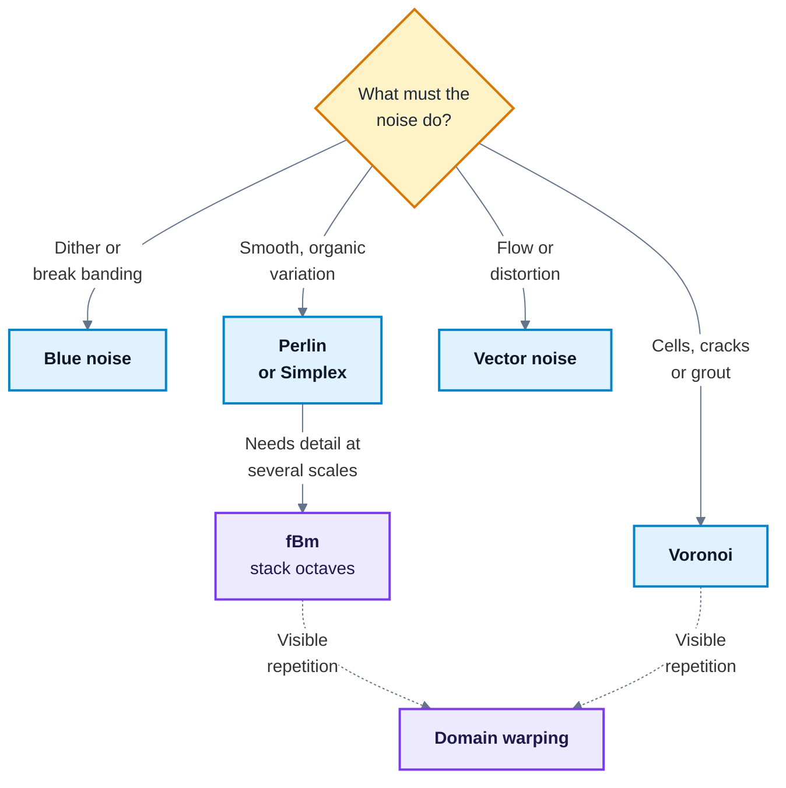

# Noise in Unreal Materials

---

## 1. Key Concepts

1. **Noise is controlled randomness.** Every noise in these notes gives the same value for the same input, so it tiles, animates and stays still when the camera moves.
2. **Each noise family has a look.** Blue noise is even speckle, Perlin and Simplex are smooth clouds, Voronoi is cells. Choose by the look you need, not by name.
3. **fBm is a technique, not a noise.** It stacks several copies of a base noise at rising frequency and falling strength to add detail at many scales.
4. **Prototype procedurally, ship baked.** The `Noise` node is quick to tune but costs arithmetic every pixel. A baked texture costs one sample.
5. **A texture sample is cheaper than heavy procedural noise, not free.** Notes 02 explains what a sample costs. Baking wins when the noise would take more arithmetic than one sample.
6. **Pack baked noise.** Perlin and Voronoi are greyscale, so one texture can hold several noises in its channels.
7. **Do not compress blue noise.** Block compression adds blocky, low-frequency error, which destroys the even spread that makes blue noise useful.
8. **Octaves cost linearly.** Every octave of fBm adds another evaluation or sample, so stop adding octaves when the extra detail is too small to see.
9. **Domain warping is a dependent lookup.** Warping UVs with noise before sampling means one sample waits for another, with the costs Notes 02 describes.
10. **Mips decide distant stability.** Baked noise with mips stays calm at a distance. Procedural noise has no mips and shimmers unless you fade it out.

---

## 2. Framing Question

A rock material looks blobby up close and shimmers at a distance. You could add three more octaves of procedural noise, or sample a baked noise texture twice more. Which fixes both problems, and what does each choice cost?

---

## 3. What You Will Learn

| Outcome | Where |
|:---|:---|
| Describe how blue, Perlin, Simplex and Voronoi noise are built | 5.2 to 5.5 |
| Stack octaves into fBm and choose octave count, lacunarity and gain | 5.6 |
| Warp a domain to break repetition, and explain its cost | 5.7 |
| Choose a noise for a material task | 5.8 |
| Decide when to bake noise into a texture, and how to pack and compress it | 5.9 |
| Build fBm roughness variation from a packed noise texture | 6.1 |
| Build a Voronoi crack mask and compare baked with procedural cost | 6.2 |

---

## 4. Why This Matters

Real surfaces are never uniform. Paint wears unevenly, stone has pores, water ripples at many scales at once. Noise is how a material adds that variation without an artist painting every texel, and it is what separates a surface that reads as real from one that reads as a tiled texture.

Noise is also a common source of slow materials. A procedural noise with several octaves can cost more than the rest of the material put together, and the cost is easy to miss because the graph looks small. Knowing how each noise is built tells you what it will cost before you place it.

---

## 5. Core Ideas

### 5.1 Three Ways to Use Noise in Unreal

| Approach | How | Strength | Weakness |
|:---|:---|:---|:---|
| **Baked texture** | Import a tileable noise image and sample it | One sample per use, mips keep it stable | Fixed resolution, repeats if tiled widely |
| **Procedural node** | `Noise` for a scalar, `VectorNoise` for a vector | Infinite, no texture memory, easy to tune | Arithmetic cost every pixel, no mips |
| **Material Function** | Wrap either approach with exposed parameters | One tuned setup reused across materials | None beyond those of what it wraps |

<!-- VERIFY: Confirm the UE 5.7 node names Noise and VectorNoise, and list the Noise node's Function options and its Levels (octaves) property. -->

Use this workflow: tune the look with the `Noise` node, bake it to a tileable texture once you are happy, and keep tiling and intensity as parameters in a Material Function. You get the iteration speed of procedural noise and the runtime cost of a texture.

### 5.2 Blue Noise

**White noise** is independent random values. It clumps: some areas get several bright pixels together and others get none. **Blue noise** suppresses those clumps. Its values are random, but spread evenly, so the eye sees fine grain rather than blotches. The name comes from its spectrum, which holds most of its energy at high frequencies.

**How it is made.** Blue noise is generated offline and stored in a texture, because generating it is too slow for a shader:

1. **Poisson-disc sampling.** Place random points, rejecting any closer than a radius `r` to an existing point, until no more fit. **Bridson's algorithm** does this quickly with an active list of candidate points.
2. **Void-and-cluster** methods go further and give every pixel a rank, so any threshold picks an evenly spread subset.

**Use it for** dithering. Dithered opacity, dithered LOD transitions and banding removal all compare blue noise with a threshold. Because the noise is evenly spread, the result reads as smooth once temporal anti-aliasing (TSR in Unreal 5) blends several frames together. Unreal's `DitherTemporalAA` node applies the same idea to opacity. <!-- VERIFY: Confirm the DitherTemporalAA node exists in UE 5.7 and that TSR is the default anti-aliasing method. -->

**Cost.** One sample. Import it with `Grayscale` compression, so it stays uncompressed, and turn off mips, because averaging blue noise in a mip produces flat grey.

### 5.3 Perlin (Gradient) Noise

**Perlin noise** gives smooth, cloud-like variation. Lay a grid over space and store a random unit **gradient** (a direction) at each grid corner. Each point measures how far it lies along each nearby corner's gradient, then blends those four values smoothly.

**How it is made, in 2D:**

```text
1. Find the cell and the position inside it:
   i = floor(x), j = floor(y), u = x - i, v = y - j
2. Hash each corner to a repeatable gradient: g00, g10, g01, g11
3. Take a dot product per corner:
   n00 = dot(g00, (u,   v  ))    n10 = dot(g10, (u-1, v  ))
   n01 = dot(g01, (u,   v-1))    n11 = dot(g11, (u-1, v-1))
4. Smooth the blend weights:
   fade(t) = t * t * (3 - 2 * t),  fu = fade(u),  fv = fade(v)
5. Blend:
   value = lerp(lerp(n00, n10, fu), lerp(n01, n11, fu), fv)    about -1 to 1
```

The `fade` curve is why the result has no creases at cell edges: its slope is zero at both ends, so neighbouring cells meet smoothly.

**Use it for** terrain masks, fog, and albedo and roughness breakup. It is the default choice for natural variation.

**Cost.** Moderate procedurally (four hashes, four dot products, a blend). Baked, one sample.

### 5.4 Simplex Noise

**Simplex noise** looks like Perlin noise with fewer artefacts. Perlin's square grid can leave faint streaks along the axes, especially in 3D. Simplex noise works on **simplices** instead: triangles in 2D and tetrahedra in 3D. Each point blends 3 corners in 2D (4 in 3D) instead of 4 (8 in 3D).

**How it is made, in 2D:**

```text
1. Skew space so the square grid becomes triangles:
   F2 = (sqrt(3) - 1) / 2,  s = (x + y) * F2
   i = floor(x + s), j = floor(y + s)
2. Unskew to find the position relative to the first corner:
   G2 = (3 - sqrt(3)) / 6,  t = (i + j) * G2
   x0 = x - (i - t),  y0 = y - (j - t)
3. Compare x0 and y0 to find which of the cell's two triangles holds the point
4. For each of the 3 corners k, with offset (xk, yk):
   tk = max(0, 0.5 - xk*xk - yk*yk)
   contribution_k = tk^4 * dot(gradient_k, (xk, yk))
5. Sum the three contributions and scale
```

**Use it for** volumetric effects such as fog and smoke, where Perlin's axis streaks show most.

**Cost.** Cheaper than Perlin in 3D and above, because it visits fewer corners. Still far more than one sample, so bake it for surface materials.

### 5.5 Voronoi (Worley, Cellular) Noise

**Voronoi noise** scatters **seed points** and, for each position, measures the distance to the nearest seed (**F1**) and the second nearest (**F2**). The distances form cells, like cracked mud, scales or paving.

**How it is made, in 2D:**

1. Split space into a grid with one hash-placed seed per cell.
2. For a point, check its own cell and the 8 around it.
3. Track the nearest distance `F1` and the second nearest `F2`.
4. Output `F1` (soft cells), `F2` (larger cells) or `F2 - F1` (thin borders).

`F2 - F1` is near zero wherever two seeds are equally close, which is exactly the border between cells. Pass it through a `SmoothStep` to get crisp cracks or grout lines.

**Use it for** stone, pores, scales, grout and chipped paint.

**Cost.** High procedurally: 9 distance checks in 2D and 27 in 3D. Baked, one sample, so bake it whenever the cells do not need to move.

### 5.6 fBm: Detail at Many Scales

**Fractal Brownian motion (fBm)** is not a new noise. It sums several **octaves** of a base noise. Each octave has a higher frequency (finer detail) and a lower amplitude (less influence) than the one before:

```text
sum = 0, amplitude = 1, frequency = 1, total = 0
for each octave k from 0 to O - 1:
    sum       = sum + amplitude * Noise(position * frequency)
    total     = total + amplitude
    amplitude = amplitude * G
    frequency = frequency * L
value = sum / total
```

| Parameter | Typical value | Effect |
|:---|:---|:---|
| Octaves `O` | 3 to 5 | More octaves add finer detail, at one more evaluation each |
| **Lacunarity** `L` | 2.0 | How much the frequency rises per octave |
| **Gain** `G` | 0.5 | How much the amplitude falls per octave. Higher gain gives rougher results |

Dividing by `total` keeps the result in the base noise's range whatever the octave count.

Two variants are worth knowing. **Turbulence** sums `abs(noise)` instead of `noise`, which folds each octave into sharp creases and suits fire and marble. **Ridged** noise inverts turbulence (`1 - abs(noise)`) for mountain ridges.

**Cost.** Linear in octaves. Three baked octaves are three samples of one texture at different tilings. These are independent lookups, so they overlap and cost far less than three dependent ones.

### 5.7 Domain Warping

**Domain warping** offsets the coordinates with one noise before sampling another:

```text
offset = VectorNoise(UV * warpFrequency).xy
warped = UV + offset * warpAmount
value  = Sample(T_Noise, warped * baseFrequency)
```

The result swirls and marbles, and it breaks the visible repetition of a tiled texture.

The second sample's UVs depend on the first sample's result, so domain warping is a **dependent texture lookup**. Notes 02 section 5.8 explains why that costs more than an ordinary sample. Keep `warpAmount` small, because large offsets stretch the texture and make neighbouring pixels read texels far apart, which misses the texture cache.

### 5.8 Choosing a Noise



| Noise | Look | Typical uses | Baked cost | Procedural cost |
|:---|:---|:---|:---|:---|
| Blue | Even speckle, no blotches | Dithered opacity, banding removal, sparkle | 1 sample | Not practical |
| Perlin | Smooth clouds | Terrain masks, fog, roughness breakup | 1 sample | Moderate |
| Simplex | Like Perlin, fewer axis streaks | Volumetric fog and smoke | 1 sample | Moderate, cheaper than Perlin in 3D |
| Voronoi | Cells and ridges | Stone, pores, scales, grout, cracks | 1 sample | High |
| fBm | Broad forms with fine detail | Rock, wood, clouds, water | 1 sample per octave | Base cost per octave |
| Vector | Directional flow | UV distortion, heat haze, wavy normals | 1 sample (RGB) | High |

### 5.9 Baking, Packing and Compressing Noise

Baking pays off for four reasons:

- **Cost.** One sample replaces dozens of instructions, and the same texture serves every material that uses it.
- **Stability.** Mips average the noise at a distance, so it does not shimmer. Procedural noise has no mips.
- **Predictability.** A texture looks the same on every platform. Procedural noise can differ slightly between shader compilers.
- **Control.** You can guarantee tiling and normalise the range before shipping.

Perlin, Simplex and Voronoi are greyscale, so pack them as Notes 02 section 5.3 describes. A sensible layout for one `Masks` texture:

| Channel | Noise | Reason |
|:---|:---|:---|
| R | Voronoi `F2 - F1` | Thresholded with `SmoothStep`, so small precision errors vanish |
| G | Perlin | Smooth gradients band first, and G has the most bits in BC1 |
| B | Perlin at a different seed | A second, uncorrelated octave source for fBm |

Keep blue noise out of the pack. BC1 encodes each 4 x 4 block from two endpoint colours, which replaces blue noise's fine, even grain with blocky, low-frequency error. Store blue noise as its own uncompressed `Grayscale` texture with mips turned off.

If a material samples many noise textures, set **Sampler Source** to a shared sampler, as Notes 02 section 5.4 describes, so noise does not use up the 16-sampler limit.

---

## 6. Worked Example

Work through this in the demo project after reading section 5. Create a folder `/Game/Student/Noise` for your own assets.

The packed noise texture is `unreal/Content/Textures/NOISE_TEXTURE_NAME`, laid out as in section 5.9: Voronoi `F2 - F1` in R, Perlin in G and B. Open it and check it uses `Masks (no sRGB)` compression.

### 6.1 Part A - fBm Roughness Variation

You build three octaves of fBm from one texture, and use it to vary roughness between 0.25 and 0.8.

1. Create `M_Noise_Roughness` and open it.
2. Add a `TextureCoordinate` node. Wire three copies of the noise texture sample, each with different tiling:
   1. `TextureCoordinate -> Multiply.A`, `Constant` 1.5 `-> Multiply.B`, `Multiply -> TextureSample (noise).UVs`. This is octave 1.
   2. The same with a `Constant` of 3.1. This is octave 2.
   3. The same with a `Constant` of 6.3. This is octave 3.

   Each tiling roughly doubles the last, a lacunarity of about 2. The ratios are deliberately not exactly 2, so the octaves of one texture do not line up and show repetition.
3. Weight the octaves with a gain of 0.5:
   1. `TextureSample (octave 2).G -> Multiply.A`, `Constant` 0.5 `-> Multiply.B`
   2. `TextureSample (octave 3).G -> Multiply.A`, `Constant` 0.25 `-> Multiply.B`
4. Sum and normalise:
   1. `TextureSample (octave 1).G -> Add.A`, `Multiply (octave 2) -> Add.B`
   2. `Add -> Add.A`, `Multiply (octave 3) -> Add.B`
   3. `Add -> Multiply.A`, `Constant` 0.5714 `-> Multiply.B`. 0.5714 is 1 / 1.75, the sum of the three amplitudes.
5. Map the result to a roughness range:
   1. `Constant` 0.25 `-> Lerp.A`, `Constant` 0.8 `-> Lerp.B`
   2. `Multiply (normalised fBm) -> Lerp.Alpha`
   3. `Lerp -> Roughness`
6. Set `Base Color` to a mid grey and `Metallic` to 0, apply, and put the material on a sphere under the sun.

Turn the octave 3 weight to 0 and back. The broad patches stay, but the fine breakup within them goes, which shows what each octave contributes. Open **Stats**: three samples, all of one texture, so they share one sampler.

### 6.2 Part B - Voronoi Cracks, Baked Against Procedural

1. Create `M_Noise_Cracks`. Wire the baked version:
   1. `TextureCoordinate -> Multiply.A`, `Constant` 4 `-> Multiply.B`, `Multiply -> TextureSample (noise).UVs`
   2. `TextureSample (noise).R -> SmoothStep.Value`, with `Constant` 0.02 `-> SmoothStep.Min` and `Constant` 0.06 `-> SmoothStep.Max`. Low values of `F2 - F1` are the borders, so the output is 0 on cracks and 1 inside cells.
   3. `Constant3Vector` (dark grey, grout) `-> Lerp.A`, `Constant3Vector` (light stone) `-> Lerp.B`, `SmoothStep -> Lerp.Alpha`, `Lerp -> Base Color`
2. Apply, note the instruction count in **Stats**, and view the material on a plane.
3. Duplicate it as `M_Noise_CracksProcedural`. Replace the texture sample with a `Noise` node set to a Voronoi function, fed by `Absolute World Position` and scaled to match the cell size. Apply and compare the instruction count. <!-- VERIFY: Confirm the UE 5.7 Noise node's Voronoi function option label, and the SmoothStep node's input pin names Min, Max and Value. -->
4. Move the camera back from the plane. The baked cracks fade evenly into the mips. The procedural cracks shimmer, because they have no mips and every pixel samples the pattern at full detail.

---

## 7. Common Pitfalls

| Pitfall | Symptom | Fix |
|:---|:---|:---|
| Blue noise compressed or mip-mapped | Dither looks blotchy, or flat grey at a distance | Use `Grayscale` compression and turn off mips |
| Noise texture left as sRGB | Noise darker overall, thresholds land in the wrong place | Set `Masks (no sRGB)` |
| Too many procedural octaves | Material slow, Stats show a large instruction count | Bake the noise, or stop at the octave where extra detail is not visible |
| fBm not normalised | Result too bright, clamps to white | Divide by the sum of the amplitudes |
| Procedural noise at a distance | Shimmer and sparkle on far surfaces | Bake to a mip-mapped texture, or fade the noise out with distance |
| Large domain warp | Texture stretches, cache misses rise | Keep the warp amount small |
| Octaves at whole-number tiling ratios from one texture | Octaves line up and repetition shows | Use non-integer ratios such as 1.0, 2.03, 4.11, or a second channel |
| Blue noise packed into a BC1 texture | Dither shows 4 x 4 blocks | Store blue noise in its own uncompressed texture |

---

## 8. Exercises

1. Write the fBm sum for 4 octaves with lacunarity 2 and gain 0.6. What constant normalises it?
2. For each task, choose a noise and say whether you would bake it: a dissolve edge on a pickup; a heat haze above a fire; mortar between bricks; dithered fade on distant trees; slowly drifting cloud shadows.
3. Count the texture samples in Part A, then in Part A with a domain warp added before every octave. Which samples are dependent?
4. Explain, with reference to how BC1 stores a block, why packing blue noise with Perlin noise ruins the blue noise but not the Perlin.
5. In Part B, the procedural version shimmers at a distance. Describe two ways to fix it without baking.

---

## 9. Reflective Questions

1. Your translucent material bands under TSR. Why does blue noise help, and how would you sample it (space, scale, animation) so it stays stable from frame to frame?
2. You need a lava flow with directional movement. Which noises and techniques would you combine, and how would you keep the sample and arithmetic cost under control?
3. A prototype uses the procedural `Noise` node and runs slowly on the target hardware. Outline a plan to bake it: which textures, how you would guarantee tiling and mips, and which parameters you would keep.
4. A hero rock using single-octave Perlin looks blobby up close. Describe an fBm stack and a domain warp that add detail at many scales without obvious stretching.

---

## 10. How This Builds

- **Notes 02** explains what a texture sample costs, how to pack channels and why dependent lookups are slow. This document applies all three to noise.
- **Week 3** builds a noise-driven dissolve with an emissive edge, where the noise choice decides how the edge looks.
- **Week 6** writes hash noise and procedural patterns in a Custom node, so you see the arithmetic a `Noise` node hides.
- **Week 7** writes fBm as an HLSL loop, where `[unroll]` and octave count decide the cost.

---

## 11. Glossary

| Term | Meaning |
|:---|:---|
| **Blue noise** | Random values spread evenly, with little low-frequency energy |
| **Domain warping** | Offsetting coordinates with one noise before sampling another |
| **F1, F2** | Distances to the nearest and second-nearest seed in Voronoi noise |
| **fBm** | Fractal Brownian motion. A sum of noise octaves at rising frequency and falling amplitude |
| **Gain** | The factor by which each fBm octave's amplitude falls |
| **Gradient** | A direction stored at a grid corner in Perlin and Simplex noise |
| **Lacunarity** | The factor by which each fBm octave's frequency rises |
| **Octave** | One layer of noise in an fBm sum |
| **Perlin noise** | Smooth gradient noise built on a square grid |
| **Simplex noise** | Gradient noise built on triangles or tetrahedra, with fewer axis artefacts |
| **Turbulence** | fBm that sums the absolute value of each octave, giving sharp creases |
| **Voronoi noise** | Noise based on distance to scattered seed points. Also called Worley or cellular noise |
| **White noise** | Independent random values, which clump visibly |

---
